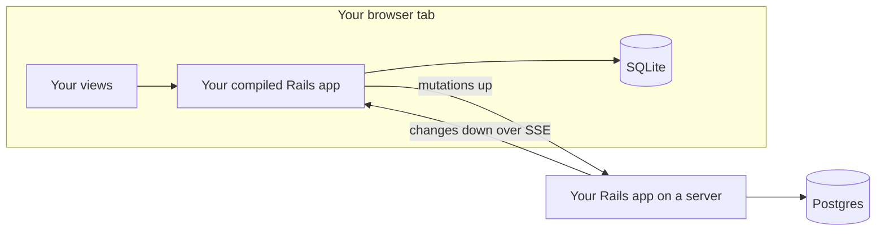

# InstantRecord

Rails models that run in the browser, sync to your server, and keep working offline.

**[Try the live demo →](https://instant-record.kieranklaassen.com)** — a Rails app compiled with Spinel, running against SQLite in your tab. Open Todo in two windows to see the same records, inspect local queries in `/console`, or visit `/receipts` to measure boot and query time on your device.

## The Problem

Apps like Linear feel instant because they never make you wait on the network: every read and write hits a **local** database, the UI renders from local data, and syncing with the server happens in the background. No spinners, no loading states, and offline works for free.

Building that today means a JavaScript sync engine, a client-side store, an API layer, and client-side state management — a whole second data architecture that leaves Rails behind.

InstantRecord is a bet that Rails developers can have local-first without leaving Ruby:

- **Instant** — `Issue.create!` commits to SQLite in the browser and the UI re-renders immediately. The network is never in the hot path.
- **Durable** — every write records a mutation in the same local transaction, so nothing is lost to a crash, a reload, or a dead connection.
- **Convergent** — a background loop drains mutations to your Rails server (the source of truth) and streams everyone else's changes back over SSE.
- **Still just Rails** — the same `ApplicationRecord` model file runs on both sides. Validations, scopes, callbacks — no API client, no duplicate schema, no JavaScript data layer.

:construction: **This is a proof of concept.** The core loop is built and demonstrated: instant optimistic writes, offline-durable outbox, two clients converging over SSE, and server rejections rolling back cleanly. See [What's proven](#whats-proven).

## The Two Runtimes

The same model file loads into two Ruby runtimes, each with its own database:

|  | In the browser | On the server |
|---|---|---|
| Ruby | Rails code compiled by Spinel to WebAssembly in a dedicated worker | CRuby + Puma |
| Database | SQLite, persisted to IndexedDB | PostgreSQL |
| Writes | **Optimistic** — instant local commit, queued for sync | **Authoritative** — validated, versioned, logged |
| Your controllers & views | Run here when the page is served by the dedicated worker | Run here at `localhost:3000` |



## Usage

### 1. Install

```ruby
# Gemfile
gem "instant_record"
```

The browser build uses the [Roundhouse and Spinel toolchain](compiled/README.md#install-the-toolchain).

### 2. Make a model syncable

This is the whole opt-in:

```ruby
class Issue < ApplicationRecord
  include InstantRecord::Syncable

  validates :title, presence: true
end
```

Syncable models need three columns — a string/uuid primary key, `server_version:integer`, and `sync_state:string`. The gem's own tables (outbox, sync metadata, change log, idempotency ledger) install automatically as engine migrations — just run `bin/rails db:migrate`.

Rules that should only run on the server (authorization, quotas, anything the client shouldn't decide) stay in the same file, scoped with a block:

```ruby
class Issue < ApplicationRecord
  include InstantRecord::Syncable

  validates :title, presence: true

  server_only do
    validate :quota_not_exceeded   # server rejects; the client rolls back
  end

  browser_only do
    after_commit :flash_confetti   # local-runtime behavior
  end
end
```

There's no server setup: the sync engine auto-mounts at `/instant_record` on the server — `POST /mutations` (batched, idempotent writes) and `GET /events` (SSE change stream) — and every model that includes `Syncable` is syncable. Two optional knobs:

```ruby
# config/application.rb — move or disable the mount
config.instant_record.mount_path = "/sync"    # or false to mount manually

# config/initializers/instant_record.rb — restrict syncing to an explicit allowlist
InstantRecord.sync(Issue, Todo)
```

### 3. Build the browser bundle

Install the compiler configuration and set the paths for your build machine:

```sh
bin/rails generate instant_record:install
bin/rails db:migrate
bin/rails instant_record:compile
```

Serve the generated site from `tmp/instant_record/compiled/web/dist`. See
[building and deploying](compiled/README.md) for the toolchain and Rails hosting settings.

### 4. Write your app like it's normal Rails

No special APIs in your controllers or views. When the page is served by the dedicated worker, this code executes **in the browser**, reading and writing the local database:

```ruby
class IssuesController < ApplicationController
  def index
    @issues = Issue.order(created_at: :desc)   # instant: local SQLite read
  end

  def create
    Issue.create!(issue_params)                # instant: local commit + queued for sync
    redirect_to root_path
  end
end
```

```erb
<% @issues.each do |issue| %>
  <li>
    <%= issue.title %>
    <span class="badge"><%= issue.sync_state %></span>  <%# "pending" until the server acks %>
  </li>
<% end %>
```

Useful helpers:

- `issue.sync_state` — `"pending"` (not yet acked) or `"synced"`
- `InstantRecord.pending_count` — outbox size, for an "unsynced changes" indicator
- `InstantRecord.sync_now` — force a sync pass (the background loop runs anyway)
- `server_only { ... }` / `browser_only { ... }` — runtime-scoped model rules
- `InstantRecord.browser?` — the underlying runtime check, for anywhere else
- `InstantRecord::Client.applying_remote?` — whether the write running right now arrived from the server, rather than being made here
- `InstantRecord.server_url(path)` — the URL that reaches the authoritative server from either runtime, honouring a customised `mount_path`
- `sync_file` — a record that carries a file, kept in the browser and sent to the server in the background (below)

Convergence is last-write-wins on `updated_at`, and the value that loses is gone from the row. A model can watch for that:

```ruby
class Issue < ApplicationRecord
  include InstantRecord::Syncable

  # A value from the server that last-write-wins threw away. The block runs with
  # the losing attribute hash at the only moment it exists here — nothing is
  # assigned, no callback fires, and the gem keeps no copy.
  on_discarded_change { |attributes| Rails.logger.info("dropped #{attributes["title"].inspect}") }
end
```

#### Server-only controller behavior: auth and scoping

Controllers load in both runtimes too — the browser runs them against local data, the server against Postgres. Anything that depends on sessions, cookies, or secrets exists only on the server, so scope it there:

```ruby
class IssuesController < ApplicationController
  extend InstantRecord::RuntimeScoped

  server_only do
    before_action :authenticate_user!   # sessions and secrets: server only
  end

  browser_only do
    skip_forgery_protection             # no CSRF secrets in the local runtime
  end

  def index
    @issues = issues_scope.order(created_at: :desc)
  end

  private

  def issues_scope
    # Server: enforce per-user scoping. Browser: the local database already
    # holds only what the server synced to this client, so Issue.all IS the
    # scoped set.
    InstantRecord.browser? ? Issue.all : current_user.issues
  end
end
```

**Where authorization actually lives:** browser-side checks are UX, never enforcement — the user owns the client and everything in it. Real enforcement has exactly two places, both on the server:

1. **The mutations endpoint** — server-side validations and `server_only` model rules reject writes the client wasn't allowed to make; the client rolls back.
2. **What you sync down** — a client can only render what the change stream delivered to it. A model that declares `sync_scope`, or `syncable_to`, is sent only to the clients that may hold its rows (both below); every other model syncs to every client.

#### Rows that belong to one client: `sync_scope`

```ruby
class Note < ApplicationRecord
  include InstantRecord::Syncable
  sync_scope :user_id   # the column that says whose row this is
end

# config/initializers/instant_record.rb
InstantRecord.config.scope_from = ->(request) { request.session[:user_id] }
```

`scope_from` reads a sync request's scope. With it and `sync_scope`, the sync endpoints keep a model's rows to their owner: the bootstrap, the change stream and history pages carry the rows whose column equals the request's scope, plus the rows where it is `NULL`, which belong to everyone. A create is stamped with the sender's scope whatever it claims, and a row of another scope cannot be changed or removed (the mutation is rejected, and the client rolls back). A request with no scope gets only the `NULL` rows and can write nothing to the model.

The default `scope_from` trusts a `scope` parameter, and the compiled site sends one: a random token it keeps in `localStorage`. That makes a browser its own scope with no sign-in, which is what the demo's Assistant uses. It is a capability, not authentication: anyone holding the token reads those rows. An app with accounts should read the scope from its session, as above.

Limits, as built: a row's scope is fixed at create, a scoped model with a `sync_window` ranks its window before the scope is applied, and the Ruby client (`InstantRecord::Client`, which the native build uses) sends no scope yet.

#### Rules a column cannot say: `syncable_to` and `writable_by`

```ruby
class Note < ApplicationRecord
  include InstantRecord::Syncable

  server_only do
    # Which notes the asker may be sent.
    syncable_to { |user| user ? where(team_id: user.team_ids).or(where(public: true)) : where(public: true) }
    # Which they may create, change and delete. Without it, what is seen may be written.
    writable_by { |user| user ? where(author_id: user.id) : none }
  end
end

# config/initializers/instant_record.rb
InstantRecord.config.scope_from = ->(request) { User.find_by(id: request.session[:user_id]) }
```

Each block runs on the model, on the server, with whatever `scope_from` returned, and returns a relation. They are the same engine as `sync_scope`, and a model may declare both: `scope_from` is the one place an app says who is asking, and its answer's `to_s` is what a `sync_scope` column is compared with.

- **Bootstrap and history** carry the rows in the relation.
- **The change stream** asks the rule again when a change is sent, since it can depend on anything. A row the asker may see is sent as it stands now. A row they may not see is sent as an empty destroy: nothing to a client that never held it, and a removal from one that did, which is how a row that stops being shared leaves a browser.
- **A write** must leave the row inside `writable_by`, checked after it is applied and rolled back if not (`not permitted`). A row the asker cannot see answers as a missing one does: an update is `record not found`, a destroy is accepted and does nothing, and no rejection carries its attributes.

**When the person behind a browser changes.** The bootstrap carries a key for whoever asked: a digest of the identity's `sync_identity_key` if it answers one, else of its class and id, else of the identity as a string, and nobody at all has a key too. The client sends it back with every poll and write. A request under another key is a browser that synced as someone else: its poll is answered with one `reset` event, the client drops every row of the scoped models along with the writes it had queued to them, and it bootstraps again as whoever is there now. Writes that arrive under the old key are refused (`identity changed`). Models every client may see are left alone, and the poll after the new bootstrap starts from the old cursor so they miss nothing. An identity may answer `sync_reset_types` to name the models its key decides, when the rest follow something that did not change. The key is a name, not a credential: the server scopes every request by its own session whatever key it carries.

A session is a cookie, so the page and the sync endpoints must be one origin for it to arrive: serve the compiled site from the Rails app (`config.instant_record.compiled_host`) or put both behind one proxy. The mutations endpoint takes JSON only, so a cross-site form cannot write through someone's cookie. The demo's Auth page (`/auth`) is this section running: three people, a real session, and a panel that asks the sync server for everything.

Limits, as built: record ids are not secret (a change to a hidden row reaches every client as an empty destroy naming its id, and a create that reuses a hidden row's id is refused); a validation that looks at other rows, such as uniqueness, answers a refused write with a message about rows the sender cannot see; a stream that is open when the session changes keeps its identity until it closes (a poll lasts at most the SSE window); a rule is one query per model per batch of changes; and a `syncable_to` model with a `sync_window` ranks its window before the rule is applied.

A `server_only` controller filter protects the server-rendered surface; it cannot and need not protect the browser's local rendering.

### 5. Sync just happens

The dedicated worker drains queued writes and polls the Rails changes endpoint.
To host the sync server on a different origin, set `SYNC_ENDPOINT` when compiling.

Behind the scenes:

- **First load** — a new client hydrates from a bootstrap snapshot (current state plus the sync cursor, windowed per model — see below) and remembers its position, so later visits paint instantly from IndexedDB and fetch only what's new.
- **Every write** — committed locally first, then delivered to the server in the background. Offline just means "delivered later"; queued writes survive reloads.
- **Other clients** — every accepted change streams to all connected clients over SSE, and their pages re-render from local data. Concurrent edits resolve last-write-wins.
- **Rejections** — if the server refuses a write (failed validation, server-only rule), the client rolls the local record back to server state and stops retrying.

### 6. Window large tables

Tables with unbounded history (chat messages, events, logs) don't have to sync whole. Declare a **sync window** and only the newest rows reach clients:

```ruby
class Message < ApplicationRecord
  include InstantRecord::Syncable

  sync_window limit: 50, partition_by: :channel_id   # newest 50 per channel
end
```

Windows order by `(created_at, id)`, so a windowed model needs a `created_at` column — and an index on `(partition, created_at, id)` keeps the queries flat at depth.

Declaring a window changes three things:

- **Fresh clients bootstrap.** A client that has never synced hydrates from `GET /instant_record/bootstrap` — current state, windowed per model, plus the change-log cursor — instead of replaying the whole change log. Windowless models still serialize in full.
- **Boot-time eviction.** On a cold boot the browser trims each windowed model back to its window per partition. Rows with `sync_state: "pending"` are never evicted.
- **History pages on demand.** Older rows stream in through keyset cursors (never OFFSET), applied idempotently with no outbox noise:

```ruby
InstantRecord.fetch_history(Message,
  partition: channel_id,
  before: { created_at: oldest.created_at.iso8601(6), id: oldest.id },
  limit: 50)
# => { ok: true, applied: 50, has_more: true }    — or :busy while a sync pass runs
```

In the browser this serves repeat scrolls and offline scrollback from the local database and only hits `GET /instant_record/records` for pages it doesn't hold. Page JavaScript reaches it through a service-worker message (never from inside a request — the wasm VM can't re-enter itself):

```js
const channel = new MessageChannel();
channel.port1.onmessage = (event) => { /* {ok, has_more, error} */ };
navigator.serviceWorker.controller.postMessage(
  { type: "instant_record.fetch_history",
    request: { type: "Message", partition: channelId,
               before: { created_at: oldestAt, id: oldestId }, limit: 50 } },
  [channel.port2],
);
```

**Render the top of the scrollback server-side.** A windowed view needs a slot above its oldest row — a scroll-up sentinel, or a "beginning of history" marker once there's nothing left. Render that slot in the initial HTML even when you don't yet know which it is, and let JavaScript fill it in place. Injecting it after a probe shifts every row below it by its height on each load.

The Slack demo's infinite scroll is the reference wiring — IntersectionObserver sentinel, scroll anchoring, in-place DOM updates — in the Stimulus controller `demo/app/javascript/controllers/conversation_controller.js`.

### 7. Carry a file with a record

Some things a record is about are too large for a column: a recording, a render, a scan. A model says its records carry one, and that is the whole opt-in:

```ruby
class Recording < ApplicationRecord
  include InstantRecord::Syncable
  sync_file max_size: 500 * 1024 * 1024   # the most bytes the server takes for one
end
```

The model's file is compiled for the browser, where an integer has 32 bits: a `max_size` there stays under two gigabytes, and a larger limit goes in `config.max_file_size`, which only the server reads.

The record is still what syncs, and nothing about that changes. The file is known by the record's type and id, in the browser and on the server, and it never changes: new bytes are a new record. Where the model has the columns an Active Storage blob has, they are used: the server serves the file as its `content_type` and refuses an upload that is not `byte_size` bytes. None is required.

The bytes are never in the local database and never pass through the compiled app. The gem's `frontend/` package keeps them in the origin's private file system (OPFS), from the page:

```js
import { fileStore, useFile } from "instant_record"

const files = fileStore()   // one for the page; beside the compiled runtime it knows the sync server and the browser's scope

// Written to this browser first, with or without a connection.
const id = crypto.randomUUID()
const about = await files.attach("Recording", id, blob)   // { filename, content_type, byte_size }
router.post("/recordings", { recording: { id, title, ...about } })   // the record, as any other

// Here, or fetched from the server and kept.
const file = await files.open("Recording", id)

// In React: status is loading, ready, missing, offline or error.
const { url, status, progress } = useFile(files, "Recording", recording.id)
```

- **Local first.** `attach` returns when the file is on this device. It is there after a reload and with no connection, and `files.get` reads it without asking the server anything.
- **Sent in the background.** The file goes to the server in 4 MB pieces, oldest first, one tab at a time. An upload that is cut off goes on from the piece it stopped at, after a reload too. A file whose record has not reached the server yet waits for it: the server answers 404 until the record's create has synced.
- **Fetched when asked for.** On another device `open` fetches the file a piece at a time and keeps it, and a fetch that is cut off keeps its pieces. A file the server does not hold (its upload has not finished where it was made) is `FileMissing`.
- **The record's rules are the file's.** Whoever may be sent the record (`sync_scope`, `syncable_to`) may read its bytes, and whoever may write it (`writable_by`) may send them. Anyone else is answered as for a file that does not exist. A model with no rule shares its files as it shares its rows.
- **A destroyed record takes its file** from the server. In a browser, `files.prune("Recording", ids)` drops the files of records that are gone, given the ids that are left, and `files.clear()` drops everything, for a sign-out. `fileStore({ name: userId })` keeps the files of two accounts in one browser apart.

**Room.** A browser gives an origin a share of the disk and may clear all of it when the disk fills. `attach` asks it not to (`navigator.storage.persist()`; `files.usage()` reports whether it agreed, with how much is held and how much is waiting to be sent). Past `fileStore({ budget: bytes })`, near the browser's own limit, or when a write fails for lack of room, the store drops files the server holds, least recently used first: those can be fetched again. A file the server does not hold yet is never dropped, and neither is one marked with `files.pin`. When nothing more may go, `attach` fails with a `QuotaExceededError` and leaves nothing behind, and `open` reads the file from the server without keeping it. Chromium reports a quota that is not the limit it enforces, so there the write that fails is what makes room.

**On the server** the files are kept under `storage/instant_record`, one per record, and served with ranges:

```ruby
# config/initializers/instant_record.rb
InstantRecord.configure do |config|
  config.file_store = InstantRecord::FileStore.new("/var/lib/my_app/files")   # or anything that answers what it does
  config.max_file_size = 1024 * 1024 * 1024                                   # for models that name no max_size (two gigabytes when left alone)
end
```

`GET <mount>/files/:type/:id` is the file (with `Range`), `GET .../upload` says where an upload stands, and `PUT` takes one piece. A file is served as a download that may run nothing, whatever type its record claims. `bin/rails instant_record:files:sweep` removes uploads that were given up.

Limits, as built: one file to a record; no checksum, so a file is trusted to be what its size and its pieces' order say; a browser must be able to write its private file system from a page (`createWritable`, which Chromium and Firefox have and Safari names from 26), and without it `open` reads from the server and keeps nothing; a file that waits for a record that never arrives is asked about once a minute while the page is open, until it is pruned; the Ruby client and the native build have no file store. What has run: headless Chromium against a Rails server, in `test/browser/files.mjs` (`node test/browser/files.mjs --big` adds a 200 MB file), and once beside a compiled build of the demo with a file on a todo. No other browser has, and no deployed server: a proxy in front of one must let a 4 MB request body through.

## Compile a Rails app for the browser

The gem includes an experimental ahead-of-time compiler. Roundhouse and Spinel
compile the app’s routes, controllers, views, and syncable models into a WebAssembly
reactor. A dedicated worker runs it against local SQLite and syncs with your Rails server.

After installing the toolchain and filling in `config/instant_record_toolchain.env`, run:

```sh
bin/rails db:migrate
bin/rails instant_record:compile
```

The static site is written to `tmp/instant_record/compiled/web/dist`. The default
sync endpoint is `/instant_record`. Use `SYNC_ENDPOINT` for a separately hosted
Rails server. The compiled demo includes Todo, Chat, Shared inbox, Ship v2, local database
inspection and Receipts. [Toolchain setup and supported features](compiled/README.md).

To ship the optimized browser app with a Rails deploy, set
`config.instant_record.build_on_precompile = :compiled` and configure its browser
hostname. Rails asset precompilation publishes the build. Open tabs detect the
release, and returning profiles migrate their local database before rendering.
[Deployment and browser migration setup](compiled/README.md#ship-on-a-rails-deploy).

## Local MCP server and offline CLI

`bin/rails instant_record:native` compiles your Rails app (models, validations, screens, and SQLite) into a screenless native `host` binary. `bin/rails instant_record:mcp` packages that binary as a local MCP JSON-RPC 2.0 stdio server and offline CLI:

```sh
# Build the native host once (or pass --build / INSTANT_RECORD_BUILD=1)
bin/rails instant_record:native

# Start the drop-in MCP stdio server against a scoped local SQLite replica
INSTANT_RECORD_ENDPOINT=http://127.0.0.1:3000/instant_record \
INSTANT_RECORD_TOKEN="$MY_TOKEN" \
INSTANT_RECORD_SCOPE="visitor-1" \
  bin/rails instant_record:mcp

# Or use the offline CLI subcommands (pass CLI arguments after `--`)
bin/rails instant_record:mcp -- sync
bin/rails instant_record:mcp -- --offline query Issue --where state=open
bin/rails instant_record:mcp -- --offline search "invoice"
bin/rails instant_record:mcp -- --offline action mailbox archive --param member=maya --param inbox=support --arg id=<id>
bin/rails instant_record:mcp -- --offline request POST /todo/issues --data 'issue[title]=Offline task'

# Standalone executable (skips Rails boot once the native host is compiled)
bundle exec instant_record_mcp serve \
  --host tmp/instant_record/compiled/.build-native/host \
  --db tmp/instant_record/mcp/local.sqlite3 \
  --endpoint http://127.0.0.1:3000/instant_record \
  --cookie "_session=..."
```

Exposed MCP tools (`<1ms` offline against local SQLite + persistent compiled `host`): `instant_record_status`, `instant_record_sync`, `instant_record_models`, `instant_record_query`, `instant_record_get`, `instant_record_search`, `instant_record_outbox`, `instant_record_render_screen`, `instant_record_action`, `instant_record_request`, and `instant_record_history`.

## Running the demo

Install Ruby 3.3.3, PostgreSQL and the [compiler toolchain](compiled/README.md#install-the-toolchain).
Copy `compiled/toolchain.env.example` to `compiled/toolchain.env` and fill in the tool paths.

```sh
bundle install && bundle exec rake test
cd demo
bundle install
bin/rails db:prepare
bin/rails test
SYNC_ENDPOINT=http://localhost:3000/instant_record ruby ../compiled/pipeline/build.rb
bin/dev
```

Open http://localhost:5173/ for the compiled demo. Rails serves sync on port 3000.

Things to try:

- **Instant writes** — create an issue; it appears immediately with a `pending` badge that flips to `synced`.
- **Two clients** — open http://127.0.0.1:5173/ too (different origin = separate local database). Changes propagate between windows through the server. A fresh client catches up automatically.
- **Shared inbox** — Open `/email` as Maya, who shares Support with Theo and Billing with Jo. Reply offline in Support and reconnect to see it arrive for Theo. Each persona and inbox has a separate SQLite snapshot, outbox and sync cursor. The public persona picker is for fictional mail.
- **Infinite scroll** — `/slack` seeds thousands of messages in `#general`, but a fresh client only syncs the newest 50 per conversation. Scroll to the top and older pages stream in; messages arriving mid-read update the page without a reload or a scroll jump.
- **Offline** — stop the Rails server, create issues (they stay `pending`), reload the tab (still there), restart the server and watch them drain.
- **Sessions and permissions** — open `/auth`, sign in as Ada, Ben or Cleo, and watch which notes this browser holds. Sign out and they leave it. "Ask the sync server for everything" shows what a browser with that cookie can get by asking directly.
- **Rejection** — create an issue titled `reject me`. It appears optimistically, the server refuses it, and it disappears on reconcile.

## Scaling the SSE stream

The compiled demo checks for new changes once a second using short HTTP requests. Clients that choose to hold an SSE stream open need a server sized for their concurrent streams. The engine's stream endpoint is a plain Rack streaming body (no `ActionController::Live`, no thread per stream) that releases its database connection between polls, so it runs well on both servers; the ceiling is the server's concurrency model. Measured on the demo (M-series MacBook, dev mode):

| Server | Concurrent SSE clients | Result |
|---|---|---|
| Puma (3 threads default) | 2 | Works — p50 delivery 103ms |
| Puma (3 threads default) | 3 | Streams consumed every thread; the sync write itself starved — 0 delivered |
| Puma (3 threads default) | 50 | Server unresponsive for minutes (rails/rails#55762's failure mode) |
| Falcon (fiber per request) | 200 | 200/200 delivered, p50 442ms, 0 errors |
| Falcon (fiber per request) | 500 | 500/500 delivered, p50 378ms, ~13 MB RSS, 0 errors |

**Recommendation:** Puma is fine for development and a handful of clients. For SSE-heavy deployments, run [Falcon](https://github.com/socketry/falcon) — streams become fibers, `sleep` and `pg` yield to the scheduler, and thousands of idle connections are cheap:

```ruby
# Gemfile
gem "falcon", require: false
```

```ruby
# config/application.rb — fiber-scoped execution state under Falcon only
config.active_support.isolation_level = :fiber if defined?(Falcon)
```

```sh
bundle exec falcon serve --bind http://localhost:3000
```

Browser clients receive changes over that held stream — measured at **130ms** from a server-side write to the row appearing, bounded by the server's 0.5s change-log poll rather than by any client interval. Reopening with `?after=<cursor>` replays whatever a dropped connection missed, so nothing polls for changes. The tail window is configurable via `config.instant_record.sse_window_seconds`.

There is no heartbeat in the browser: a sync pass runs on a local write, at boot, and when the network returns, then retries with backoff only while the outbox still has something in it. An idle tab issues no requests at all beyond holding its stream. Reproduce the numbers with `demo/script/sse_load_spike.rb`.

## What's proven

Measured on the demo (Chrome, M-series MacBook):

- The browser compiles and loads the Spinel WebAssembly module, opens SQLite and handles requests locally. Visit `/receipts` for measurements on your own device.
- Instant optimistic create with local persistence across reloads.
- Two independent clients converging through POST + SSE, including fresh-client catch-up.
- Server rejection reconciled by rolling the local record back.
- ~5,000 seeded messages in one channel: a fresh client bootstraps only the newest window per conversation, older pages stream in on scroll, and a cold boot evicts the local database back to the window.
- Browser tests exercise multi-tab offline writes, release upgrades, local migrations, retries and server reconciliation.

## Roadmap ideas

Sketched but **not built**:

```ruby
# Model-level conflict resolution beyond last-write-wins
class Issue < ApplicationRecord
  include InstantRecord::Syncable
  resolves_conflict_on :state, prefer: :closed
end
```

Also out of scope for the PoC, on purpose: CRDTs, Postgres logical replication, multi-tab leader election, several files to a record or a file that changes (a record carries one file: `sync_file`), a sign-in of the gem's own (it scopes the sync endpoints by whatever your app's session says: `sync_scope`, `syncable_to`), and migration generators. The Inbox demo runs as an Inertia page in React, with its props kept live from the local database: `docs/solutions/2026-11-19-inbox-on-inertia.md` says what held and what the gem would need to offer it properly.

## History

View the [changelog](CHANGELOG.md).

## Contributing

Everyone is encouraged to help improve this project. Here are a few ways you can help:

- [Report bugs](https://github.com/kieranklaassen/instant_record/issues)
- Fix bugs and [submit pull requests](https://github.com/kieranklaassen/instant_record/pulls)
- Write, clarify, or fix documentation
- Suggest or add new features

To get started with development:

```sh
git clone https://github.com/kieranklaassen/instant_record.git
cd instant_record
bundle install
bundle exec rake test
```
