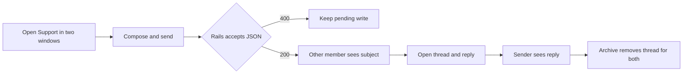
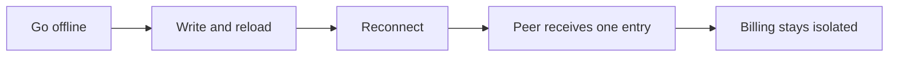

# Dogfood report — shared-inbox delivery

## Diff Summary

- Repair the deployed Rails application's JSON parser dependency. Browsers already queue and retry failed writes.
- Exercise the wire format on the running app and cross-window delivery in the compiled demo.

## Personas

Maya and Theo share Support. Jo reads Billing. Their memberships come from the demo directory. A returning visitor expects an offline reply to survive reload.

## Flows Tested

## Test Matrix & Results

| # | Scenario | Status | Evidence |
|---|---|---|---|
| 1 | Rails parses the JSON mutation envelope | Fixed locally | The HTTP probe reproduced a 400 on production at `6a96311`. The same probe on repaired Rails received the expected JSON rejection with HTTP 200. |
| 2 | Two open Support windows see an online send and reply without reload | Pass locally | In the in-app browser, Maya sent to support@example.test, Theo replied, and Maya saw the reply. Chrome also checked a second Maya window sharing the sender's profile and a teammate in a separate profile. |
| 3 | Offline reload, reconnect, archive and inbox isolation | Pass locally | The independent teammate received one reply after reconnect. Archiving removed the conversation from both lists. Billing stayed separate. |
| 4 | Landing page, other demos and sync inspector | Pass locally | Browser suites exercised five card images, Todo, Slack channel navigation and scrollback, migration note writes and rollback, console queries, receipts, offline recovery and inspector controls. |

## Pack Compliance

No packs declared.

## What Was Fixed

Rails 8.1.3 passed a positional options hash to JSON.parse. The deployment resolved json 3.1.0, which rejected that call before Rails reached the mailbox controller. Commit `2bc6476` constrains the demo's JSON dependency and adds a repeatable deployment probe and online browser regression.

## Paper Cuts (by persona)

During a failed send, Maya could read her local message even though Theo could not see it. The inspector showed one pending write and repeated HTTP 400 responses.

## Console Errors

The broken production request returned HTTP 400. The full-demo and inspector browser suites checked for uncaught page errors and passed.

## Human Verifications

Mail stays within the fictional demo.

## Decisions for a Human

None.

## Learnings

Reading the bootstrap endpoint only proves that existing messages can load. Verify a deployed write with another open session, and use the mutation probe to check the installed parser without storing mail.

### Pack candidates

None.

## Final Status

Local QA passed with 126 gem tests, 113 demo tests, and five browser suites. A production test conversation was queued before rollout to verify recovery afterward.
