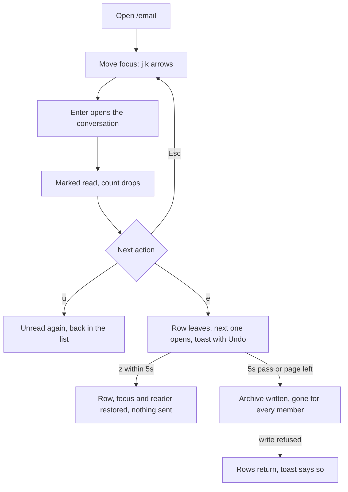
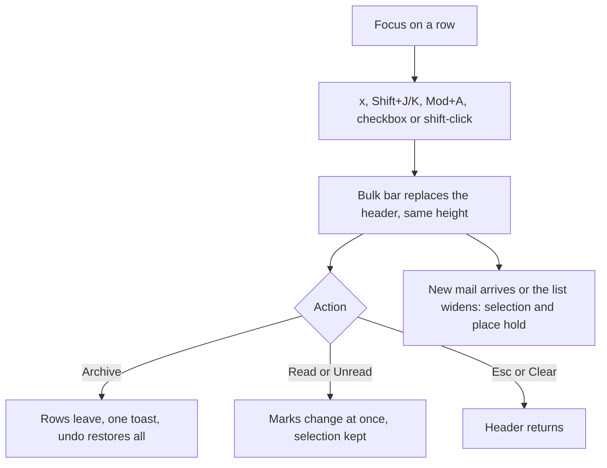
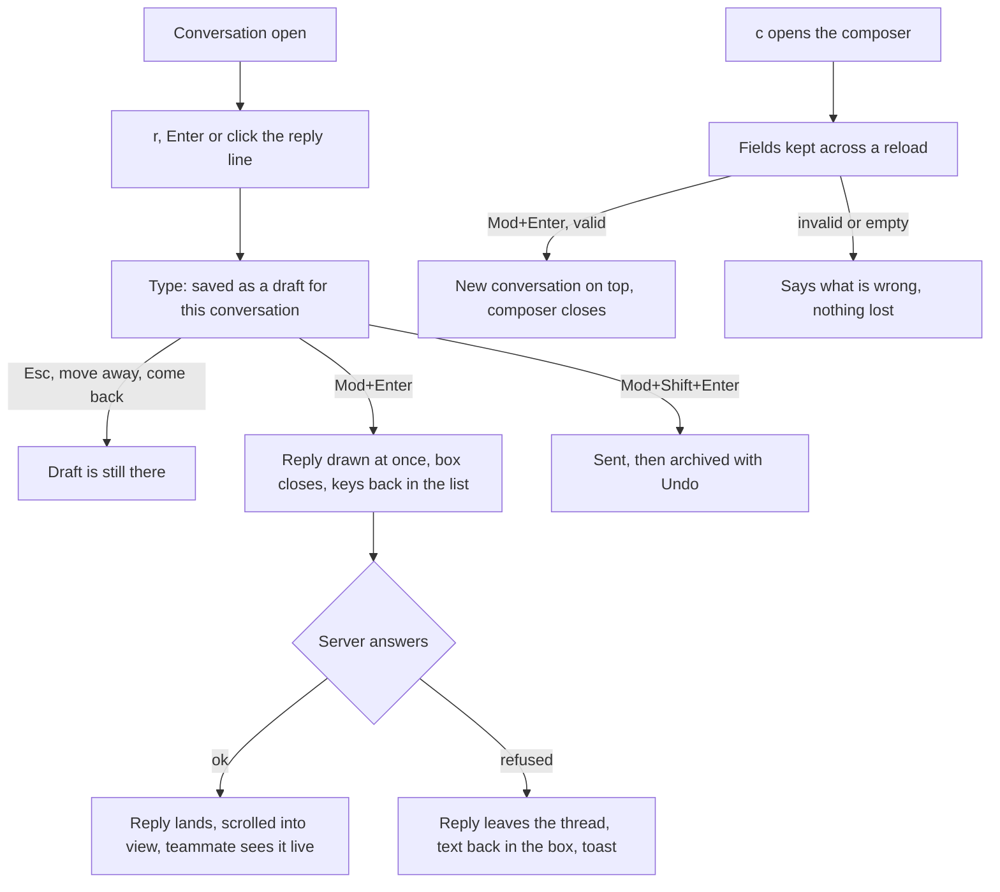
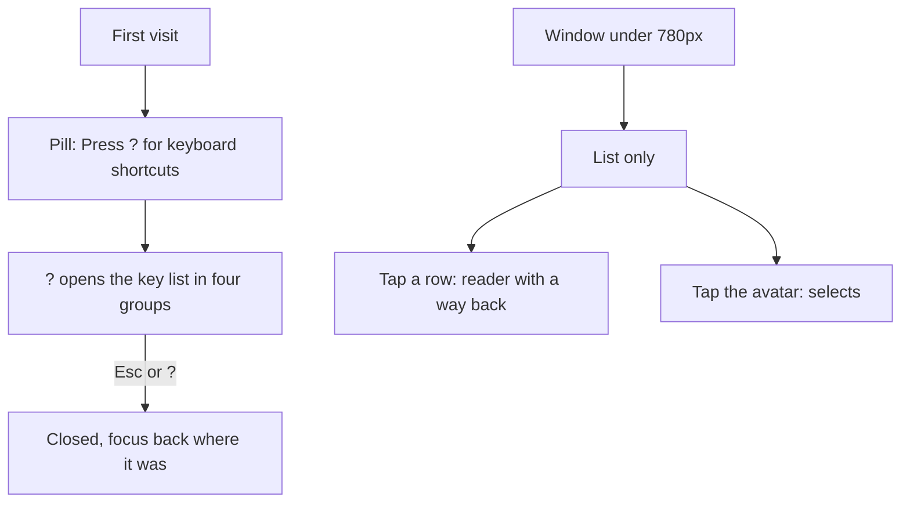

# Dogfood Report — claude/project-thread-k68sea

> Diff-scoped browser QA of `claude/project-thread-k68sea` vs the trunk. Generated by `ce-dogfood` on 2026-11-19.

## Diff Summary

- The Inbox demo (`demo/app/frontend`) selects rows by key, checkbox and shift-click, and acts on them in bulk from a bar that takes the list header's place.
- Archive is held for five seconds and can be undone (`z`, `Mod+Z`, the toast's button). `u` marks unread and goes back, `Shift+I` marks read.
- The reply box opens by key, keeps a draft per conversation, sends with `Mod+Enter` (`Mod+Shift+Enter` sends and archives) and draws the reply at once. The composer keeps its fields and sends the same way.
- The reader shows a new conversation from the top, scrolls with Space, and keeps the reply box docked under it. A key list opens with `?`.
- The gem's `frontend/` package gains `useShortcuts`, `useSelection`, `useUndoable` and `write`. `useKeyboardNavigation` no longer owns keys.
- No Ruby, route or sync change.

## Personas

Inferred: the repo has no strategy, product or persona document, and declares no Compound Packs (the resolver returned no roots).

- **Maya, a support lead who lives on the keyboard** — clears a shared inbox quickly and expects mail-client keys to do what they do in Cora, Superhuman or Gmail, with nothing lost on a slip — inferred
- **Theo, a teammate in the same inbox with a mouse and a small window** — needs to see what others did without reloading, and to do everything without knowing a single key — inferred
- **A developer evaluating InstantRecord** — reads the demo to judge whether writes feel instant and whether the pieces could be lifted into their own app — inferred from the README

## Flows Tested

## Test Matrix & Results

| # | Flow | Journey / Scenario | Status | Issue | Fix | Commit |
|---|------|--------------------|--------|-------|-----|--------|
| 1 | Triage | j, k and arrows move focus; holding j through a 10,000-row inbox stays smooth and in view | Pass | - | - | - |
| 2 | Triage | Enter opens, marks read, the count drops; Esc goes back | Pass | - | - | - |
| 3 | Triage | u marks unread and goes back; Shift+I marks read | Pass | - | - | - |
| 4 | Triage | e with the reader open, then z: row, focus and reader restored, nothing sent | Pass | - | - | - |
| 5 | Triage | An archive not undone is written after five seconds and stays gone after a reload | Pass | - | - | - |
| 6 | Triage | An archive the server refuses puts the rows back and says so | Pass | - | - | - |
| 7 | Selection | x, Shift+J, Shift+K, Mod+A and Esc | Pass | - | - | - |
| 8 | Selection | Checkbox on hover, shift-click range, every bulk bar button by mouse | Pass | - | - | - |
| 9 | Selection | Bulk archive with one toast and one undo; bulk read and unread | Pass | - | - | - |
| 10 | Selection | Incoming mail while rows are selected: selection and place hold | Pass | - | - | - |
| 11 | Reply | r and Enter open the box; a draft survives Esc, moving away and a reload of the tab | Pass | - | - | - |
| 12 | Reply | Mod+Enter: drawn at once, lands, scrolled into view, keys back in the list | Pass | - | - | - |
| 13 | Reply | Mod+Shift+Enter sends and archives, and undo brings the conversation back with its reply | Pass | - | - | - |
| 14 | Reply | A refused send returns the text to the box with a toast | Pass | - | - | - |
| 15 | Reply | Composer: c, fields kept across reload, Mod+Enter sends, invalid input is explained | Fixed | Mod+Enter sent a malformed address past the browser's check, and the server's refusal opened Inertia's error window over the page | The key asks for the field check; a refusal is the page's toast | 97d192f |
| 16 | Reply | A teammate sees the reply and the archive without reloading | Pass | - | - | - |
| 17 | Keys | First-visit pill, the key list, focus on close, keys inert behind the list | Fixed | Tab in the key list moved focus into the page behind it | Tab stays on the card | 774635e |
| 18 | Reader | Space scrolls, a new conversation starts at the top, hairlines appear | Pass | - | - | - |
| 19 | Small window | Under 780px: list, reader, back, avatar tap selects, reply | Fixed | On a 390px screen the open reply box put Send below the fold, and controls showed key caps | The box scrolls into view when it opens; no caps on controls where the pointer is coarse | 774635e |
| 20 | Switching | Changing mailbox or member clears selection and keeps drafts apart | Pass | - | - | - |
| 21 | Whole app | Mouse only, no keys: every action reachable | Pass | - | - | - |
| 22 | Whole app | Screen-reader names and the other demos unaffected by the new stylesheet | Fixed | Buttons were named with their key ("Mark unread U") | Key caps inside controls are hidden from the name | 774635e |

Status values: `Pending`, `Pass`, `Fixed`, `Skipped`, `Blocked (needs human verify)`, `Blocked (human decision)`.

## Pack Compliance

None. The repo declares no packs.

## What Was Fixed

### The composer opened Inertia's error window — `97d192f`
- **Symptom:** With "not-an-address" in To, Mod+Enter sent the message. The server answered 422 and Inertia drew its own error dialog over the whole page, on top of the page's toast. The dialog then swallowed every click until it was dismissed.
- **Root cause:** The key called the send directly, so the browser's check of the fields never ran, and `onHttpException` did not return `false`, which is what tells Inertia the page has handled the failure.
- **Fix:** `demo/app/frontend/components/mail/Composer.jsx` asks the form for `reportValidity()` before sending and returns `false` from `onHttpException`. An empty Mod+Enter now points at the first empty field, where before it did nothing and said nothing.
- **Regression test:** None automated. The demo has no component test harness (its node tests cover modules that import no React), and adding one for a single form is not a small fix. Replayed in the browser three ways: empty, malformed address, and a valid message the server refuses. Each leaves the fields as typed and shows no Inertia dialog.

### Tab left the key list — `774635e`
- **Symptom:** With the key list open, Tab moved focus to a control in the page behind the dialog.
- **Root cause:** The dialog has nothing focusable inside it and did not hold Tab.
- **Fix:** `demo/app/frontend/components/ui/KeyHelp.jsx` keeps Tab on the card.
- **Regression test:** None automated, for the reason above. Replayed: two Tabs, focus still inside `role=dialog`.

### Buttons were named with their key — `774635e`
- **Symptom:** A screen reader would read "Mark unread U", "Reply R", "Undo Z".
- **Root cause:** The key cap is text inside the button.
- **Fix:** `Kbd` takes `silent`, which hides the caps from the accessibility tree, and every cap inside a control passes it (`IconButton.jsx`, `Toasts.jsx`, `ReplyBox.jsx`, `Rail.jsx`). The key list keeps its caps readable.
- **Regression test:** None automated. Checked by role and exact name in the browser.

### Send was off screen on a phone — `774635e`
- **Symptom:** At 390px, tapping "Reply to…" opened the box with its Send button below the bottom of the screen.
- **Root cause:** In one column the reply box is part of the page's flow, not docked.
- **Fix:** `ReplyBox.jsx` scrolls its form into view when it opens. `ui.css` hides key caps on controls where the pointer is coarse.
- **Regression test:** None automated: layout. Replayed at 390×780 with touch: Send is inside the viewport and sends.

## Paper Cuts (by persona)

- **Maya** — With the reader beside the list, `u` "marks unread and goes back", but the reader keeps showing the same conversation, so only the dot tells her it worked — low — deferred
- **Maya** — The undo toast sits over the last visible row for five seconds — low — deferred
- **Maya** — A conversation with a reply draft looks like any other row in the list; the draft shows only once it is opened — medium — deferred (named in the plan as follow-up work)
- **Theo** — A message he sent shows as "To Pat@Example.Test": the row capitalises an address as if it were a name. Older than this branch — low — deferred
- **Theo** — A message the server refuses says "Couldn't send that. It's still here." without saying why — low — deferred
- **Theo** — Send below the fold on a phone — sharp — fixed `774635e`
- **A developer evaluating InstantRecord** — Nothing on the page says the archive is being held for five seconds before it is written, so the sync inspector shows no write when `e` is pressed — low — deferred

## Console Errors

None from the page's own code. The only console lines were the 500 and 422 answers the run forced to test refused writes.

## Human Verifications

Not applicable: the branch touches no outside service.

## Decisions for a Human

### Enter opens the reply, Mod+Enter sends
- **What's broken:** Nothing. The request said "enter to send the reply". In a multi-line reply box Enter is a new line, so the branch sends with Mod+Enter and uses Enter (outside the box) to open it. Cora itself sends with Mod+Enter.
- **Why escalated:** It is a reading of the request, and the other reading (plain Enter sends, Shift+Enter for a new line, as in chat apps) is a one-line change to the key table with a different feel.
- **Options:** keep Mod+Enter (a mail client's habit, no accidental sends) / plain Enter sends (faster for one-line replies, riskier for long ones).
- **Recommendation:** keep Mod+Enter.

### The compiled runtime has not run this
- **What's broken:** Unknown. No compiled toolchain exists where this ran, so every scenario above is against the Rails-served page.
- **Why escalated:** It needs a machine with Spinel and Roundhouse.
- **Options:** run `compiled/` locally and walk scenarios 2, 5, 12 and 14 with the Offline switch on.
- **Recommendation:** check first that `write` (a plain `fetch` form post) is answered by the worker.

## Learnings

- An Inertia visit's `onHttpException` must return `false`, or Inertia shows its own error dialog as well as whatever the page does.
- A key that submits a form skips the browser's field validation. Call `reportValidity()` first.
- A key cap inside a button becomes part of its name unless it is hidden from the accessibility tree.

### Pack candidates

None.

## Final Status

Ready to merge, with the compiled runtime unverified. All 22 scenarios end `Pass` or `Fixed`. Suites: `bundle exec rake test` 130 runs, 0 failures; `bin/rails test` in `demo/` 132 runs, 0 failures (both run before the fixes above, which touch no file those suites read); `npm test` in `demo/` 35 pass, run after them.

Browsers on offer: the cloud environment's own Chromium, driven through its preinstalled Playwright. `agent-browser` is not installed and there is no host application browser, so the environment's Chromium was the built-in choice. Three contexts were used: Maya at 1600px, Theo in a separate profile, and a 390px touch screen.

Once, a phone-sized page took more than 30 seconds to show its rows while three other windows were open against the same local server. It did not happen again in three reruns and was not traced.

The environment replaced nothing the branch depends on: the demo has no sign-in and no outside service. Refused writes were forced by answering the page's POST with 500 or 422 in the browser. Test conversations the run created ("Walk test", "Dogfood") live only in the local development database.
