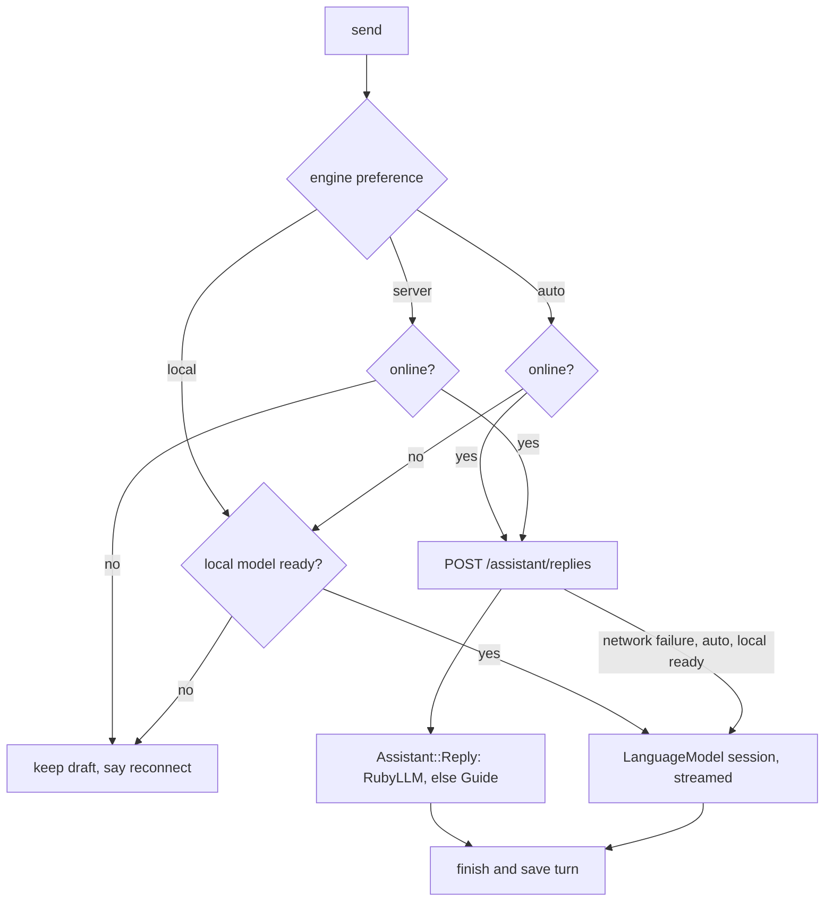

# Assistant Answers Online and Offline - Plan

## Goal Capsule

- **Objective:** A visitor to the Assistant demo gets an answer from a real language model whether or not they have a connection, and can choose where the answer comes from.
- **Means:** RubyLLM on the Rails server for online replies (KTD1), Chrome's built-in Prompt API (Gemini Nano) for replies in the browser (KTD3), one engine switch in the composer (KTD4).
- **Authority:** Kieran's request of 2026-11-19, then this plan, then `AGENTS.md`.
- **Execution profile:** one branch, merged to `main` with a merge commit per `AGENTS.md`. No pull request.
- **Stop conditions:** the gem's tests or the demo's tests fail on the merged result; RubyLLM cannot be bundled on the demo's Ruby; the change breaks the compiled build's carve step.
- **Who finishes:** the implementing agent merges and pushes `main`. Kieran sets a provider key where the demo is deployed.

---

## Product Contract

### Summary

The Assistant demo answers from a scripted Ruby guide today and refuses to send while offline. This change puts a real model behind it on both sides of the connection: RubyLLM on the server, a model that runs in the browser when the server is out of reach, and a switch between them.

### Problem Frame

InstantRecord's pitch is a Rails app that keeps working offline. The Assistant is the one demo that stops: offline, the composer disables and says to reconnect. It also shows no real model, only a regex-matched guide, so it demonstrates neither an LLM in a Rails app nor local-first AI.

### Requirements

**Server replies**

- R1. With a provider key configured, an online reply comes from a real model called through RubyLLM, and the conversation's recent turns are sent as context.
- R2. With no provider key, or when the model call fails, the reply comes from the existing scripted guide and the request still succeeds.
- R3. The reply says which engine produced it, and the transcript labels each answer with its engine.
- R4. The public endpoint bounds what visitors can spend on the provider account: prompt and history sizes, output length, call time, requests per minute per address, and a daily total across all visitors, after which replies come from the guide.
- R12. The page and the README say that a server reply may be sent to a hosted model provider.

**Browser replies**

- R5. Where the browser offers a built-in model, the Assistant can answer from it with no request to the server, streaming the reply and honoring Stop.
- R6. A reply from the browser model is saved and synced across tabs exactly as a server reply is.
- R7. Where the browser model must first be downloaded, the visitor starts the download by choosing it, and sees progress.

**Choosing the engine**

- R8. The composer offers Auto, Server and On-device. Auto uses the server when online and the browser model when offline. The choice persists on the device.
- R9. Offline in Auto, with a browser model available, sending works. Offline with none available, today's behavior holds: the draft is kept and the status says to reconnect.
- R10. In Auto, when the server cannot be reached and a browser model is available, the reply comes from the browser model instead of an error.
- R11. On-device is shown as unavailable, with the reason, where the browser has no built-in model.

### Scope Boundaries

- No second in-browser runtime (WebLLM, Transformers.js). A multi-hundred-megabyte model download from a CDN, cached for offline use, is its own piece of work. The engine seam (KTD3) leaves room for it.
- No token streaming from the server. The server returns the whole reply and the page reveals it word by word, as now.
- No server-side conversation storage. Turns stay in the browser's storage.
- The scripted example conversations and their history endpoint are unchanged.

### Assumptions

- "The chat example" means the Assistant demo at `/assistant`, the only demo with a model reply and a leftover "Gemini Nano" label. The Slack-style Chat demo is not touched.
- The provider is whichever key the environment holds. No provider is preferred over another.
- Kieran has no provider key set on the deployed demo yet, so the deployed demo keeps the guide until he adds one.

---

## Planning Contract

### Key Technical Decisions

- KTD1. **RubyLLM lives behind one class, `Assistant::Reply`.** The controller validates and renders; `Assistant::Reply.call(prompt:, history:)` returns `{ reply:, engine:, model: }`. It picks the model, builds the chat (`RubyLLM.chat(model:)`, `with_instructions`, `with_max_output_tokens`, prior turns added as messages, `ask`), and rescues `StandardError` around building the chat and `ask` into the guide, logging the error class. RubyLLM's `ModelNotFoundError` and `ConfigurationError` are not `RubyLLM::Error`s, so a narrower rescue would turn a mistyped `ASSISTANT_MODEL` into a 500. The guide's `case` moves out of the controller into `Assistant::Guide`. Rejected: calling RubyLLM in the controller, which mixes HTTP with a provider call and leaves nothing to test without a request.
- KTD2. **The model is chosen from the environment, with no key meaning the guide.** `ASSISTANT_MODEL` names a model outright. Without it, the first of `ANTHROPIC_API_KEY`, `OPENAI_API_KEY`, `GEMINI_API_KEY` present picks that provider's small model (`claude-haiku-5-5`, and the small OpenAI and Gemini ids confirmed against RubyLLM's registry at implementation time). Keys are set in `config/initializers/ruby_llm.rb`. Rejected: Rails credentials, which the demo does not use anywhere else.
- KTD3. **The browser engine is Chrome's Prompt API, wrapped in a small module.** `assistant_local_model.js` exports `availability()`, `prepare(onProgress)` and `reply(prompt, history, { signal, onChunk })` over `LanguageModel.availability()`, `LanguageModel.create({ initialPrompts, monitor })` and `session.promptStreaming()`. The controller knows only that interface, so another runtime can stand behind it later. A new session per reply, seeded with the system prompt and the thread's recent turns, then destroyed: threads switch freely and no session state needs syncing. Rejected: WebLLM as the first engine, for the download and caching work in Scope Boundaries.
- KTD4. **One engine preference, three values, resolved at send time.** `auto | server | local` in `localStorage`. `send` resolves it against `this.offline` and the local model's availability to exactly one of: server, local, or blocked. The existing server path and the new local path both end in the same `finish`/`save`, so storage, cross-tab sync, Stop and the interrupted marker work unchanged.
- KTD5. **The server engine name travels in the reply, and the turn stores it.** Turns gain `engine: "ruby_llm" | "local" | "guide"` and an optional `model` string. The label reads from those. The leftover `"model"` engine value maps to the on-device label so any old saved turn still renders.
- KTD6. **The compiled build never sees RubyLLM.** `compiled/pipeline/carve.py` already drops `replies_controller.rb`; the new initializer and the `Assistant::Reply` and `Assistant::Guide` files join its `REMOVE` list. The page reaches the server through the same `instant_record_network` request as now, with `history` added to the body it already forwards. `demo/Gemfile` does reach the compiled app (only the lockfile is dropped), as `rack-attack` already does, so a compiled build is part of verification. The new JavaScript file joins the fixed Assistant list in `compiled/pipeline/source_pages.py`.

### High-Level Technical Design

### Implementation Constraints

- The demo pins Ruby 3.3.3 and a cloud thread has 3.3.6: run the demo's tests through an untracked Gemfile copy without the `ruby` line via `BUNDLE_GEMFILE`, and regenerate `demo/Gemfile.lock` so its `RUBY VERSION` stays as committed.
- No test may call a provider. Stub at `RubyLLM.chat`.
- The endpoint answers any origin (`InstantRecord::CORS_HEADERS`, which the compiled build needs), so a per-address throttle alone does not bound spend. The daily total in R4 is the bound that holds.
- Headless Chromium has no `LanguageModel`. Browser tests install a fake one with `addInitScript`.

---

## Implementation Units

### U1. RubyLLM behind `Assistant::Reply`

- **Goal:** Online replies come from a real model when a key is set, the guide otherwise.
- **Requirements:** R1, R2, R3, R4
- **Files:** `demo/Gemfile`, `demo/Gemfile.lock`, `demo/config/initializers/ruby_llm.rb`, `demo/app/models/assistant/reply.rb`, `demo/app/models/assistant/guide.rb`, `demo/app/controllers/assistant/replies_controller.rb`, `demo/config/initializers/rack_attack.rb`, `demo/test/controllers/assistant/replies_test.rb`, `demo/test/models/assistant/reply_test.rb`
- **Approach:** KTD1, KTD2. The controller accepts `prompt` (as now) and optional `history`: an array of at most 6 `[prompt, reply]` string pairs, each string at most 2000 characters, anything else `422`. `Assistant::Reply` caps output tokens (about 600) and sets a request timeout of about 20 seconds with no retries beyond one. The system prompt says what the demo is and to answer briefly in the plain Markdown subset the page renders (paragraphs, `-` lists, numbered lists, fenced code). A `RubyLLM::Tool` named for the workspace returns the open and done todo counts, so "Inspect my workspace" stays true with a real model. Add a `Rack::Attack` throttle of 12 per minute per IP on `POST /assistant/replies`. Count model calls per UTC day in `Rails.cache` and answer from the guide once the count passes `ASSISTANT_DAILY_LIMIT` (default 500).
- **Patterns:** `demo/app/controllers/assistant/replies_controller.rb` for the endpoint's headers and preflight; `demo/app/models/mail_shell.rb` for a plain model-layer class.
- **Test Scenarios:**
  - No key: reply is the guide's, `engine` is `guide`, the existing three tests pass unchanged.
  - Key set and `RubyLLM.chat` stubbed: reply is the stub's content, `engine` is `ruby_llm`, `model` is the chosen id, and the stub received the history turns in order before the prompt.
  - Stubbed chat raises `RubyLLM::Error`, and separately a timeout: `200`, guide reply, `engine` `guide`.
  - `ASSISTANT_MODEL` set overrides the provider default.
  - History that is not an array of string pairs, has 7 pairs, or holds a string over 2000 characters: `422`.
  - `ASSISTANT_MODEL` set to an unknown id, and set with no provider key: `200`, guide reply, `engine` `guide`.
  - With the daily limit set to 1, the second call answers from the guide and `RubyLLM.chat` is called once.
  - The workspace tool returns counts matching `Issue`.
- **Verification:** `bin/rails test test/controllers/assistant test/models/assistant` in `demo/`.

### U2. The browser model

- **Goal:** The page can answer from Chrome's built-in model.
- **Requirements:** R5, R7, R11
- **Files:** `demo/app/javascript/controllers/assistant_local_model.js`, `demo/app/controllers/source_controller.rb`
- **Approach:** KTD3. `availability()` returns `unavailable` when `LanguageModel` is undefined or throws, else the API's own value. `prepare` creates and destroys a session with a `downloadprogress` monitor. `reply` accumulates chunks and calls `onChunk` with the text so far; it handles both delta and cumulative chunk streams by checking whether a chunk starts with the text so far. The system prompt matches the server's in intent. Add the file to the Assistant's source drawer list.
- **Test Scenarios:** Covered through U3's browser test with a fake `LanguageModel`, which exercises all three exports. Test expectation for this unit alone: none, the demo has no JavaScript unit runner.
- **Verification:** U3's browser test.

### U3. Engine switch and send routing

- **Goal:** The visitor chooses the engine, and offline sends work when a browser model exists.
- **Requirements:** R3, R5, R6, R8, R9, R10, R11
- **Files:** `demo/app/javascript/controllers/assistant_chat_controller.js`, `demo/app/views/assistant/chats/index.html.erb`, `demo/app/assets/stylesheets/assistant.css`, `compiled/test/assistant-chat.mjs`, `compiled/test/assistant-engines.mjs`
- **Approach:** KTD4, KTD5. Replace the static "Rails demo guide" chip with a three-way segmented control in the same place and the same pill styling. `connection()` enables Send when the resolved engine can answer, and words the status for each state. The idle status for the server engine says replies may come from a hosted model through RubyLLM (R12). `send` sends `history` (the thread's last 6 saved turns, each string clipped to 2000 characters so a long on-device reply cannot make a later server send fail) to the server and reads `engine` and `model` from the reply. The local path sets `received` on the first chunk and renders through the same `format` replacement the server path uses. Choosing On-device while the model is `downloadable` calls `prepare` and shows percent in the status line.
- **Patterns:** the existing `send`, `stop`, `finish` in `assistant_chat_controller.js`; `.relay-engine` in `assistant.css`.
- **Test Scenarios** (new `compiled/test/assistant-engines.mjs`, runnable against the Rails-served demo, with a fake `LanguageModel` installed by `addInitScript`):
  - Auto, online: a send posts to `/assistant/replies` with the thread's earlier turn in `history`; the answer is labeled for the server engine.
  - Auto, Offline checked: a send makes no request, the fake model's reply streams in, the answer is labeled on-device, and it survives a reload.
  - On-device chosen while online: no request is made. The choice survives a reload.
  - Server chosen, Offline checked: Send is disabled and the status says to reconnect.
  - Auto, online, the reply request aborted by the test: the fake model answers.
  - A fake-model reply longer than 2000 characters, then a Server send in the same thread: `200`.
  - Stop during a local reply: the saved turn ends with "Reply stopped."
  - No `LanguageModel`: On-device is disabled with its reason, and Auto offline behaves as today (the existing `assistant-chat.mjs` offline assertions still pass).
  - Fake model reporting `downloadable`: choosing On-device shows progress, then becomes ready.
- **Verification:** `node compiled/test/assistant-engines.mjs <origin>` and `node compiled/test/assistant-chat.mjs <origin>` against a running Rails demo, using copies without `channel: "chrome"`.

### U4. Compiled build and docs

- **Goal:** The compiled build still carves, and the setup is written down.
- **Requirements:** R1, R2, R12
- **Files:** `compiled/pipeline/carve.py`, `compiled/pipeline/source_pages.py`, `demo/README.md`, `CHANGELOG.md`
- **Approach:** KTD6. README: the three provider keys, `ASSISTANT_MODEL`, `ASSISTANT_DAILY_LIMIT`, what happens with none, that prompts and recent turns go to the provider when a key is set, and that On-device needs a Chrome with the built-in model.
- **Test expectation:** none for the docs. The carve and source lists are checked by the compiled build in the Verification Contract.

---

## Verification Contract

| Check | Command | Proves |
|---|---|---|
| Gem tests | `bundle exec rake test` | The gem is untouched |
| Demo tests | `bin/rails test` in `demo/` | U1, and no regression in the other demos |
| Engine browser test | `node compiled/test/assistant-engines.mjs <origin>` | U2, U3 |
| Existing Assistant browser test | `node compiled/test/assistant-chat.mjs <origin>` | No regression for a browser with no local model |
| Compiled build | `bin/rails instant_record:compile` in `demo/` with the toolchain, then both browser tests against it | KTD6: the Gemfile line and the removed files do not break the compiled app |

Not verifiable in a cloud thread, to be stated in the final report: a reply from a real provider (no key here), and a reply from the real Gemini Nano (headless Chromium does not ship it).

## Definition of Done

- All five checks above pass on the branch merged with `origin/main`.
- With no key and no `LanguageModel`, the Assistant behaves as it did before.
- No test reaches a provider.
- The leftover "Gemini Nano" label for engine `"model"` is replaced by the engine labels of KTD5.
- No experimental code or unused branch from an abandoned approach remains in the diff.
