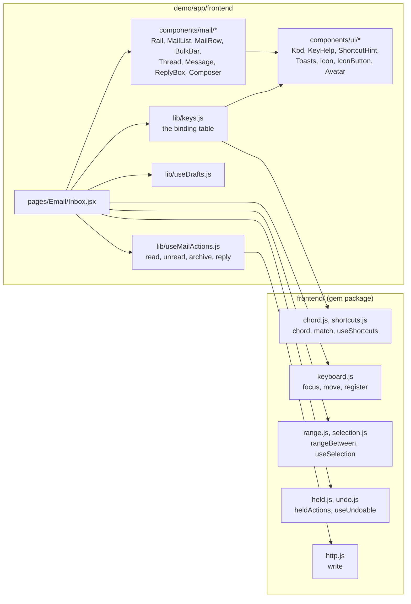

# Inbox Polish - Plan

## Goal Capsule

- **Objective:** A person can work through the Inbox demo the way they work through Cora: move, select, mark, archive, undo and reply from the keyboard, with the list and reader never jumping, losing their place, or dropping what they typed.
- **Means:** Port Cora's inbox patterns at demo size, with the behaviour in small modules in the gem's `frontend/` package and the interface in small components in the demo (KTD1, KTD2).
- **Authority:** Kieran's request of 2026-11-19, then `AGENTS.md`, then the Product Contract below, then the Planning Contract. Cora (`EveryInc/cora`, `app/javascript/pages/Inbox`, `app/javascript/components/inbox`) is the reference for behaviour, never a source to copy files from.
- **Stop conditions:** A change would need new Ruby in `Email::MailboxesController` or `MailEntry`, a change to the sync wire format, or a redesign of the approved look. Stop and report.
- **Execution profile:** One branch, merged to `main` as `AGENTS.md` says. No pull request.
- **Who finishes:** The implementing agent runs the checks in the Verification Contract and merges. Kieran reviews on `main`.

---

## Product Contract

### Summary

The Inbox demo gains the next layer of Cora's feel. Rows can be selected and acted on in bulk. Archive can be undone. Every shortcut is listed once and shown where it applies. The reply box opens with a key, keeps a draft per conversation, sends with a key and shows the reply at once. The reader and the list hold their scroll through all of it. The pieces that are not about mail move into the gem's `frontend/` package and a small set of shared demo components.

### Problem Frame

The Inbox was rebuilt on Inertia and React on 2026-11-19 with single-row focus: j, k, open, archive, reply, compose. Its requirements named range selection, bulk actions and undo as the next step (`docs/brainstorms/2026-11-19-inbox-inertia-react-requirements.md`, "Not in this round"). What is there still falls short of a mail client in ways a reader notices in the first minute:

- An archive cannot be taken back, and there is no way to act on several conversations.
- `u` only goes back, the key list is a flat card, and no control shows its key.
- Moving to another conversation throws away a half-written reply. A sent reply appears only when the server answers. A failed write is one line of grey text in the header.
- The reader keeps its scroll offset when the conversation changes, and Space does nothing.
- `Inbox.jsx` holds the page, its writes and its key map in one 237-line component, and `MailReader.jsx` holds five unrelated components, so nothing in it can be reused by the next demo.

### Key Decisions

- **The Inbox demo is Inertia + React with Cora-style j/k** (session-settled: user-directed — chosen over the earlier Hotwire/ERB inbox: Kieran chose the rebuild). Governs R1–R22.
- **Reusable Inertia helpers ship in the gem's `frontend/` package** (session-settled: user-directed — chosen over a separate npm package: one gem to install). Governs R21.

### Requirements

These R-IDs are this plan's own. They do not continue the numbering of the origin document, whose requirements all still hold.

**Scrolling**

- R1. Moving focus with the keyboard scrolls the list only as far as needed to show the focused row, and holding a movement key stays smooth through rows the list has not drawn yet.
- R2. Opening a different conversation shows it from the top. Opening the same conversation again, or a live update to it, leaves the reader's scroll where it was.
- R3. With a conversation open and no field focused, Space scrolls the reader down by most of a screen and Shift+Space scrolls it up.
- R4. A reply the reader just sent is scrolled into view in the thread.
- R5. The list header and the reader toolbar show a hairline once content has scrolled beneath them.

**Marking and selection**

- R6. `u` marks the open or focused conversation unread and returns to the list. `Shift+I` marks it read. Esc returns to the list without changing a mark.
- R7. `x` selects or deselects the focused row. `Shift+J`, `Shift+K`, `Shift+↓` and `Shift+↑` extend or shrink a range from the row where selecting began. Shift+click selects the range to the clicked row. `Mod+A` selects every loaded row. Esc clears a selection before it does anything else.
- R8. A row shows a labelled checkbox in place of its avatar while hovered or while any row is selected, and clicking it toggles that row without opening it. Where there is no hover (touch, or the one-column layout under 780px) tapping the avatar does the same.
- R9. While rows are selected a bar takes the place of the list header, at the same height so no row moves, states how many are selected, and offers Archive, Mark read, Mark unread and Clear, each with its key. The header returns when the selection empties. `e`, `u` and `Shift+I` then act on the selection instead of the focused row.
- R10. Focused, open, selected and unread are four separate row states that can all be read at once, by eye and by a screen reader.

**Archive and undo**

- R11. Archiving removes the rows at once and moves focus to the row that took their place. When the reader was open it shows that next conversation.
- R12. An archive can be undone for five seconds with `z`, `Mod+Z` outside a text field, or the Undo button on its toast. Undo restores the rows, the focus and the open conversation. An archive that is not undone is sent when the five seconds pass, or when the reader leaves the page, whichever comes first.
- R13. Every write that fails says so in a toast and puts the screen back as it was. In a bulk action, conversations already written stay as written and the rest are put back.

**Shortcuts**

- R14. `↓` and `↑` move focus as `j` and `k` do.
- R15. `?` opens a key list grouped as Navigation, Actions, Reply and compose, and Selection. The list, the handlers and the key hints on controls come from one table, so a key cannot be listed and not work, or work and not be listed.
- R16. Controls with a shortcut show it: Reply, Archive, Mark unread, Compose, Send.
- R17. On a first visit a small pill says "Press ? for keyboard shortcuts" and leaves after five seconds or the first key press, and does not return. It is not shown where the pointer is coarse.

**Reply flow**

- R18. `r`, or Enter while a conversation is open, opens the reply box and places the caret in it. Until then the box is one line: "Reply to <address>" with its key. Send is disabled, and `Mod+Enter` does nothing, while the reply is empty.
- R19. `Mod+Enter` sends the reply. `Mod+Shift+Enter` sends it and archives the conversation, which then follows R11 and R12. Either way the reply appears in the thread at once, at reduced emphasis until the server has it, the box closes, and the keyboard returns to the list.
- R20. A reply being written is kept per conversation for the session: moving away and back, or a live update, does not lose it. Esc in an empty reply closes the box. Esc in a reply with text leaves the text and the open conversation as they are and returns the keyboard to the list. A reply whose send failed is back in the box (R13). The composer for a new conversation keeps its fields the same way and sends with `Mod+Enter`.

**Reuse**

- R21. Behaviour that is not about mail lives in the gem's `frontend/` package and is exported from it: shortcut matching, list selection, undoable held actions, and a write that does not visit.
- R22. Interface pieces live in the demo as one component per file. Those that are not about mail (key cap, key list, first-visit hint, toasts, icon, icon button, avatar) sit apart from the mail components and take no mail props.

### Acceptance Examples

- AE1. **Covers R11, R12.** Given the reader open on the second of five conversations, when the reader presses `e` then `z` within five seconds, then the second conversation is back in its place, focused and open, and no archive was sent.
- AE2. **Covers R7, R9, R12.** Given focus on row 2, when the reader presses `x`, `Shift+J`, `Shift+J`, `e`, then rows 2–4 leave, focus is on the row that was fifth, one toast says "3 conversations archived", and `z` brings all three back.
- AE3. **Covers R7.** Given a range 2–4 begun on row 2, when the reader presses `Shift+K` once, then rows 2–3 are selected.
- AE4. **Covers R20.** Given "Thanks, on it" typed in a reply, when the reader presses Esc, `j`, `k`, `r`, then the box holds "Thanks, on it" with the caret at its end.
- AE5. **Covers R19, R13.** Given a reply sent while the server refuses writes, then the reply leaves the thread, its text is back in the open box, and a toast says it was not sent.
- AE6. **Covers R6, R9.** Given three selected rows of which one is unread, when the reader presses `Shift+I`, then all three are read and the unread count drops by one.

### Scope Boundaries

Not built, and why:

- **Undo for a sent reply.** Cora holds a send for eight seconds. The demo's point is that a write lands in the local database at once and syncs, so a held send would hide the thing being shown. A wrong reply in a fictional inbox costs nothing.
- **A guarantee that a held archive survives the page closing.** Leaving the page sends what is held (R12) as a keep-alive request, which a browser may still drop. The row then comes back on the next load, in plain sight, and one key archives it again. Cora keeps a marker to reconcile because real mail is at stake.
- **A separate screen-reader announcer module.** The toast stack is itself the polite live region and the bulk bar's count is a status, so nothing else needs to speak yet.
- **A send-hold or queue for writes made offline on the Rails-served page.** Beside a local database a write is answered by it and syncs later, as before. Served by Rails alone a write made offline fails and R13 applies.
- **An unarchive on the server.** Undo is done by holding the write (KTD4), so the append-only mail log and both halves of the controller stay as they are.
- **Star, snooze, move, search, `g` sequences, dictation, pop-out reply, swipe.** The mail model has nothing behind them.

#### Deferred to Follow-Up Work

- A "Draft" marker on a row whose reply has text.
- One request for a bulk action in place of one per conversation (needs new controller Ruby in both runtimes).
- Rewriting `compiled/test/mail-volume.mjs` and `compiled/test/shared-inbox.mjs` against the React page. Already stale before this plan.

---

## Planning Contract

### Key Technical Decisions

- KTD1. **Behaviour goes in `frontend/`, interface goes in the demo.** The package is plain `.js` with `createElement`, no JSX and no stylesheet, so an app can install it without a build step of its own. Hooks and pure functions fit that. Styled components do not, so they stay in `demo/app/frontend/components`, with the mail-free ones under `components/ui/`. Instantiates the settled `frontend/` decision (session-settled: user-directed — chosen over a separate npm package: one gem to install). Governs R21, R22.
- KTD2. **One binding table drives keys, help and hints.** A binding is `{ keys, label, group, run, when }`. `frontend/chord.js` holds a pure `chord(event)` that names a key press (`"Mod+Shift+Enter"`, `"Shift+J"`, `"?"`), where `Mod` is ⌘ on Apple platforms and Ctrl elsewhere, and a pure `match(bindings, event, target)`. `frontend/shortcuts.js` holds the `useShortcuts(bindings)` hook that owns the one `keydown` listener. The table itself is the page's, in `demo/app/frontend/lib/keys.js`. The demo's key list and key caps read the same table. This replaces the `keys` object and the listener inside `useKeyboardNavigation`, which keeps focus, movement and the scroll registry. Owns R15.
- KTD3. **Keys while typing are opt-in per binding.** Today every key is dropped while a field has focus. A binding marked `typing: true` (`Mod+Enter`, `Mod+Shift+Enter`, Esc) still fires there. `Mod+Z` and `Mod+A` are never marked, so the browser's own text undo and select-all keep working in a field. A binding for Enter or Space does not fire when the target is a button, link, checkbox or other control those keys activate, or sits inside an open dialog: the control keeps the key.
- KTD4. **Undo is a held write, in `frontend/undo.js`.** `useUndoable` keeps a last-in-first-out stack of `{ label, ids, commit }`, each with its own timer. The page hides held ids from `rows` and from the unread count. Before holding, the page moves focus to the topmost of the ids in list order when the focused row is among them, so the existing `resolveFocus` hands focus to the row that takes the block's place. Undo drops the entry. Expiry calls `commit`, which answers a promise per id: an id stays held until its own write is answered, so no row returns between writes, and the ids of a failed run leave `held` together and reappear. Chosen over an optimistic archive plus a server-side unarchive, which would add a mail kind, change `open_messages` and need the unverified compiled half to match.
- KTD5. **A bulk action is one light write per conversation, sent in turn, then one reload.** `frontend/http.js` gains `write(url, data, { keepalive })`: a form post by `fetch` that does not follow the redirect and reloads nothing, carrying the XSRF token Inertia's own requests carry. It reaches Rails or, in the compiled runtime, the worker, as `localHttpClient` already does. The run ends with one partial reload of `mail`. Chosen over `router.post` per conversation, which answers each with the whole `mail` prop and lets unwritten rows flash back. A failure stops the run and R13 applies. Marks on several rows use the same path, with a page-level overlay of pending marks over `mail.rows` and the unread count, released per id as its write is answered. Leaving the page (`pagehide`) sends what is held with `keepalive`.
- KTD6. **Selection is `frontend/selection.js`.** A pure `rangeBetween(ids, anchorId, cursorId)` and a `useSelection(ids)` hook holding the selected set and the anchor. Ids that leave the list leave the set. The page decides what a selection means.
- KTD7. **Drafts are kept in `sessionStorage`, keyed by member, inbox and conversation.** A reload inside the session keeps them, a new session does not, and nothing reaches the server or the sync log. The reply form reads its starting text from there in place of resetting on every conversation change.
- KTD8. **A sent reply is drawn from the page's own pending list until the `thread` prop carries it.** The thread prop is rows of strings answered by the controller, so the pending reply is appended after the prop's replies and dropped when a reply with the same body by the same member appears, or when the write fails.
- KTD9. **Toasts replace the header status line.** One stack at the bottom centre, above the reply box and clear of the reader toolbar at every width. The stack is a polite live region. It shows at most one undo toast, the newest; older held entries stay undoable by `z`, which then shows the next. Failure toasts stack above it and dismiss themselves. An undo toast says what `z` does.
- KTD10. **Shared component styles get their own stylesheet,** `demo/app/assets/stylesheets/ui.css`, using the tokens `base.css` already defines, so another demo can take the components without `mail.css`.

### Assumptions

No one was present to confirm these, so they are bets:

- "Enter to send the reply" is read as Cora's flow: Enter opens the reply, `Mod+Enter` sends. Plain Enter makes a new line. If Kieran meant plain Enter sends, that is one binding in the table.
- `Mod+Enter` sends and stays, and `Mod+Shift+Enter` sends and archives. Cora has these the other way round. Here the reader should see their reply land.
- `u` follows Cora (mark unread and go back), which changes its meaning from the first round, where it only went back.
- "Archive" keeps its name. Cora says "Done".
- "Send and archive" stays in although nothing asked for it by name: it is Cora's main reply flow, which the request points at.
- Research was done by reading the code directly; no research or flow-analysis agents were run.

### High-Level Technical Design

### Sequencing

U1–U3 are independent and come first. Each keeps what its tests import free of React. U4 needs U1. U5 is a move with no behaviour change and comes before the behaviour units so their diffs are small. U6–U8 build on U1–U5. U9 is last.

---

## Implementation Units

### U1. Shortcut table and chords in the gem

- **Goal:** One place that names a key press and runs bindings, usable by any page.
- **Requirements:** R14, R15, R21. KTD2, KTD3.
- **Dependencies:** none.
- **Files:** `frontend/chord.js` (new, no React import), `frontend/chord.test.js` (new), `frontend/shortcuts.js` (new), `frontend/keyboard.js`, `frontend/index.js`.
- **Approach:**
  1. `chord(event, { apple })` builds the name from modifiers and `event.key`; a letter with Shift is named `Shift+J`, and a shifted symbol such as `?` is named by the symbol alone.
  2. `match(bindings, event, target)` applies KTD3 and `when` and answers the first binding. `useShortcuts(bindings)` attaches one `keydown` listener, skips events already handled, and runs what `match` answers.
  3. `useKeyboardNavigation` drops its `keys` argument and its listener. Its other arguments and what it answers are unchanged.
- **Patterns to follow:** `frontend/focus.js` with `frontend/keyboard.test.js` for a pure function tested under `node --test`; the header comment style of `frontend/keyboard.js`.
- **Test scenarios:** (`frontend/chord.test.js` catches naming and matching; it does not exercise the DOM listener, which the browser walk covers. A tested file imports no React, as `frontend/focus.js` does for `keyboard.test.js`, because `frontend/` has no `node_modules`)
  - `j` with no modifiers is `"j"`; with Shift it is `"Shift+J"`.
  - Enter with ⌘ on an Apple platform and Enter with Ctrl elsewhere are both `"Mod+Enter"`; Enter with Ctrl on an Apple platform is not.
  - Shift+`/` producing `?` is `"?"`.
  - Alt with any key matches no binding.
  - A binding with `when` returning false does not match and a later binding for the same chord does.
  - While typing, a binding without `typing: true` does not match and one with it does.
  - Enter and Space on a button target match no binding, and `j` on the same target still does.
- **Verification:** the Inbox behaves as before with its keys expressed as bindings.

### U2. Selection in the gem

- **Goal:** A selected set with an anchor and ranges, for any list of ids.
- **Requirements:** R7, R21. KTD6.
- **Dependencies:** none.
- **Files:** `frontend/range.js` (new, no React import), `frontend/range.test.js` (new), `frontend/selection.js` (new), `frontend/index.js`.
- **Approach:** `rangeBetween` is pure. `useSelection(ids)` answers `{ selected, anchor, toggle, extendTo, all, clear }`; `extendTo(id)` replaces the range from the anchor, so a range shrinks as well as grows. `toggle` with nothing selected sets the anchor.
- **Test scenarios:**
  - Covers AE3. A range from index 1 to 3 then to 2 holds exactly indexes 1–2.
  - A range upward from the anchor holds the same rows as the same range downward.
  - An anchor that is no longer in `ids` answers only the cursor row.
  - An empty `ids` answers an empty range.
- **Verification:** exported from `instant_record` and covered by the node tests.

### U3. Undoable held actions and the light write in the gem

- **Goal:** Hold a write for a few seconds so it can be undone, and send a write without visiting.
- **Requirements:** R12, R13, R21. KTD4, KTD5.
- **Dependencies:** none.
- **Files:** `frontend/held.js` (new, no React import), `frontend/held.test.js` (new), `frontend/undo.js` (new), `frontend/http.js`, `frontend/index.js`.
- **Approach:** Keep the stack and its timers in a plain object created by a `heldActions({ ms, onChange })` function so it can be tested without React; `useUndoable` wraps it in state and exposes `{ pending, held, hold, undo, flush }`, where `held` is the set of ids under any pending entry. Entries expire independently. `commit(ids, { keepalive })` answers one promise per id, and an id leaves `held` when its promise settles. `pagehide` and unmount flush with `keepalive`. `write` is described in KTD5; confirm against Rails that a `303` not followed counts as sent, and that the token header is accepted.
- **Patterns to follow:** Cora's `pages/Inbox/hooks/useUndoToast.ts` (stack with a timer per entry), at a fraction of the size; `localHttpClient` in `frontend/http.js` for the form post.
- **Test scenarios:** (with `node:test` mock timers)
  - An entry not undone commits once when its time passes and leaves the stack.
  - Undo removes the newest entry, never commits it, and leaves an older entry to commit on its own time.
  - `held` is the union of ids of pending and committing entries, and shrinks on undo and as each committed id's write is answered.
  - A commit whose second write fails releases the remaining ids together and reports the failure once.
  - `flush` commits every pending entry at once, oldest first.
  - Undo with nothing pending answers nothing and does not throw.
- **Verification:** node tests pass; nothing in the files mentions mail.

### U4. Shared interface components

- **Goal:** The mail-free interface pieces, one per file, with their own styles.
- **Requirements:** R15, R16, R17, R22. KTD2, KTD9, KTD10.
- **Dependencies:** U1.
- **Files:** `demo/app/frontend/components/ui/Kbd.jsx`, `KeyHelp.jsx`, `ShortcutHint.jsx`, `Toasts.jsx`, `Icon.jsx`, `IconButton.jsx`, `Avatar.jsx` (all new); `demo/app/assets/stylesheets/ui.css` (new); the layout or stylesheet manifest that loads `mail.css`.
- **Approach:**
  - `Kbd` and a combo form that splits a chord name into caps and shows ⌘ or Ctrl for `Mod`.
  - `KeyHelp` is a labelled modal dialog. It takes bindings, groups them by `group`, shows every `keys` entry, traps Esc, moves focus in and restores it on close.
  - `ShortcutHint` remembers dismissal in `localStorage` and survives storage being unavailable.
  - `Toasts` follows KTD9.
  - `Icon` holds the inline SVG paths now repeated across `Inbox.jsx` and `MailReader.jsx`, by name.
  - `IconButton` is a button with a label, an optional icon and an optional chord shown as a cap.
- **Patterns to follow:** Cora's `components/ui/Kbd.tsx`, `components/inbox/KeyboardHelpOverlay.tsx` and `ShortcutHint.tsx` for behaviour; the tokens and flat depth of `demo/app/assets/stylesheets/base.css` and `mail.css` for the look.
- **Test scenarios:** `Test expectation: none -- presentational components; the demo has no component test runner, and the browser walk in the Verification Contract covers them.`
- **Verification:** the key list shows four groups, restores focus on close, and scrolls inside itself on a short window.

### U5. One component per file, and the page's behaviour in modules

- **Goal:** Split what exists, with no change in behaviour, so later units touch small files.
- **Requirements:** R22.
- **Dependencies:** U4.
- **Files:** `demo/app/frontend/components/mail/Rail.jsx`, `MailList.jsx`, `MailRow.jsx`, `Thread.jsx`, `Message.jsx`, `ReplyBox.jsx`, `Composer.jsx`, `EmptyState.jsx` (new, from `components/MailList.jsx` and `components/MailReader.jsx`, which are removed); `demo/app/frontend/lib/useMailActions.js` (new); `demo/app/frontend/lib/keys.js` (new); `demo/app/frontend/pages/Email/Inbox.jsx`.
- **Approach:** `useMailActions(scope)` owns `send`, `read`, `unread`, `archive` and the optimistic prop updates now inline in `Inbox.jsx`. `lib/keys.js` builds the binding table from the page's handlers. `Inbox.jsx` keeps composition: props, hooks, layout.
- **Execution note:** Move first and prove nothing changed before adding behaviour: the existing Rails tests and a short keyboard walk should pass on this unit alone.
- **Test scenarios:** `Test expectation: none -- a move with no behaviour change; demo/test/controllers/email and the node tests still pass.`
- **Verification:** no file in `components/mail` or `lib` is over about 120 lines, and `Inbox.jsx` no longer contains a `router.post`.

### U6. Marking, selection, archive and undo

- **Goal:** The marking and bulk behaviour of the Product Contract.
- **Requirements:** R6–R13. KTD4, KTD5, KTD6.
- **Dependencies:** U1, U2, U3, U4, U5.
- **Files:** `demo/app/frontend/pages/Email/Inbox.jsx`, `demo/app/frontend/lib/useMailActions.js`, `demo/app/frontend/lib/keys.js`, `demo/app/frontend/lib/mail.js`, `demo/app/frontend/lib/mail.test.js` (new), `demo/package.json` (test script), `demo/app/frontend/components/mail/MailRow.jsx`, `MailList.jsx`, `BulkBar.jsx` (new), `Thread.jsx`, `demo/app/assets/stylesheets/mail.css`.
- **Approach:**
  1. The page filters held ids out of `rows` before `useKeyboardNavigation` and `useSelection` see them, and subtracts held unread rows from the count.
  2. `archive(ids)` moves focus as KTD4 says, then holds one entry for all of them. Its `commit` writes them in turn (KTD5).
  3. Undo restores focus to the first restored row and reopens the reader when it was open at the time.
  4. Mark read and unread on several rows go through the pending-mark overlay of KTD5.
  5. `MailRow` gains `selected` and `selecting` props and the checkbox, and says its selection with `aria-selected`; Shift+click and checkbox clicks do not open the row.
  6. Esc order in `back`: key list, selection, composer, reader. Esc inside the reply box is the box's own (R20) and never reaches `back`.
- **Test scenarios:** (pure parts in `demo/app/frontend/lib/mail.test.js`, new, run by the demo's `npm test`; it catches list arithmetic and misses rendering)
  - Hiding held ids from a list of raw rows leaves order intact and reduces the unread count only by held rows that were unread.
  - Covers AE6. Marking read a mix of read and unread rows changes only the unread ones and drops the count by their number.
  - A bulk label reads "Conversation archived" for one and "3 conversations archived" for three.
  - Covers AE2. Archiving rows 2–4 of eight with focus on row 4 leaves focus on the row that was fifth.
- **Verification:** AE1, AE2, AE3 and AE6 pass in the browser walk, with a second persona's window showing the archive only after the five seconds.

### U7. Reply flow

- **Goal:** The reply and compose behaviour of R18–R20.
- **Requirements:** R13, R16, R18, R19, R20. KTD3, KTD7, KTD8.
- **Dependencies:** U5, U6.
- **Files:** `demo/app/frontend/components/mail/ReplyBox.jsx`, `Composer.jsx`, `Thread.jsx`, `demo/app/frontend/lib/useDrafts.js` (new), `demo/app/frontend/lib/useMailActions.js`, `demo/app/frontend/lib/keys.js`, `demo/app/frontend/pages/Email/Inbox.jsx`, `demo/app/assets/stylesheets/mail.css`.
- **Approach:**
  1. `ReplyBox` has a one-line prompt, an open box that grows with its text to about twelve lines and then scrolls, and a sending state. Opening is a prop from the page, replacing the `replyFocus` counter.
  2. `useDrafts(scope)` reads and writes `sessionStorage` and tolerates it being unavailable.
  3. `reply(id, body, { archive })` adds a pending reply, clears the draft, writes, and on failure removes the pending reply, restores the draft, reopens the box and reports.
  4. Send-and-archive calls `archive([id])` after the reply is written, so undo brings the conversation back with the reply in it.
  5. The composer keeps its three fields under one draft key and clears it on send.
- **Test scenarios:** (in `demo/app/frontend/lib/mail.test.js`)
  - A pending reply is shown after the prop's replies, and is dropped once the prop holds a reply by the same member with the same body.
  - Two pending replies with the same body are dropped one at a time as each arrives.
  - A draft key differs across members, inboxes and conversations.
- **Verification:** AE4 and AE5 pass in the browser walk; AE5 by sending while offline with no local database, or with the request blocked.

### U8. Scroll and row polish

- **Goal:** The reader and list hold their place and show their state.
- **Requirements:** R1–R5, R10.
- **Dependencies:** U5, U6, U7.
- **Files:** `demo/app/frontend/components/mail/Thread.jsx`, `MailList.jsx`, `MailRow.jsx`, `demo/app/frontend/lib/keys.js`, `demo/app/frontend/lib/mail.js`, `demo/app/assets/stylesheets/mail.css`, `frontend/LiveList.js` only if R1 needs it.
- **Approach:**
  1. The reader's scroller resets to the top when the conversation id changes, and only then.
  2. Space and Shift+Space are bindings that scroll that element when the reader is open.
  3. A pending reply's element is scrolled into view when it is added.
  4. A scrolled flag on the list and reader sets the hairline.
  5. Row states: focus ring, a tinted background for open, a filled checkbox and tint for selected, weight and dot for unread, each visible beside the others.
- **Execution note:** R1 is a check of what exists. Hold `j` through a mailbox of several thousand messages and change `LiveList` only if the focused row lags or the list jumps.
- **Test scenarios:** `Test expectation: none -- scroll and styling; covered by the browser walk.`
- **Verification:** a screenshot of a row in each state and in all four at once; the reader starts at the top on `j` and stays put when a reply arrives over sync.

### U9. Documentation

- **Goal:** The gem's docs say what the package now holds.
- **Requirements:** R21.
- **Dependencies:** U1–U8.
- **Files:** `CHANGELOG.md`, `README.md` where it lists the package, `frontend/package.json` (version), `frontend/index.js` (header comment), `docs/solutions/2026-11-19-inbox-on-inertia.md` (the file table and "Left out on purpose").
- **Test scenarios:** `Test expectation: none -- documentation.`
- **Verification:** every export of `frontend/index.js` is named in the changelog entry or the solution doc's table.

---

## Verification Contract

| Check | Command or method | Applies to |
| --- | --- | --- |
| Gem tests | `bundle exec rake test` | all units |
| Frontend unit tests | `npm test` in `demo/`, widened to include `app/frontend/lib/*.test.js` | U1–U3, U6, U7 |
| Bundle builds | `npm run build` in `demo/` | U1–U8 |
| Demo tests | `bin/rails test` in `demo/` (Postgres and the Ruby version as project memory describes) | all units |
| Browser walk | Chromium against the Rails-served page: AE1–AE6 and R1–R20, in a mailbox of more than eight rows, with two personas side by side and a window under 780px | U4–U8 |
| Structure | Every export of `frontend/index.js` has a use or a test, and `components/ui` imports nothing from `components/mail` or `lib/mail.js` | R21, R22 |

Not run by this plan, and to be said wherever the result is described: the compiled runtime (no toolchain in a cloud thread). No Ruby changes, so the unverified surface is the same as before this plan.

## Definition of Done

- R1–R20 hold in the browser walk, AE1–AE6 pass, and the structure check holds for R21–R22.
- All checks in the Verification Contract pass on the branch merged with `origin/main`.
- `Email::MailboxesController`, `MailEntry` and the sync code are unchanged.
- No code from an abandoned approach remains, and `components/MailList.jsx` and `components/MailReader.jsx` are gone.
- The branch is merged to `main` as `AGENTS.md` describes.

## Sources

- `docs/brainstorms/2026-11-19-inbox-inertia-react-requirements.md` and `docs/solutions/2026-11-19-inbox-on-inertia.md`: the first round and what it left out.
- `demo/app/frontend/pages/Email/Inbox.jsx`, `demo/app/frontend/components/`, `frontend/`: what exists.
- `demo/app/controllers/email/mailboxes_controller.rb`, `demo/app/models/mail_entry.rb`: the write kinds (`reply`, `archive`, `read`, `unread`) and why archive has no inverse.
- Cora: `app/javascript/components/inbox/KeyboardHelpOverlay.tsx`, `ShortcutHint.tsx`, `InboxRow.tsx`; `app/javascript/components/ui/Kbd.tsx`; `app/javascript/pages/Inbox/hooks/useKeyboardNavigation.ts`, `useUndoToast.ts`, `useAnnouncer.ts`, `useSendHold.ts`.
