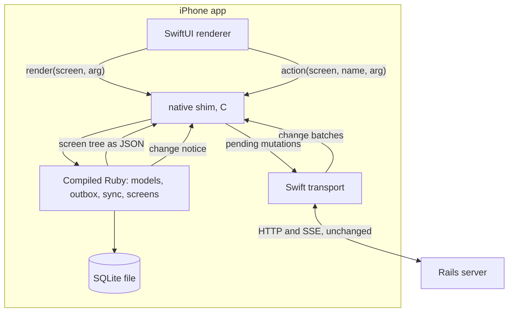

# Native Ruby Views - Plan

## Goal Capsule

- **Objective:** A Rails developer can ship an InstantRecord app as a native iPhone app without writing its models, its sync or its screens a second time in Swift. The Inbox demo is the first app that does.
- **Means:** Ruby runs on the phone. A view written in Ruby returns a description of the screen, and a generic renderer draws it with native iOS controls.
- **Product authority:** Kieran chose the first proof, the Inbox on iPhone with Ruby views. The view style and the phone app's feature set are bets made for him and are his to change.
- **Execution profile:** Two groups, each merged to `main` by the repo's branch-and-merge workflow in `AGENTS.md`. PR1 is the Ruby half and runs on Linux. PR2 is the Swift half and needs a Mac with Xcode.
- **Stop conditions:** Stop if Spinel cannot compile the view layer without rewriting it around a missing Ruby feature (KTD1), or if the emitted app cannot be built as a native library (KTD3). Either one invalidates the first Key Decision and goes back to Kieran.
- **Who finishes:** The agent finishes PR1. PR2 starts when a Mac session is available and Kieran has said the toolchain may be built there.

---

## Product Contract

### Summary

The Inbox demo becomes a native iPhone app whose screens are written in Ruby. The app carries the same model files the server and the browser use, keeps mail in a local database on the phone, and draws each screen with native iOS lists and navigation from a description the Ruby view returns. A screen is one Ruby file, and changing it never means editing Swift.

### Problem Frame

InstantRecord's claim is that a Rails developer gets a local-first app without leaving Ruby. That claim holds in a browser tab and stops at the phone. The only route to iOS today is a web view around the web app, which keeps the code and loses the native feel: no system lists, no native navigation, no swipe actions that behave like Mail.

The alternative is a hand-written Swift app. That means a second copy of the models, a second sync client and a second set of screens, each drifting from the Rails app. It is the same second architecture InstantRecord exists to remove, moved from JavaScript to Swift.

The web demo now runs on Inertia and React, so the browser side is settled. The phone is the remaining place where an InstantRecord app has to leave Ruby.

### Key Decisions

- **Ruby runs on the phone and a generic renderer draws its screens** (session-settled: user-approved — chosen over translating Ruby to SwiftUI source at build time: a translator leaks wherever Ruby and Swift differ and leaves no Ruby on the phone to hold the models). Governs R1, R2, R6.
- **The first proof is the Inbox on iPhone, and the web demo stays on React** (session-settled: user-directed — chosen over one Ruby UI for both web and iPhone, and over porting only the data half: it proves Ruby views on native without reopening the React rebuild). Governs R7, R8.
- **Screens are written in SwiftUI's vocabulary as plain Ruby blocks, one class per screen.** A Rubyist reads it without learning a template language, and an iOS developer recognises every word. This is a bet Kieran has not reviewed. Governs R3, R4.
- **The phone app looks like a stock iOS app.** The point is native feel, and the web demo's paper design would need custom drawing that proves nothing about the idea. Governs R9.
- **Archive is the one write the first version carries.** One write is enough to prove an offline change queues and syncs. Governs R8, R12.

### Requirements

**Writing a screen**

- R1. A screen is written in Ruby and nowhere else. Adding a field to a row, a section to a list or an action to a swipe is a change to one Ruby file.
- R2. The renderer on the phone knows nothing about mail. No Swift names a message, an inbox or any other part of the Inbox app.
- R3. A screen is one Ruby class whose body is built from blocks named after what iOS draws: a list, a section, a row, text, an image, a button, a navigation link, a swipe action.
- R4. A screen reads its data by calling the app's models directly, with the same scopes and associations the Rails app uses.
- R5. A screen can be exercised in plain Ruby tests without a simulator. A test builds the screen and asserts on the description it returns.
- R6. Everything the view layer offers compiles with the same Ruby compiler InstantRecord already uses for the browser. A view never needs a Ruby feature that compiler lacks.

**The Inbox on iPhone**

- R7. The app shows the mailbox as a native scrolling list, with the same messages, order and read state the web demo shows for the same member and inbox.
- R8. Tapping a message opens it on a pushed native screen with a back button and the back swipe. Opening an unread message marks it read. A swipe on a row archives it, and so does a control on the open message.
- R9. Lists, navigation, swipe actions and type come from the system. The app follows the phone's text size and its light or dark setting.
- R10. The first screen appears from the phone's local database with no wait on the network once the app has synced one time.

**Local data and sync**

- R11. The app loads the same model files as the Rails server and the browser build. No model, validation or scope is written again for the phone.
- R12. A write on the phone commits to the local database and shows on screen at once. It is queued in the same transaction and sent to the server in the background.
- R13. A change made elsewhere reaches the phone and appears on the screen that is showing it, with no pull to refresh.
- R14. With no connection the app opens, shows mail and accepts an archive. The archive reaches the server after the connection returns.
- R15. The server needs no change to serve the phone. The phone speaks the sync protocol the browser speaks today.
- R16. A write the server rejects is undone on the phone, as it is in the browser.

### Key Flows

- F1. Read mail
  - **Trigger:** The developer launches the app in the iPhone simulator after one earlier sync.
  - **Steps:** The mailbox list appears from local data. The developer taps a message, reads it on the pushed screen and goes back.
  - **Outcome:** The message shows as read in the list on the phone and, moments later, in the web demo.
  - **Covered by:** R7, R8, R10, R12
- F2. Archive offline
  - **Trigger:** The phone has no connection and the mailbox is on screen.
  - **Steps:** The developer swipes a row to archive it. The row leaves the list. The connection returns.
  - **Outcome:** The message leaves the web demo's list for the same inbox without anyone reloading.
  - **Covered by:** R8, R12, R14
- F3. Change arrives from elsewhere
  - **Trigger:** A message is archived or arrives in the web demo while the phone shows the same inbox.
  - **Steps:** The server sends the change. The phone applies it to its local database.
  - **Outcome:** The phone's list updates in place and keeps its scroll position.
  - **Covered by:** R13
- F4. Change a screen
  - **Trigger:** The developer wants each row to show the sender's address under the name.
  - **Steps:** The developer edits the mailbox screen's Ruby file, runs its Ruby test, rebuilds and launches.
  - **Outcome:** The rows show the address. No Swift file changed.
  - **Covered by:** R1, R2, R5

### Acceptance Examples

- AE1. **Covers R12, R14.** Given the phone is offline with twelve messages listed, when the developer archives one, then eleven remain at once and the web demo still shows twelve. When the phone reconnects, the web demo shows eleven.
- AE2. **Covers R13.** Given the phone shows the mailbox scrolled halfway down, when a new message arrives through the server, then it appears at the top of the list and the rows the developer was reading stay where they were.
- AE3. **Covers R8.** Given an unread message, when the developer opens it and goes back, then its row shows as read without the list reloading.
- AE4. **Covers R16.** Given the server rejects an archive, when the rejection reaches the phone, then the message returns to the list.
- AE5. **Covers R10.** Given the app has synced once and the phone is in airplane mode, when the app is launched cold, then the mailbox list appears with its messages.

### Success Criteria

- Kieran reads the mailbox screen's Ruby file and would be content to have written it.
- Scrolling the mailbox and pushing a message feel like Apple's Mail, with no web view anywhere in the app.
- The Ruby written for the phone is the screens. Counting lines, the app-specific code outside the shared models is view code only.

### Scope Boundaries

**Deferred for later**

- Compose, reply and search on the phone.
- Ruby views drawn in the browser, replacing React. The view layer avoids ideas that only exist on iOS so this stays possible.
- Changing a screen on a running app without a rebuild.
- A real device, signing, TestFlight and the App Store.
- Choosing a member and inbox inside the app. The first version opens as one demo member in one inbox.
- The paper design, custom fonts and the sync inspector from the web demo.
- iPad and Mac layouts.

**Outside this product's identity**

- Translating Ruby into Swift source.
- Screens described by the server and sent to the phone. The phone's own local database is the source of what it shows.
- Android. Nothing here should make it harder, and nothing here builds it.
- A general Ruby toolkit for iOS apps that do not use InstantRecord.

<!-- ce-section: work-relationships -->
### How This Work Fits Together

This plan covers the Inbox as a native iPhone app with Ruby views. The list below is the current understanding of what surrounds it, not a committed roadmap.

- One Ruby UI for web and iPhone. Depends on this plan's view layer proving itself on the phone. Still to decide whether it replaces React in the demos.
- Other demos on the phone, such as Chat and Todo. Can proceed independently once this plan's renderer exists, and would show whether the view vocabulary is wide enough.
- A packaged way for any InstantRecord app to build for iPhone. Depends on this plan. Shares the compile step the browser build uses.

### Dependencies / Assumptions

- Unverified: the C that Spinel emits compiles and links for iOS and its runtime works there. Spinel documents native executables and a WebAssembly runtime, and does not mention iOS.
- Unverified: the models as Roundhouse translates them for the browser run natively against the phone's SQLite, including the outbox and the sync loop.
- Verified in Spinel's README: it emits one C file per program, compiles blocks, procs and `instance_eval` with a block, offers direct C calls through an FFI, and does not support `method_missing`, `eval` of strings, or `define_method` and `send` with names computed at run time. R6 rests on this.
- Building and running an iPhone app needs a Mac with Xcode. The compiler toolchain is documented in `compiled/README.md`.
- The Inbox demo's sync endpoint scopes data by member and inbox through a signed address. The phone reuses that scoping unchanged, per R15.

### Sources / Research

- `README.md`: the two runtimes, and the claim that one model file runs on both.
- `compiled/README.md` and `lib/instant_record/compiler.rb`: the Roundhouse and Spinel build that produces the browser app.
- `docs/brainstorms/2026-11-19-inbox-inertia-react-requirements.md`: the web Inbox's requirements, which this plan mirrors for read, open and archive.
- `lib/instant_record/inertia.rb` and `frontend/`: how the web UI learns that local records changed.
- Spinel, `https://github.com/matz/spinel`, at `282d00572`: README and `docs/limitations.md` for the supported Ruby subset, `docs/FFI.md` for direct C calls.

---

## Planning Contract

### Key Technical Decisions

- KTD1. **A screen builds a tree of one node class and the bridge sends it as JSON.** Spinel infers types across the whole program, so every node is the same class with the same fields: a kind, an identity, text, string properties, an action and children. Builder methods push a node, `yield`, and pop. Nothing uses `method_missing`, `instance_eval`, or `send` with a computed name, which Spinel does not compile. Serves R3, R5, R6.
- KTD2. **A tap is a named action with one string argument, handled by a `case` in the screen.** The host sends the screen name, the action name and the argument. The screen writes through the models and returns. Navigation is a node property naming the next screen and its argument, so the host pushes without asking Ruby. Serves R1, R2, R8.
- KTD3. **The phone runs the same emitted app as the browser, behind a native reactor.** Roundhouse already emits a native Spinel project, and `compiled/pipeline/make_wasm_entry.py` replaces its server loop with entry points a host calls. The native build adds a sibling entry with the same calls plus render and action, and links it as a static library instead of a WASI module. (session-settled: user-approved — chosen over translating Ruby to SwiftUI source at build time: a translator leaks wherever Ruby and Swift differ and leaves no Ruby on the phone to hold the models.) Serves R4, R11, R12, R15, R16.
- KTD4. **The host owns the network and Ruby owns the data, as in the browser.** The worker in `compiled/web/src` fetches and streams, then hands bytes to Ruby through the reactor. The Swift runtime does the same with `URLSession`. Serves R13, R14, R15.
- KTD5. **A change redraws the whole screen description and SwiftUI keeps identity by node id.** Ruby's existing change notice tells the host which record types changed, the host asks for the visible screens again, and rows keep their place because each row's identity is its record id. No diffing in Ruby. Serves R13 and AE2.
- KTD6. **The host and Ruby exchange strings through memory, not files.** The browser build passes data through `/host/in` and `/host/out` because WASI gives it a filesystem. The native shim keeps one input and one output buffer and exposes them to Ruby through Spinel's FFI.
- KTD7. **The view layer ships in the gem and the Inbox screens ship in the demo.** This follows the Inertia helpers, which live in `lib/instant_record/inertia.rb` with the demo as their first user.

### High-Level Technical Design



A node carries `kind`, `id`, `text`, `props`, `action` and `children`. The first vocabulary is `navigation`, `list`, `section`, `row`, `stack`, `text`, `image`, `button`, `link`, `swipe` and `toolbar`. This is direction for the implementer, not a schema to copy.

```ruby
class MailboxScreen < InstantRecord::Native::Screen
  def body
    navigation title: "Support" do
      list do
        entries.each do |entry|
          row id: entry.id, link: "thread", arg: entry.id do
            text entry.author, style: "headline"
            text entry.subject
            swipe "Archive", action: "archive", arg: entry.id, role: "destructive"
          end
        end
      end
    end
  end

  def perform(action, arg)
    case action
    when "archive" then archive(arg)
    end
  end
end
```

### Assumptions

- The Inbox demo's mail is `MailEntry` rows synced by `Email::SyncController`, with archive and read stored as appended entries. The phone's writes go through the same path the compiled browser app uses for `Email::MailboxesController#create`.
- Roundhouse does not translate arbitrary classes under `app/`. Screens reach the emitted project the way `compiled/pipeline/vendor_gem.py` brings in gem sources, as an overlay step after emit.
- The cloud container can build Spinel at `7c56323d2` and Roundhouse at `b937108ce` from source. It has no Swift and no Xcode.

### Sequencing

U1 and U2 need only CRuby. U3 needs Spinel. U4 needs Spinel, Roundhouse and the SQLite amalgamation, and is the first unit that tests KTD3. U5 through U7 need a Mac and start from U4's library.

### Risks & Dependencies

- Spinel's type inference may reject a builder that CRuby accepts, for example a hash of mixed value types or a block that returns different types. U3 exists to find this before any Swift is written.
- The emitted `main.rb` may assume its TCP server or threads in ways the wasm tree removes with `compiled/pipeline/make_wasm_tree.py`. The native reactor may need the same single-threaded copy.
- Spinel's runtime has not been built for iOS. If it uses calls iOS forbids, such as `system` or `fork`, U6 needs stubs.
- Spinel and Roundhouse are pinned commits of fast-moving projects. The native build uses the same pins as the browser build.

---

## Implementation Units

### PR1: Ruby views and a native reactor, verified on Linux

Waits on: nothing.

### U1. View layer in the gem

- **Goal:** A screen class returns a tree and the tree serialises to JSON, under CRuby.
- **Requirements:** R1, R3, R5.
- **Files:** `lib/instant_record/native.rb`, `lib/instant_record/native/node.rb`, `lib/instant_record/native/screen.rb`, `lib/instant_record.rb`, `test/native_screen_test.rb`.
- **Approach:** Per KTD1 and KTD2. Write JSON by hand in the node so the compiled build does not depend on how Spinel's JSON package treats nested objects. Keep every property value a string.
- **Test Scenarios:** A screen with a list of rows returns nested nodes in order. A row carries its id, link target and argument. A swipe carries its action and argument. Text with quotes, newlines and non-ASCII characters round-trips through `JSON.parse`. An empty list returns a list node with no children. `perform` with an unknown action does nothing and does not raise. A registry returns a screen by name and raises on an unknown name.
- **Verification:** `bundle exec rake test`.

### U2. Inbox screens in the demo

- **Goal:** `MailboxScreen` and `ThreadScreen` describe the Inbox from `MailEntry` rows and perform read and archive.
- **Requirements:** R4, R7, R8, R12.
- **Files:** `demo/app/screens/mailbox_screen.rb`, `demo/app/screens/thread_screen.rb`, `demo/test/screens/mailbox_screen_test.rb`, `demo/test/screens/thread_screen_test.rb`, `demo/config/application.rb` if the directory needs registering.
- **Approach:** Reuse the queries in `demo/app/controllers/email/mailboxes_controller.rb` for the open list, unread marks and thread. Move a query into `MailEntry` only where both the controller and a screen then call it. Writes append `archive` and `read` entries the way `append_entry` does.
- **Test Scenarios:** The mailbox lists open messages newest first for one member and inbox. An archived message is absent. An unread message carries the unread property and a read one does not. Covers AE3: performing `open` on an unread message appends a `read` entry and the next render shows it read. Covers AE1: performing `archive` removes the row from the next render. The thread screen shows the message, its replies in order and an archive control. A thread id from another inbox renders an empty state.
- **Verification:** `cd demo && bin/rails test test/screens`.

### U3. The view layer compiles with Spinel

- **Goal:** The gem's view layer and a sample screen compile with Spinel to a native executable whose output equals CRuby's.
- **Requirements:** R6.
- **Files:** `compiled/pipeline/native/sample_screen.rb`, `compiled/pipeline/native/check_views.py`, `test/native_spinel_test.rb`, `compiled/README.md`.
- **Approach:** The sample screen uses every node kind and builds rows from an array of plain objects, with no database. The check compiles it with `spinel`, runs it, and compares its JSON with the same file run under `ruby`. The test skips with a message when no toolchain is configured.
- **Test Scenarios:** The compiled binary prints the same JSON as CRuby for the sample screen. An action that mutates the sample data changes the next render in both. Strings with quotes and non-ASCII characters match byte for byte.
- **Verification:** `INSTANT_RECORD_TOOLCHAIN=<path> bundle exec rake test TEST=test/native_spinel_test.rb`.

### U4. Native reactor for the emitted app

- **Goal:** The demo builds as a native library with boot, render, action and the existing sync entry points, and a host program drives the Inbox against a SQLite file.
- **Requirements:** R10, R11, R12, R14, R16.
- **Files:** `compiled/pipeline/make_native_entry.py`, `compiled/pipeline/native_shim.c`, `compiled/pipeline/native/host_check.c`, `compiled/pipeline/build_native.py`, `lib/instant_record/compiler.rb`, `lib/tasks/` for an `instant_record:compile_native` task, `compiled/README.md`.
- **Approach:** Per KTD3 and KTD6. Start from `make_wasm_entry.py` and `reactor_shim.c` and share what is common instead of copying it. Overlay the gem's view layer and the demo's screens into the emitted project. Build for the host architecture first. The host check is a small C program that boots, seeds a mailbox through the sync entry point with a recorded bootstrap payload, renders the mailbox, archives a message and renders again.
- **Test Scenarios:** Boot twice against the same file keeps its rows, covering AE5 without a network. Render of the mailbox returns one row per open message. Covers AE1: after `archive`, the row is gone and the pending mutation count is one. Covers AE4: feeding a rejection for that mutation restores the row. A change batch for a new message produces a change notice and the next render includes it.
- **Verification:** `INSTANT_RECORD_TOOLCHAIN=<path> python3 compiled/pipeline/build_native.py --check`.

### PR2: The iPhone app

Waits on: PR1 merged. Needs a Mac with Xcode and the compiler toolchain.

### U5. Swift runtime and renderer

- **Goal:** A Swift package that boots the library, decodes a screen tree and draws it with SwiftUI.
- **Requirements:** R2, R9, R13.
- **Files:** `native/ios/InstantRecordNative/Package.swift`, `native/ios/InstantRecordNative/Sources/InstantRecordNative/`, `native/ios/InstantRecordNative/Tests/`.
- **Approach:** Per KTD4 and KTD5. One `Node` type decoded from JSON and one recursive view that switches on `kind`. A runtime object owns the C calls on a serial queue. A transport object drains pending mutations and feeds change batches.
- **Test Scenarios:** A tree with every node kind decodes. An unknown kind draws nothing and does not crash. Two renders with the same row ids keep SwiftUI identity. A change notice triggers one re-render of the visible screens.
- **Verification:** `swift test` in `native/ios/InstantRecordNative`.

### U6. Inbox app in the simulator

- **Goal:** The Inbox runs in the iPhone simulator against a local Rails server.
- **Requirements:** R7 through R16.
- **Files:** `native/ios/Inbox/`, `compiled/pipeline/build_native.py` for the iOS simulator and device architectures, `native/ios/README.md`.
- **Approach:** A thin app target that links U4's library built for the simulator and names the first screen. No file in it mentions mail apart from the screen name and the sync address.
- **Test Scenarios:** F1 through F4 and AE1 through AE5, each run by hand in the simulator with the web demo open beside it, with a screenshot kept for each.
- **Verification:** `xcodebuild -scheme Inbox -destination 'platform=iOS Simulator,name=iPhone 17' build`, then the flows above.

### U7. Documentation

- **Goal:** A reader can find the idea, the view vocabulary and the build steps.
- **Requirements:** R1, R3.
- **Files:** `README.md`, `compiled/README.md`, `CHANGELOG.md`.
- **Approach:** State plainly which parts have run and which have not, on which machine.
- **Verification:** Read through against the code.

---

## Verification Contract

| Check | Command | Applies to |
|---|---|---|
| Gem tests | `bundle exec rake test` | U1, U3, U4 |
| Demo tests | `cd demo && bin/rails test` | U2 |
| Views under Spinel | `INSTANT_RECORD_TOOLCHAIN=<path> bundle exec rake test TEST=test/native_spinel_test.rb` | U3 |
| Native reactor | `INSTANT_RECORD_TOOLCHAIN=<path> python3 compiled/pipeline/build_native.py --check` | U4 |
| Swift package | `swift test` in `native/ios/InstantRecordNative` | U5 |
| Simulator | `xcodebuild` build, then F1 through F4 by hand | U6 |

Per `AGENTS.md`, merge `origin/main` into the branch and run the gem and demo suites on that result before merging to `main`.

---

## Definition of Done

- Every unit in the group being merged passes its verification, and the commit says what ran and what did not.
- The browser build is unchanged: `compiled/pipeline/build.py` produces the same app, and the existing gem and demo suites pass.
- Anything that has not run on an iPhone simulator is described as unverified wherever the docs mention it.
- No abandoned experiment, scratch harness or copied-and-unused pipeline code remains in the diff.
- PR1 is done when U1 through U4 hold. The Objective is met only when U6 holds.
