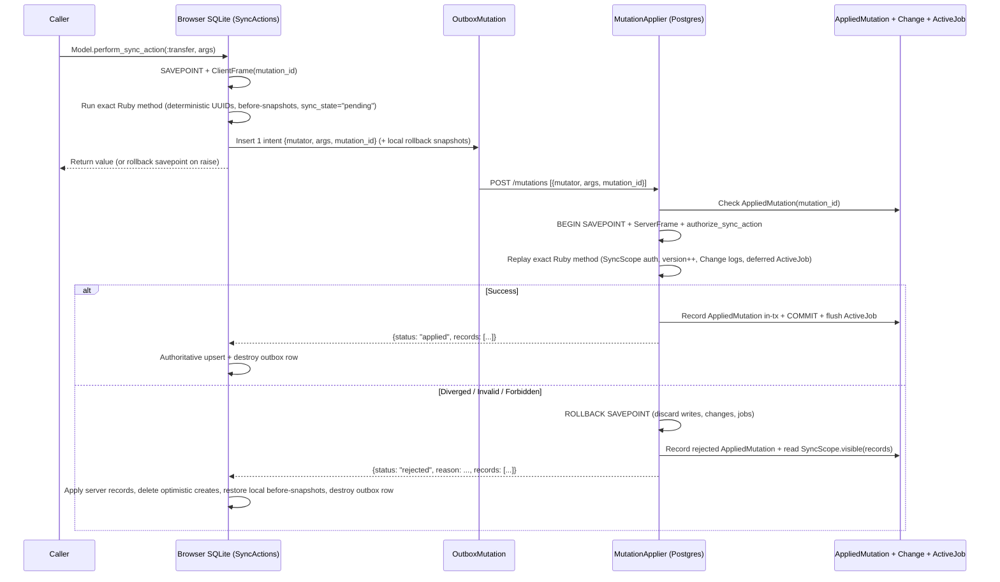

# Dual-Runtime Transactional Custom Mutators (sync_action) - Plan

## Goal Capsule

- **Objective:** Application authors can write multi-row or invariant-checked domain writes once in Ruby and execute them optimistically in local SQLite and authoritatively in Postgres as one atomic intent with unified auth, idempotency, transactional job enqueueing, and clean client rollback on divergence.
- **Means:** Declarative `sync_action` DSL with `EntryBuilder`-generated static `case` dispatch for Spinel, single-intent outbox queueing inside a savepoint, and transactional server replay in `MutationApplier` (KTD1–KTD6).
- **Authority hierarchy:** `AGENTS.md` workflow rules (no pull requests; merge `origin/main`, test, merge `--no-ff` into `main`, push, delete branch) outrank everything; Product Contract requirements govern behavior; Planning Contract KTDs govern mechanism.
- **Stop conditions:** Tests fail after implementation, `origin/main` moves with a non-trivial merge conflict, or `git push` is refused.
- **Execution profile:** Single branch (`feat/dual-runtime-custom-mutators`), merged `--no-ff` into `main` per `AGENTS.md`. Gem-only changes (`lib/`, `app/`, `test/`); `demo/` stays untouched.

## Product Contract

### Summary

Add declarative dual-runtime transactional custom mutators (`sync_action`) to InstantRecord so domain operations run the exact same Ruby method optimistically in local SQLite and authoritatively in Postgres. Client execution runs inside a savepoint, suppresses per-row outbox mutations, and queues one `{ mutator, args, mutation_id }` intent. Server `MutationApplier` replays the method inside one transaction with `AppliedMutation` idempotency, unified authorization, commit-safe `ActiveJob` enqueueing, and authoritative rollback payloads when server state diverges.

### Problem Frame

Today `InstantRecord::Syncable` records only flat single-row `saved_changes` in `OutboxMutation` (`lib/instant_record/syncable.rb:120-135`), and `MutationApplier` applies each row in an isolated savepoint (`app/models/instant_record/mutation_applier.rb:34-36`). Multi-row invariants, server-side sequence allocations, and transactional background jobs cannot travel through the sync protocol without splitting `server_only` and `browser_only` write paths (as seen in `demo/app/controllers/email/mailboxes_controller.rb:147-150, 185-187`).

### Requirements

#### Declaration and Dispatch

R1. Models including `InstantRecord::Syncable` (or any class including `InstantRecord::SyncActions`) can declare custom mutators with `sync_action :action_name` backed by `def self.action_name(...)` (0-arg, single `args` hash, or keyword arguments), and CRuby callers/tests can also pass an inline block `sync_action :action_name do |args| ... end`.

R2. Callers execute a declared mutator identically in browser and server runtimes via `Model.perform_sync_action(:action_name, args = {}, mutation_id: nil)` or `InstantRecord.mutate("Model.action_name", args = {}, mutation_id: nil)`, returning the mutator method's return value.

R3. In compiled browser (Wasm) and native builds, `EntryBuilder` statically discovers all `sync_action` declarations from `app/models/**/*.rb` using Prism and emits a `case` dispatcher in `main_wasm.rb` and `main_native.rb` with zero `send`, `public_send`, or `constantize`.

#### Client Optimistic Execution and Rollback

R4. Executing a `sync_action` in browser runtime runs inside a SQLite savepoint, suppresses per-row `OutboxMutation` inserts for all Syncable writes inside the action, marks modified/created records `sync_state = "pending"`, captures pre-mutation rollback snapshots for touched rows, and creates exactly one `OutboxMutation` intent in the same savepoint.

R5. If the mutator raises in browser runtime, the SQLite savepoint rolls back all local row writes and queues zero outbox rows.

R6. Any Syncable record created inside a `sync_action` without an explicit `id` receives a deterministic RFC 4122-formatted UUID derived from `(mutation_id, sequence)` so client and server assign identical IDs when replaying the same intent.

R7. When `Client.apply_results` processes an `applied` mutator result, it reconciles all returned server records authoritatively (marking them `synced` with server versions/attributes and removing destroyed rows) and removes the outbox row.

R8. When `Client.apply_results` processes a `rejected` mutator result, it applies any authoritative server `records` returned by the server, deletes optimistically created local rows absent from the server payload, restores local pre-mutation snapshots for optimistically updated or destroyed rows not overridden by server state, and removes the outbox row.

R9. Identity resets (`Client.reset`) drop queued mutator intents whose owner model or locally touched models intersect the reset types.

#### Server Authoritative Replay

R10. `MutationApplier.apply` accepts custom mutator intents (`{ mutator:, args:, mutation_id: }` or outbox-shaped `{ id:, operation: "mutator", mutator:, args:, record_type: }`), enforces `AppliedMutation` idempotency on `mutation_id`, and replays only explicitly declared `sync_action` methods inside one transaction (`requires_new: true`).

R11. During server replay, every Syncable record created, updated, or destroyed gets its `server_version` assigned/incremented, `sync_state = "synced"`, an `InstantRecord::Change` row in the same transaction, and is returned in the result's `records` array.

R12. Server replay enforces unified authorization: optional `authorize_sync_action` hooks on the mutator class plus `SyncScope` (`sync_scope`, `syncable_to`, `writable_by`) visibility and pre/post-write writability checks on every touched Syncable record; any violation raises `NotPermitted` and rolls back the entire transaction.

R13. `ActiveJob` jobs enqueued inside a server `sync_action` transaction are only dispatched when the transaction commits; rolled-back or rejected mutators enqueue zero jobs, and idempotent replays do not re-enqueue jobs.

R14. When server state diverges or fails validation/auth (`RecordInvalid`, `RecordNotFound`, `RecordNotUnique`, `ArgumentError`, `NotPermitted`, `MutationRejected`, or unknown mutator), `MutationApplier` rolls back the transaction, records the rejection in `AppliedMutation`, and returns `{ mutation_id:, status: "rejected", reason:, records: [...] }` where `records` contains authoritative post-rollback server rows filtered through `SyncScope.visible` (and re-filtered per requester on idempotent replay so hidden records never leak).

R15. `InstantRecord::MutationsController#create` permits custom mutator payloads (including nested JSON `args`), rejects stale-identity mutators, and returns their results alongside ordinary row mutations in the same batch.

### Scope Boundaries

- **In scope:** Gem runtime (`lib/instant_record/`), engine (`app/models/instant_record/`, `app/controllers/instant_record/`), compiler (`EntryBuilder`, `GemVendor`), and comprehensive gem test suite (`test/`).
- **Out of scope:** Modifying `demo/` (its `Email::SyncController` is a custom non-Syncable showcase and its test suite requires Postgres.app trust auth unavailable in headless runs) and adding new database migrations to `instant_record_outbox`.

## Planning Contract

### Key Technical Decisions

KTD1. **Zero-migration outbox encoding.** Store custom mutator intents in the existing `instant_record_outbox` table (`operation: "mutator"`, `record_type: owner_class`, `record_id: mutator_name`, `changes_payload: { "mutator" => ..., "args" => ..., "touched" => [...] }`). `OutboxMutation#as_mutation` strips local `"touched"` rollback snapshots and emits `{ id:, mutation_id:, operation: "mutator", record_type:, mutator:, args: }`. Chosen over adding outbox columns because existing browser SQLite databases and consumer apps gain `sync_action` with zero schema migration. (Governs R4, R8, R9, R10.)

KTD2. **Static `EntryBuilder` `case` dispatch with Prism inspection.** `InstantRecord::SyncActions` holds a `dispatch(name, args)` method: on CRuby it dispatches via the registered `sync_action` table; in compiled builds `EntryBuilder` scans `app/models/**/*.rb` with Prism (already a compiler dependency in `browser_migrations.rb`), inspects each declared `sync_action` and matching `def self.<name>` signature, and rewrites `InstantRecord::SyncActions.dispatch` in `main_wasm.rb` and `main_native.rb` to a static `case` statement. Block-form `sync_action` declarations in compiled apps raise `Compiler::BuildError` with clear guidance to define `def self.<name>(args)`. Chosen over runtime `send`/`constantize` because Spinel compiles Ruby ahead-of-time with no dynamic dispatch. (Governs R1, R3.)

KTD3. **Pure-Ruby 32-bit-safe SHA-256 deterministic UUIDs.** Inside an active mutator frame, blank primary keys derive UUIDs from SHA-256 of `"#{mutation_id}:#{seq}"` formatted as RFC 4122 UUIDv5 (`8-4-4-4-12`). All arithmetic uses unsigned 32-bit masked words with `^ 0xFFFFFFFF` (no multiplication, max intermediate `< 2^35`), avoiding `-DSP_INT_OVERFLOW_MODE_RAISE` traps in Spinel and guaranteeing byte-identical UUIDs across CRuby and Spinel without `Digest`. (Governs R6.)

KTD4. **Fiber-local client/server mutator frames on `Syncable`.** `SyncActions` tracks active execution frames via `ActiveSupport::IsolatedExecutionState` (already used by `InstantRecord.applying_client_mutation?`). Client frames capture pre-write snapshots via `before_update`/`before_destroy` and `after_create` while suppressing `OutboxMutation.create!`. Server frames hook `Syncable` callbacks (`before_create`, `after_create`, `before_update`, `after_update`, `before_destroy`, `after_destroy`, and `server_only` `after_find`) to enforce `SyncScope`, version bumps, `Change` logging, and read/write reference collection for post-rollback rejection payloads. On server success, `AppliedMutation` is written inside the same transaction so writes, changes, and idempotency commit atomically. (Governs R4, R5, R10, R11, R12, R14.)

KTD5. **Commit-guarded `ActiveJob` enqueueing.** Prepend a small server-only `ActiveJobCommitGuard` onto `ActiveJob::Base` (via `ActiveSupport.on_load(:active_job)` and immediate install if `ActiveJob::Base` is already loaded). When a non-DB queue adapter enqueues a job inside an active server mutator frame and `enqueue_after_transaction_commit` is not already deferring it, defer the enqueue onto `ActiveRecord::Base.connection.current_transaction.after_commit`. DB-transactional adapters (e.g., SolidQueue) execute inside the Postgres transaction naturally; non-DB adapters defer until commit and discard on rollback. (Governs R13.)

KTD6. **Dual-runtime savepoint seam.** `SyncActions.with_savepoint(&block)` calls `ActiveRecord::Base.transaction(requires_new: true, &block)` on CRuby. `GemVendor` replaces `with_savepoint` in compiled builds with native SQLite `SAVEPOINT` / `RELEASE SAVEPOINT` / `ROLLBACK TO SAVEPOINT` via `Db.exec`, supporting both top-level and nested savepoints in Spinel. (Governs R4, R5.)

### High-Level Technical Design

## Implementation Units

### U1. `SyncActions` Core DSL, Deterministic UUIDs, Client Savepoint & Outbox Intent

- **Goal:** Implement `InstantRecord::SyncActions` DSL, deterministic UUID generator, client savepoint execution, `OutboxMutation` mutator encoding, `Syncable` integration, and `InstantRecord.mutate`.
- **Requirements:** R1, R2, R4, R5, R6.
- **Files:**
  - `lib/instant_record/sync_actions.rb` (new)
  - `lib/instant_record/syncable.rb`
  - `lib/instant_record/outbox_mutation.rb`
  - `lib/instant_record.rb`
- **Approach:**
  - Create `lib/instant_record/sync_actions.rb` with:
    - `InstantRecord::MutationRejected < StandardError`
    - `InstantRecord::SyncActions` concern (`sync_action`, `authorize_sync_action`, `perform_sync_action`, `instant_record_sync_actions`, `instant_record_action_authorizer`)
    - Module-level registry (`register`, `resolve`, `dispatch`, `reset_registry!`), `mutate(mutator_name, args = {}, mutation_id: nil)`, `with_savepoint`, pure-Ruby 32-bit-safe `deterministic_uuid(mutation_id, seq)`, JSON-safe `normalize_args`, `ClientFrame`, and `ServerFrame`.
  - Update `lib/instant_record/syncable.rb` to include `InstantRecord::SyncActions` and hook client/server mutator frames into `assign_instant_record_uuid`, `before_save`/`before_update`/`before_destroy`, `after_create`/`after_update`/`after_destroy`, and `server_only { after_find ... }`.
  - Update `lib/instant_record/outbox_mutation.rb` with `mutator?`, `mutator_name`, `mutator_args`, `touched_records`, and mutator-aware `as_mutation`.
  - Update `lib/instant_record.rb` to require `instant_record/sync_actions` on `:active_record` load and expose `InstantRecord.mutate`.
- **Test Scenarios:**
  - Client `perform_sync_action` / `InstantRecord.mutate` runs inside a savepoint, writes multiple rows, marks them `pending`, and queues exactly one `operation: "mutator"` outbox row with `{ mutator, args, mutation_id }` on the wire.
  - Raising inside a browser `sync_action` rolls back all local writes and leaves zero outbox rows.
  - Deterministic UUIDs match across browser and server runs for the same `mutation_id` and sequence.
  - Direct server invocation runs in one transaction, bumps versions, logs `Change` rows, and writes zero outbox rows.
- **Verification:** `bundle exec ruby -Ilib:test test/sync_actions_test.rb`

### U2. Server `MutationApplier`, Unified Auth, Commit-Safe `ActiveJob`, and `MutationsController`

- **Goal:** Replay custom mutator intents authoritatively in `MutationApplier` inside one transaction with idempotency, unified auth, transactional `ActiveJob` enqueueing, rejection payloads, and controller support.
- **Requirements:** R10, R11, R12, R13, R14, R15.
- **Files:**
  - `app/models/instant_record/mutation_applier.rb`
  - `app/controllers/instant_record/mutations_controller.rb`
  - `lib/instant_record/sync_actions.rb` (ActiveJob commit guard + server hook)
  - `lib/instant_record/engine.rb`
- **Approach:**
  - Detect mutator payloads in `MutationApplier` (`@mutation[:mutator].present? || @mutation[:operation] == "mutator"`), resolve `mutation_id = @mutation[:mutation_id] || @mutation[:id]`.
  - Add `apply_mutator`: check `AppliedMutation` first (re-filtering `records` through `SyncScope.visible` on replay); validate registered action and synced-model allowlist; run inside `ActiveRecord::Base.transaction(requires_new: true)` with `ServerFrame`, `authorize_sync_action`, and `Syncable` server mutator callbacks; persist `AppliedMutation` inside the same transaction on success.
  - Rescue `NotPermitted`, `MutationRejected`, `ArgumentError`, `ActiveRecord::RecordInvalid`, `ActiveRecord::RecordNotFound`, `ActiveRecord::RecordNotUnique`, `ActiveModel::UnknownAttributeError`: roll back savepoint, collect authoritative post-rollback `records` via `SyncScope.visible`, and record rejection in `AppliedMutation`.
  - Install `ActiveJobCommitGuard` via `ActiveSupport.on_load(:active_job)` (and immediately if `ActiveJob::Base` is defined) so jobs enqueued inside a `ServerFrame` on non-DB adapters defer to `current_transaction.after_commit`.
  - Update `MutationsController#create` to permit `:mutation_id`, `:mutator`, and recursive JSON-safe `args`, and enforce stale-identity rejection for mutators whose owner model is in `stale`.
- **Test Scenarios:**
  - Multi-row mutator replays atomically in one transaction, bumps versions, logs `Change` rows, writes `AppliedMutation`, and returns `applied` + `records`.
  - Idempotent replay returns original result without re-running domain logic, re-logging changes, or re-enqueuing jobs; replay by another identity hides records invisible to them.
  - `authorize_sync_action`, `sync_scope`, `syncable_to`, and `writable_by` (pre- and post-update, hidden records, cross-scope writes) all reject and roll back completely.
  - `ActiveJob` enqueued inside a mutator fires on commit, does NOT fire on rollback/rejection, and does NOT double-fire on replay.
  - Diverged server state (e.g., validation failure or `ArgumentError` after reading a row) rolls back and returns authoritative visible `records`.
  - `MutationsController` accepts mixed batches of row mutations and custom mutators (with nested `args` hashes/arrays) and rejects stale-identity mutators.
- **Verification:** `bundle exec ruby -Ilib:test test/sync_actions_test.rb`

### U3. Client Reconciliation and Identity Reset for Mutator Intents

- **Goal:** Reconcile `applied` and `rejected` custom mutator results cleanly in `InstantRecord::Client`, and drop scoped mutators on identity reset.
- **Requirements:** R7, R8, R9.
- **Files:**
  - `lib/instant_record/client.rb`
- **Approach:**
  - In `Client.apply_results`, branch on `mutation.mutator?`:
    - `applied`: apply each entry in `result["records"]` (destroy if `"destroy"`, otherwise `upsert_from_server(..., authoritative: true)`), and mark any remaining touched local records synced if absent from `records`.
    - `rejected`: apply every authoritative server record in `result["records"]` via `upsert_from_server(..., authoritative: true)`; then for each locally-touched snapshot in `mutation.touched_records` not already reconciled from `result["records"]`, delete if `op == "create"` or restore the `before` snapshot (preserving prior `server_version` and `sync_state`) if `op == "update"` or `"destroy"`.
  - In `Client.reset`, destroy a queued mutator row if `types.include?(mutation.record_type)` OR any of `mutation.touched_records` has its `"type"` in `types`.
- **Test Scenarios:**
  - End-to-end client optimistic multi-row mutator -> server `MutationApplier` applied -> `Client.apply_results` converges all rows to `synced` with server versions and clears outbox.
  - End-to-end diverged server state -> server rejects with authoritative rows -> client updates modified rows to server state, deletes optimistically created rows, restores optimistically destroyed rows, and clears outbox.
  - Early rejection with empty `records` (e.g., auth failure) restores all local `before` snapshots cleanly and deletes optimistic creates.
  - `Client.reset` drops queued mutators touching reset types while preserving unscoped mutators.
- **Verification:** `bundle exec ruby -Ilib:test test/sync_actions_test.rb`

### U4. Compiler Support (`GemVendor` + `EntryBuilder` Static `case` Dispatch)

- **Goal:** Make `sync_action` 100% Spinel-compatible in compiled Wasm and native builds via Prism discovery and generated `case` dispatch with zero `send`/`constantize`.
- **Requirements:** R3.
- **Files:**
  - `lib/instant_record/compiler/gem_vendor.rb`
  - `lib/instant_record/compiler/entry_builder.rb`
  - `lib/instant_record/compiler/wasm_build.rb`
  - `test/compiler_test.rb`
- **Approach:**
  - Add `lib/instant_record/sync_actions.rb` to `GemVendor::COPY`.
  - In `GemVendor#apply_core_seams`, patch `lib/instant_record/sync_actions.rb` for Spinel:
    - Replace `with_savepoint` with SQLite `SAVEPOINT` / `RELEASE SAVEPOINT` / `ROLLBACK TO SAVEPOINT` via `Db.exec`.
    - Strip CRuby-only dynamic dispatch/ActiveJob guard helpers so zero `send`/`public_send`/`constantize` exist in the vendored file.
  - In `EntryBuilder`, add `discover_sync_actions(app_dir)` using Prism to parse `app/models/**/*.rb` (walking nested `ModuleNode`/`ClassNode` namespaces, finding `sync_action :name` calls, rejecting block-form `sync_action` with `BuildError`, and matching `def self.<name>` parameter shape: 0-arg, 1 positional arg, or keyword args).
  - Emit a generated `SyncActions` dispatcher (`InstantRecord::SyncActions.dispatch(name, args)` using a static `case name`) in both `write_wasm_entry` and `write_native_entry`.
  - Update `WasmBuild#emit_tree` to pass `app_dir: app` into `EntryBuilder.write_wasm_entry` (with `app_dir: nil` default for backward compatibility in unit tests).
  - Update `test/compiler_test.rb` (`GemVendor` file count + new tests verifying Prism discovery, nested namespaces, keyword/positional/zero-arg dispatch generation, zero `send`/`constantize` in generated entry + vendored `sync_actions.rb`, and `BuildError` on block-form `sync_action`).
- **Test Scenarios:**
  - `EntryBuilder` generates static `case` dispatch in both `main_wasm.rb` and `main_native.rb` for top-level and namespaced models with hash-arg, keyword-arg, and zero-arg mutators.
  - Generated and vendored files contain zero `send`, `public_send`, or `constantize` calls for `sync_action` dispatch.
  - Block-form `sync_action` in a compiled app raises `InstantRecord::Compiler::BuildError`.
  - Full stub-toolchain `Compiler.build` and `Compiler.build_native` pass with a consumer app declaring `sync_action`.
- **Verification:** `bundle exec rake test`

## Verification Contract

- Primary gem test suite: `bundle exec rake test` (must exit 0 with 0 failures and 0 errors).
- New dedicated test file `test/sync_actions_test.rb` covering:
  - DSL declarations (hash arg, keyword arg, zero arg, block form, unknown action)
  - Client SQLite savepoint atomicity & rollback on error
  - Deterministic UUID parity across browser and server
  - Server `MutationApplier` transactionality, `AppliedMutation` idempotency, replay visibility filtering
  - Unified auth (`authorize_sync_action`, `sync_scope`, `syncable_to`, `writable_by`)
  - In-transaction / commit-guarded `ActiveJob` enqueueing (commit, rollback, replay)
  - Diverged-state rejection payloads and end-to-end client rollback (create/update/destroy)
  - `Client.reset` with mutators
  - `MutationsController` HTTP JSON integration (mixed batches, nested `args`, stale identity)
- Compiler tests in `test/compiler_test.rb` proving `EntryBuilder` static `case` generation and `GemVendor` Spinel seams.

## Definition of Done

- All requirements R1–R15 are implemented and verified by automated tests.
- Zero `send`/`public_send`/`constantize` in compiled `sync_action` dispatch or vendored `sync_actions.rb`.
- No dead-end or experimental code remains in the diff.
- `origin/main` is merged into `feat/dual-runtime-custom-mutators`, `bundle exec rake test` passes on the merged result, the branch is merged `--no-ff` into `main`, `main` is pushed, and the feature branch is deleted per `AGENTS.md`.
