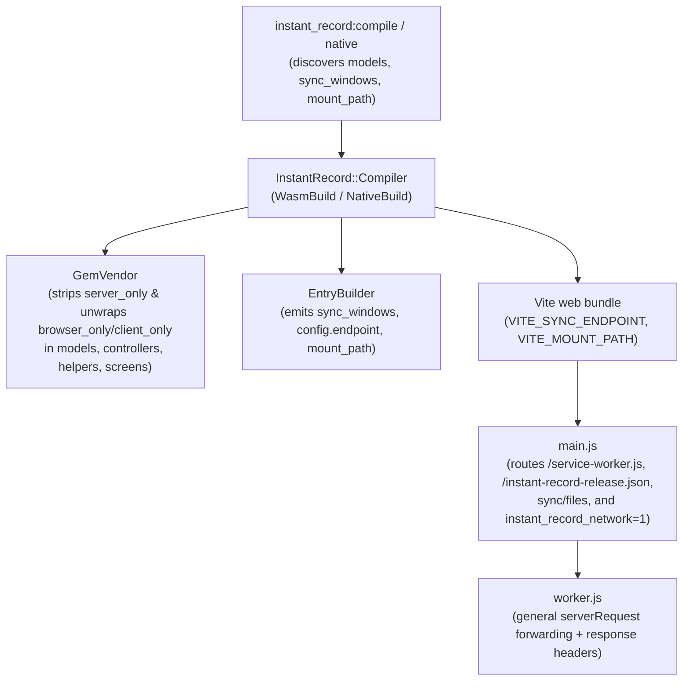

# InstantRecord 0.3.0 Gem Readiness, Consumer App Fixes, and Release Prep - Plan

## Goal Capsule

- **Objective:** A Rails developer who installs the `instant_record` gem (0.3.0) in their own Rails 8 app can follow the README and generators to declare synced models (including `browser_only`/`client_only` blocks, `sync_window`, `sync_scope`/`syncable_to`, `sync_file`, and `InstantRecord.server_url`), check their toolchain, compile, host, and build an accurate, warning-free gem release announced in `CHANGELOG.md` on `main`.
- **Means:** Fix every demo-only hardcode and consumer-app gap in the compiler, browser worker, middleware, and rake tasks; polish the install generator and gemspec; align `VERSION` (`0.3.0`), `CHANGELOG.md`, `README.md`, and `compiled/README.md` with reality; and ship via the repo's branch-and-merge workflow (`AGENTS.md`).
- **Authority hierarchy:** `AGENTS.md` (no PRs; branch, merge `origin/main`, test, `git merge --no-ff` to `main`, push `main`, delete branch) > this plan's Requirements > Planning Contract KTDs > Implementation Units.
- **Execution profile:** Single branch (`feat/gem-0-3-0-release-readiness`) merged to `main` per `AGENTS.md`.
- **Stop conditions:** Stop and report if gem tests (`bundle exec rake test`), JS tests (`node --test`), or `gem build` fail after fixes, or if `git push origin main` is refused.

---

## Product Contract

### Summary

Bring the `instant_record` gem to a clean, consumer-ready `0.3.0` release on `main`. Fix five concrete defects that currently work only in the repository's demo app (or fail in consumer apps), clean up gem packaging and the install generator, and update `CHANGELOG.md`, `README.md`, and `compiled/README.md` so every documented capability matches what the gem actually ships.

### Problem Frame

Recent feature work added `sync_scope`, `syncable_to`/`writable_by`, `sync_file`, Inertia live props, native iOS screens, and a pure-Ruby compiler pipeline, but left consumer-app seams unfinished and release metadata stale. `lib/instant_record/version.rb` is still `0.2.0` while `frontend/package.json` is `0.3.0`, `CHANGELOG.md` puts an outdated `## Unreleased` section below `## 0.2.0` citing deleted Python scripts, `gem build` emits four RubyGems warnings and bundles demo overlays and JS tests, and several documented gem features (`browser_only` in models, `sync_window` in compiled apps, `InstantRecord.server_url`, custom `mount_path`, and `service-worker.js` under `CompiledSite`) either silently fail or throw demo-only errors outside the repo's demo.

### Requirements

**Consumer-app compiler & runtime parity**

- R1. `GemVendor` strips `server_only` blocks and unwraps `browser_only` / `client_only` blocks across `app/models`, `app/controllers`, `app/helpers`, and `app/screens`, so documented model-level `browser_only` and `client_only` blocks execute in compiled consumer apps.
- R2. Compiled consumer apps preserve every model's declared `sync_window` in `main_wasm.rb` and `main_native.rb` (and include `sync_windows` in `WasmBuild#input_digest`), removing the demo-only `Message.sync_window` hardcode.
- R3. `InstantRecord.server_url(path)` works in both CRuby and compiled runtimes, handles custom `mount_path` without crashing when `Rails.application.config` lacks `instant_record`, and preserves existing query strings (`?` vs `&`).
- R4. `compiled/web/src/worker.js` forwards any safe same-origin `instant_record_network=1` path for consumer apps (preserving request and response `Content-Type` and deriving the server root from the configured endpoint and mount path) instead of throwing `"Unknown demo server action"`, and `compiled/web/src/main.js` routes `/service-worker.js`, `/instant-record-release.json`, and same-origin sync/file endpoints to the network rather than Wasm.
- R5. `InstantRecord::CompiledSite` serves `/service-worker.js` with `cache-control: no-cache` when present in the published release directory, and passes through to Rails otherwise.

**Consumer onboarding, rake UX, and packaging**

- R6. `bin/rails instant_record:compile` validates toolchain presence via `require_toolchain` and aborts cleanly on `InstantRecord::Compiler::BuildError` / `ArgumentError` (matching `instant_record:native` and `instant_record:doctor`), and `WasmBuild#ensure_web_node_modules` gives an actionable error message when `WEB_NODE_MODULES` is missing.
- R7. `bin/rails generate instant_record:install` generates both `config/instant_record_toolchain.env` and a commented `config/initializers/instant_record.rb` starter, prints clear next steps (`db:migrate`, `instant_record:doctor`, `instant_record:compile`, required `Syncable` columns), and has generator test coverage.
- R8. `instant_record.gemspec` builds `instant_record-0.3.0.gem` with zero RubyGems warnings, excludes demo-only overlays (`compiled/pipeline/demo`) and JS test files (`*.test.js`, `frontend/test`), and `InstantRecord::VERSION` is `"0.3.0"` matching `frontend/package.json`.

**Documentation and release announcement**

- R9. `CHANGELOG.md` has `## 0.3.0` (dated `2026-11-21`) at the top above `## 0.2.0` and `## 0.1.0`, accurately announces every feature and fix shipped since `0.2.0` (including the pure-Ruby compiler, `sync_file`, `sync_scope`/`syncable_to`/`writable_by`, Inertia live props, native iOS screens, instrumentation, SSE heartbeats, and consumer-app fixes), and removes all references to deleted Python pipeline scripts.
- R10. `README.md`, `compiled/README.md`, and `compiled/toolchain.env.example` give a clear, accurate consumer-app setup path: exact `Syncable` migration columns, `instant_record:doctor`, accurate `widenWindow` / dedicated-worker history fetching (replacing stale `navigator.serviceWorker.controller` code), `frontend/` install instructions, accurate SSE vs compiled worker polling explanation, optional `RAILS_GEMS` note, and concise pointers to Inertia and native iOS support.

### Scope Boundaries

- **Out of scope:** Pushing the `.gem` to RubyGems.org (requires external credentials and is an irreversible public publish); modifying the demo app's behavior or requiring a running PostgreSQL server for demo tests (unless demo files are touched, per `AGENTS.md`); rewriting Spinel/Roundhouse compiler internals or adding new runtime features not already in the gem.

---

## Planning Contract

### Key Technical Decisions

- KTD1. **Pass `sync_windows` and `mount_path` explicitly into `Compiler` / `EntryBuilder` (governs R2, R3).** `lib/tasks/instant_record.rake` already eager-loads `InstantRecord.syncable_models`; extracting `{ model.name => { limit: w.limit, partition_by: w.partition_by } }` and `mount_path` there keeps `WasmBuild`, `NativeBuild`, and `EntryBuilder` completely independent of a booted Rails app while still supporting standalone unit tests and `build_demo`. Validate every model name (`MODEL_NAME_PATTERN`), positive integer `limit`, and column name (`/\A[a-z_][a-z0-9_]*\z/`) before emitting Ruby source.
- KTD2. **Initialize `InstantRecord.config.endpoint` and `InstantRecord.config.mount_path` in `EntryBuilder` boot code and make `mount_path` Spinel-safe (governs R3).** Setting `InstantRecord.config.endpoint` and `InstantRecord.config.mount_path` at boot (only when non-nil/non-empty so existing `EntryBuilder` callers with defaults remain intact) and patching `mount_path` in `GemVendor` to avoid `Rails.application.config.instant_record` in Spinel builds guarantees `InstantRecord.server_url(path)` compiles and works on the very first render with default or custom `mount_path`.
- KTD3. **Safe general `serverRequest` forwarding and `isLocalUrl` routing in `worker.js` / `main.js` using `VITE_MOUNT_PATH` (governs R4).** Instead of a hardcoded demo path allowlist, extract pure routing helpers into `compiled/web/src/server-request.js` (unit-tested in `server-request.test.js`): validate that `payload.path` resolves to a safe single-slash path (not protocol-relative `//`), derive `serverRoot` by stripping `VITE_MOUNT_PATH` (default `/instant_record`) from `publicEndpoint`, forward `method`, `body`, and `contentType` (returning response `contentType`), and exclude `/service-worker.js`, `/instant-record-release.json`, and same-origin `syncEndpoint` paths from `isLocalUrl`.
- KTD4. **Keep `GemVendor`'s demo `server_url` edits intact for existing demo tests while unifying `rewrite_scoped_blocks` (governs R1, R3).** Keep `DemoCarver` / `apply_demo_seams` strictly compatible with `test/compiler_test.rb` and `demo/test/compiled_carve_test.rb`; simplify `GemVendor#rewrite_scoped_blocks` to cover `app/models`, `app/controllers`, `app/helpers`, and `app/screens` in one pass.
- KTD5. **Pessimistic gemspec bounds, clean file manifest, and synced lockfiles (governs R8).** Use `~> 8.0` for `rails`, `~> 2.1` for `sqlite3`, `~> 1.0` for `prism`, and remove duplicate `homepage_uri` (keeping `spec.homepage` + `source_code_uri` + `changelog_uri`) so `gem build` emits zero warnings. Exclude `compiled/pipeline/demo/**`, `**/*.test.js`, and `frontend/test/**` from `spec.files`. Sync both root `Gemfile.lock` and `demo/Gemfile.lock` via `bundle lock --local` and verify `cd demo && bin/rails test` passes alongside `bundle exec rake test`.

### High-Level Technical Design

---

## Implementation Units

### U1. Consumer-app compiler parity (`GemVendor`, `EntryBuilder`, `WasmBuild`, `NativeBuild`, `Compiler`, `instant_record.rake`)
- **Goal:** Fix model/helper `browser_only`/`client_only` unwrapping, consumer `sync_window` emission, boot-time `endpoint`/`mount_path` wiring, rake task toolchain guards, and clear `WEB_NODE_MODULES` errors.
- **Requirements:** R1, R2, R3, R6
- **Files:** `lib/instant_record.rb`, `lib/instant_record/configuration.rb`, `lib/instant_record/compiler.rb`, `lib/instant_record/compiler/gem_vendor.rb`, `lib/instant_record/compiler/entry_builder.rb`, `lib/instant_record/compiler/wasm_build.rb`, `lib/instant_record/compiler/native_build.rb`, `lib/tasks/instant_record.rake`
- **Approach:**
  - In `lib/instant_record.rb`, make `mount_path` safely check `Rails.application.config.respond_to?(:instant_record)`, support `config.mount_path` override (for compiled builds), and have `server_url(path)` use `&` when `path.include?("?")` and `?` otherwise. Update stale PoC CORS comment.
  - In `GemVendor`, move `strip_server_only` + `unwrap_client_only` into `rewrite_scoped_blocks` over `%w[app/models app/controllers app/helpers app/screens]`.
  - In `EntryBuilder`, accept optional `sync_windows: nil`, `endpoint: nil`, and `mount_path: nil` (defaulting for `demo: true` to `{"Message" => { limit: 50, partition_by: :channel_id }}`). Validate window model names, positive integer limits, and column identifiers; emit `<Model>.sync_window(...)`, and emit `InstantRecord.config.endpoint = ...` / `InstantRecord.config.mount_path = ...` only when non-nil/non-empty so existing callers stay compatible.
  - Thread `sync_windows:` and `mount_path:` through `Compiler.build`, `Compiler.build_native`, `WasmBuild`, `NativeBuild`, and `lib/tasks/instant_record.rake`. Include `sync_windows` and `mount_path` in `WasmBuild#input_digest` and pass `VITE_MOUNT_PATH` to Vite.
  - In `WasmBuild#ensure_web_node_modules`, raise a clear `BuildError` explaining `npm ci` setup when `WEB_NODE_MODULES` is missing.
  - In `lib/tasks/instant_record.rake`, add `require_toolchain.call(options[:toolchain])` and clean `BuildError`/`ArgumentError` rescue to `instant_record:compile` and `instant_record:native`.
- **Test Scenarios:**
  - `GemVendor` unwraps `browser_only` and `client_only` and strips `server_only` inside `app/models/*.rb` and `app/helpers/*.rb`, not just controllers and screens, and strips the `Rails.application.config.instant_record` reference from `lib/instant_record.rb`'s `mount_path`.
  - `EntryBuilder` emits consumer `sync_window` declarations (with and without `partition_by`), rejects invalid column/model names, and emits `InstantRecord.config.endpoint` + `mount_path` only when provided.
  - `InstantRecord.server_url` handles existing query strings (`?a=1`), custom `mount_path` via `config.mount_path`, and a `Rails.application.config` that does not respond to `instant_record`.
  - `WasmBuild#input_digest` changes when `sync_windows` or `mount_path` changes; missing `WEB_NODE_MODULES` raises an actionable `BuildError`.
  - `instant_record:compile` and `instant_record:native` rake tasks abort cleanly with a helpful message on missing `INSTANT_RECORD_TOOLCHAIN` or `InstantRecord::Compiler::BuildError`.
- **Verification:** `bundle exec rake test`

### U2. Browser worker & `CompiledSite` consumer-app routing (`worker.js`, `main.js`, `compiled_site.rb`)
- **Goal:** Make `InstantRecord.server_url` forwarding work for any consumer app route and custom `mount_path`, route static/sync endpoints past Wasm in `main.js`, and serve `/service-worker.js` through `CompiledSite`.
- **Requirements:** R4, R5
- **Files:** `compiled/web/src/worker.js`, `compiled/web/src/main.js`, `compiled/web/src/server-request.js`, `compiled/web/src/server-request.test.js`, `lib/instant_record/compiled_site.rb`, `test/compiled_release_test.rb`
- **Approach:**
  - Extract pure helpers into `compiled/web/src/server-request.js`: `serverRoot(publicEndpoint, mountPath)`, `resolveServerRequest(path, origin)`, and `isLocalUrl(url, origin, syncEndpoint)` (excluding `/assets/`, `/harness/`, `/app-*.wasm`, `/service-worker.js`, `/instant-record-release.json`, and same-origin `syncEndpoint` paths including `/files/`).
  - Update `worker.js` `serverRequest` handler and `fetchReply` to use the helper, forward optional `contentType` cleanly (defaulting to `application/json` for sync endpoints and preserving caller `contentType` for `serverRequest`), and return response `contentType`.
  - Update `main.js` so `window.fetch` uses `isLocalUrl`, passes `contentType` on `serverRequest`, and sets `Content-Type` on the returned `Response`.
  - Update `InstantRecord::CompiledSite` to serve `/service-worker.js` with `cache-control: no-cache` when that file exists in the published release directory, while falling through to Rails when absent.
- **Test Scenarios:**
  - Pure JS unit tests verify safe consumer paths (`/sessions`, `/billing/checkout?plan=pro`), rejection of protocol-relative `//evil.test/x`, root derivation for `/instant_record`, `/sync`, `http://localhost:3000/instant_record`, and `http://localhost:3000/sync`, and `isLocalUrl` returning `false` for `/service-worker.js`, `/instant-record-release.json`, `/instant_record/bootstrap`, `/instant_record/files/Recording/1`, and custom `/sync/files/Recording/1` while returning `true` for `/issues`.
  - `CompiledReleaseTest` verifies `CompiledSite` serves `/service-worker.js` with `no-cache` when present and falls through to Rails when absent.
- **Verification:** `node --test compiled/web/src/*.test.js frontend/*.test.js` and `bundle exec rake test`

### U3. Install generator polish and generator tests (`install_generator.rb`, `toolchain.env.example`)
- **Goal:** Give new consumer apps a starter initializer, clear toolchain comments, and complete onboarding instructions, backed by tests.
- **Requirements:** R7, R10
- **Files:** `lib/generators/instant_record/install/install_generator.rb`, `lib/generators/instant_record/install/templates/instant_record.rb`, `compiled/toolchain.env.example`, `test/install_generator_test.rb`
- **Approach:**
  - Add a clean, well-commented `templates/instant_record.rb` initializer documenting `scope_from`, `file_store`, `max_file_size`, and `config.instant_record.*` (`mount_path`, `compiled_host`, `build_on_precompile`, `native_dev`).
  - Update `InstallGenerator` to create `config/instant_record_toolchain.env` and `config/initializers/instant_record.rb` and print clear, copy-pasteable next steps (`db:migrate`, `instant_record:doctor`, `instant_record:compile`, and the 3 `Syncable` columns).
  - Clarify in `compiled/toolchain.env.example` that `RAILS_GEMS` is optional when using Bundler and `PLAYWRIGHT_NODE_MODULES` is only for the gem's benchmarks.
  - Add `test/install_generator_test.rb` testing file creation, non-overwrite with `--skip`, and printed instructions.
- **Test Scenarios:**
  - Running `InstallGenerator` creates `config/instant_record_toolchain.env` and `config/initializers/instant_record.rb` with valid Ruby syntax.
  - Re-running with `--skip` preserves existing user config files.
- **Verification:** `bundle exec rake test`

### U4. Release 0.3.0 packaging, gemspec hygiene, `CHANGELOG.md`, `README.md`, and `compiled/README.md`
- **Goal:** Ship a warning-free `0.3.0` gem specification, accurate `CHANGELOG.md` announcement, and crystal-clear consumer documentation.
- **Requirements:** R8, R9, R10
- **Files:** `lib/instant_record/version.rb`, `instant_record.gemspec`, `Gemfile.lock`, `demo/Gemfile.lock`, `CHANGELOG.md`, `README.md`, `compiled/README.md`, `test/gemspec_test.rb`
- **Approach:**
  - Bump `InstantRecord::VERSION` to `"0.3.0"` (matching `frontend/package.json`) and refresh both root `Gemfile.lock` and `demo/Gemfile.lock` via `bundle lock --local`.
  - Clean `instant_record.gemspec`: pessimistic version bounds (`rails ~> 8.0`, `sqlite3 ~> 2.1`, `prism ~> 1.0`), deduplicate `homepage_uri`, exclude `compiled/pipeline/demo/**`, `**/*.test.js`, and `frontend/test/**` from `spec.files`.
  - Add `test/gemspec_test.rb` asserting zero build warnings (or valid gemspec validation), `VERSION == frontend/package.json version`, required runtime/compiler/migration/generator/native files present, and demo overlays/test files excluded.
  - Rewrite `CHANGELOG.md` top sections so `## 0.3.0 — 2026-11-21` sits cleanly at the top (above `## 0.2.0` and `## 0.1.0`), accurately covering all changes since `0.2.0` with no stale `.py` references.
  - Update `README.md` and `compiled/README.md` for consumer-app clarity: exact `Syncable` migration columns, `instant_record:doctor`, dedicated-worker `widenWindow` example (removing stale `serviceWorker.controller`), `frontend/` npm install line before `fileStore` usage, accurate polling vs SSE explanation, concise Inertia and Native iOS sections, and optional `RAILS_GEMS`.
- **Test Scenarios:**
  - `gem build instant_record.gemspec` exits 0 with zero `WARNING:` lines and produces `instant_record-0.3.0.gem`.
  - `test/gemspec_test.rb` verifies file manifest invariants and version parity with `frontend/package.json`.
  - Installing/loading the built gem in a temporary check confirms `InstantRecord::VERSION == "0.3.0"` and all required files exist.
- **Verification:** `bundle exec rake test`, `node --test compiled/web/src/*.test.js frontend/*.test.js`, `gem build instant_record.gemspec` (zero warnings, then remove built `.gem` artifact).

---

## Verification Contract

| Check | Command | Must Pass |
|---|---|---|
| Gem unit & integration suite | `bundle exec rake test` | 0 failures, 0 errors |
| JS unit tests (worker + frontend) | `node --test compiled/web/src/*.test.js frontend/*.test.js` | 100% pass |
| Gem build & manifest check | `gem build instant_record.gemspec --output /tmp/instant_record-0.3.0.gem` | exit 0, 0 `WARNING:` lines |
| Git clean / no untracked artifacts | `git status --short` | no leftover `.gem` or scratch files |

---

## Definition of Done

- All requirements R1–R10 implemented across U1–U4 with passing unit/integration tests.
- `bundle exec rake test` and `node --test compiled/web/src/*.test.js frontend/*.test.js` pass after merging `origin/main`.
- `gem build instant_record.gemspec` succeeds with zero warnings and produces `0.3.0`.
- `CHANGELOG.md`, `README.md`, and `compiled/README.md` accurately reflect `0.3.0` with zero stale `.py` or deleted-service-worker references.
- Code simplified, reviewed, eligible review findings applied, and shipped to `main` via `git merge --no-ff` and pushed per `AGENTS.md` (no PRs; feature branch deleted locally and remotely).
