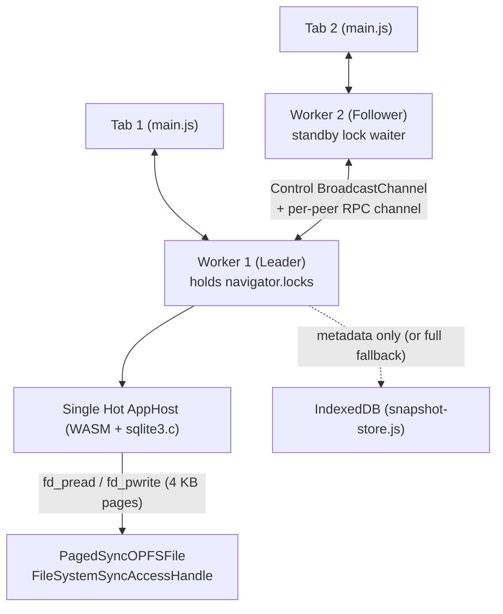
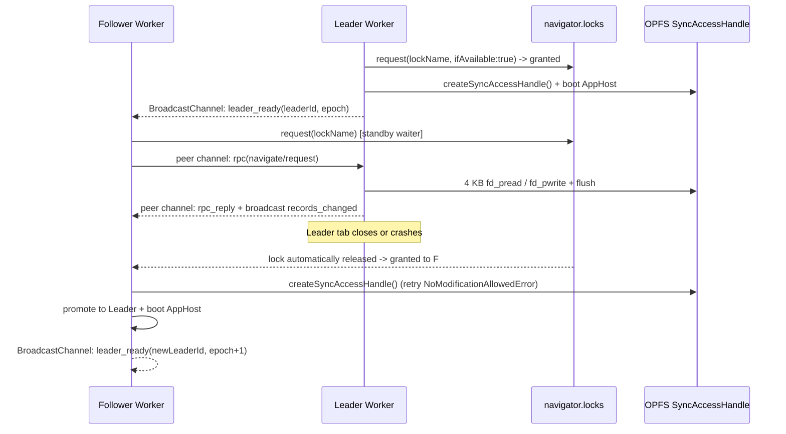

# OPFS Page-Level WASI Storage and Leader-Elected Worker Reactor - Plan

## Goal Capsule

- **Objective:** Eliminate whole-file SQLite snapshot serialization, per-tab WASM/SQLite cold-reboots on peer writes, and the 24 MB local history ceiling for compiled browser apps, while keeping multi-tab sync, offline durability, and Private Mode working transparently.
- **Means:** Mount `@bjorn3/browser_wasi_shim`'s `SyncOPFSFile` (extended with WASI `fd_pread`/`fd_pwrite`/`fd_tell` and matching inode metadata) at `/storage/development.sqlite3`, owned exclusively by one `navigator.locks`-elected leader worker per `(origin, scope)` that serves peer tabs over `BroadcastChannel`/`MessageChannel` with automatic crash failover and IndexedDB fallback (KTD1–KTD5).
- **Authority Hierarchy:** `AGENTS.md` workflow rules (no pull requests; branch -> merge `origin/main` -> run tests -> `git merge --no-ff` into `main` -> push -> delete branch) > User Request > Product Contract (R-IDs) > Planning Contract (KTD-IDs) > Implementation Units (U-IDs).
- **Execution Profile:** Single branch (`feat/opfs-sync-wasi-leader-reactor`), merged `--no-ff` into `main` after full verification; no PRs per `AGENTS.md`.
- **Stop Conditions:** Stop and report clearly if `bundle exec rake test`, `cd demo && bin/rails test`, or Node/browser verification fails unrecoverably, or if another parallel thread moves `main` and creates an unresolvable merge conflict.

---

## Product Contract

### Summary

Compiled InstantRecord browser apps currently keep their SQLite database as an in-memory WASI `File` per tab, dumping the entire file into IndexedDB on every write and tearing down and cold-rebooting `new AppHost` on peer edits. This change replaces whole-file IndexedDB snapshots with OPFS page-level WASI storage (`SyncOPFSFile` over `FileSystemSyncAccessHandle`) owned by a single `navigator.locks`-elected leader worker per `(origin, scope)`, serving peer tabs over dedicated per-peer channels with crash-safe failover and clean IndexedDB fallback when OPFS sync handles are unavailable.

### Problem Frame

`compiled/web/src/worker.js:71-73` caps background history fill at `FILL_BUDGET_BYTES = 24 * 1024 * 1024` because the entire database is held in memory and serialized whole on every write. `compiled/web/src/worker.js:99-136` tears down and cold-reboots `new AppHost` from full IndexedDB bytes whenever a peer tab increments `snapshot_revision`, and calls `host.databaseBytes()` on every write. This makes writes O(DB size), causes latency spikes on multi-tab edits, and caps local offline history at 24 MB.

### Requirements

**Page-Level OPFS Storage**
- R1. The compiled WASI runtime mounts `/storage/development.sqlite3` on an OPFS `FileSystemSyncAccessHandle` wrapped via `@bjorn3/browser_wasi_shim`'s `SyncOPFSFile` so Spinel's statically linked `sqlite3.c` reads and writes 4 KB pages via WASI `fd_pread`/`fd_pwrite` without modifying SQLite's C VFS.
- R2. Writes flush dirty pages directly to OPFS without reading or serializing the whole SQLite database to IndexedDB.
- R3. Background history fill in OPFS mode removes the 24 MB whole-file cap and reads database size in O(1) without calling `databaseBytes()`.
- R4. Existing browser profiles with a legacy IndexedDB `development.sqlite3` snapshot migrate their database bytes into OPFS once on boot and clear the legacy blob only after boot and migrations succeed.
- R5. Schema upgrades preserve the exact prior SQLite image and metadata when a migration fails, and rejected prebuilt shells leave storage clean for normal bootstrap.

**IndexedDB Fallback**
- R6. When OPFS sync handles are permanently unavailable (e.g., Safari Private Mode, missing `createSyncAccessHandle`, `SecurityError`/`NotAllowedError`), the worker falls back cleanly to IndexedDB whole-file snapshots and retains the 24 MB history fill cap.
- R7. `AppHost` preserves its existing in-memory `File` constructor and `restoreDatabase(bytes, schemaVersion)` API for Node tests and IndexedDB fallback.

**Single-Leader Election and Peer Routing**
- R8. Exactly one dedicated worker per `(origin, scope)` is elected leader via `navigator.locks`, owns the OPFS sync handle and single hot `AppHost`, and executes sync draining, change polling, and background history fill.
- R9. Peer tabs connect to the active leader over `BroadcastChannel`/`MessageChannel` and execute navigations, requests, history queries, sync triggers, and inspector commands without instantiating a second `AppHost` or cold-rebooting on peer edits.
- R10. Multi-tab offline simulation stays compatible with existing single-tab and multi-tab test contracts: sync goes offline only when all connected tabs simulate offline, while individual tabs still receive debug logs, history fill state, and `records_changed` events.
- R11. Local writes notify all other connected tabs with `records_changed`; remote sync, stream, and fill completions notify all connected tabs.

**Crash-Safe Failover and Lifecycle**
- R12. When the leader tab closes or terminates abruptly, a standby follower automatically acquires the released Web Lock, retries transient OPFS `NoModificationAllowedError` handle handoff, boots `AppHost` against the persisted database, announces leadership, and serves remaining tabs transparently.
- R13. In-flight idempotent RPCs and unacknowledged requests on surviving followers automatically re-route to the newly elected leader without dropping the tab's UI flow.
- R14. Wiping local data (`measure_controller.js` cold boot reset) closes and deletes OPFS storage in addition to IndexedDB.

### Scope Boundaries

- **Outside scope:** Rewriting SQLite's C VFS in `sqlite3.c`, enabling SQLite WAL mode (`SQLITE_OMIT_WAL` remains set), changing the Rails sync wire protocol, or modifying native iOS builds.

---

## Planning Contract

### Key Technical Decisions

- KTD1. **Extend `@bjorn3/browser_wasi_shim`'s `SyncOPFSFile`/`OpenSyncOPFSFile` with `fd_pread`, `fd_pwrite`, `fd_tell`, and consistent inode `stat`.** Verified against `@bjorn3/browser_wasi_shim@0.4.2` (`dist/fs_opfs.js`): `OpenSyncOPFSFile` omits `fd_pread`, `fd_pwrite`, and `fd_tell` (falling back to `Fd`'s `ERRNO_NOTSUP`), and issues a separate `ino` in `fd_filestat_get()` than `SyncOPFSFile.stat()`. Subclassing both classes in a factory (`opfs-wasi-core.js` + `opfs-wasi-file.js`) fixes these gaps while staying on the pinned shim dependency and keeping unit tests runnable in vanilla Node without `node_modules`.
- KTD2. **Keep small metadata in IndexedDB v3 store (`snapshot-store.js`) while moving `development.sqlite3` bytes to OPFS.** Existing `rails_schema_version`, `secret_key_base`, `migration_history`, `schema_digest`, `history_fill`, and `snapshot_revision` stay in IndexedDB (tiny, atomic metadata) with an in-memory fallback if IndexedDB is unavailable. Only the SQLite database file moves to OPFS (`instant-record-spinel/<scope-segments>/development.sqlite3`). Normal writes never touch IndexedDB; only boot, schema upgrade, and history-fill progress touch metadata.
- KTD3. **Guard schema migrations in OPFS with a pre-migration byte backup.** Because `SQLITE_DEFAULT_SYNCHRONOUS=0` and `PRAGMA journal_mode = MEMORY` are compiled into the wasm reactor, a mid-migration failure writes directly through `SyncOPFSFile`. Before running `ensureBooted()` when `hasExistingDb && previous < targetSchema`, snapshot the pre-migration bytes once in memory and restore them to OPFS if `ensureBooted()` throws. Normal boots (`previous === targetSchema`) do zero whole-file reads.
- KTD4. **Control `BroadcastChannel` + per-follower dedicated RPC channels, with injectable `MessageChannel` port compatibility.** `BroadcastChannel.postMessage` does not support transferable `MessagePort`s across independent tabs. Using one lightweight control channel (`instant-record-leader[/<scope>]`) for discovery/broadcasts and one dedicated channel per follower (`instant-record-peer/<followerId>`) isolates per-tab RPC payloads so peer tabs do not wake on each other's responses, while exposing the exact `{ postMessage, onmessage, close }` interface that `MessageChannel` ports share for same-context callers and unit tests.
- KTD5. **All-tabs-offline aggregation and per-tab simulation map on the leader.** Storing `tabSimulations` keyed by `tabId` and treating network sync as offline only when every connected tab has `offline: true` preserves `compiled/test/overlapping-writes.mjs` (which keeps Tab 1 online while checking Offline on Tab 2 in the same context) as well as two-tab offline persistence.

### High-Level Technical Design

---

## Implementation Units

### U1. OPFS Page-Level WASI File and `AppHost` Mount Support

- **Goal:** Provide a `SyncOPFSFile` subclass with full WASI `fd_pread`/`fd_pwrite`/`fd_tell` and consistent `ino` stats, and let `AppHost` mount it at `/storage/development.sqlite3` with O(1) size and flush helpers.
- **Requirements:** R1, R2, R3, R7 (KTD1).
- **Files:**
  - `compiled/web/src/opfs-wasi-core.js` (new)
  - `compiled/web/src/opfs-wasi-file.js` (new)
  - `compiled/web/src/opfs-wasi-file.test.js` (new)
  - `compiled/web/src/app-host.js` (modify)
- **Approach:** Implement `createPagedSyncOPFSClasses({ SyncOPFSFile, OpenSyncOPFSFile, wasi })` in `opfs-wasi-core.js` and re-export bound classes from `opfs-wasi-file.js`. Extend `AppHost` with `mountDatabase(inode, schemaVersion)`, `databaseSize()`, `flushDatabase()`, and OPFS-aware `databaseBytes()`.
- **Test Scenarios:**
  - `fd_pread` and `fd_pwrite` read/write exact 4 KB page ranges at arbitrary offsets without mutating sequential `position`.
  - `fd_read`, `fd_write`, `fd_seek` (`SET`/`CUR`/`END`), `fd_tell`, `fd_allocate`, `fd_filestat_set_size`, and `fd_sync` match WASI semantics.
  - `path_filestat_get` (`file.stat()`) and `fd_filestat_get()` return identical `ino` and updated `size`.
  - Readonly file rejects `OFLAGS_TRUNC`, `RIGHTS_FD_WRITE`, `fd_write`, and `fd_pwrite` with `ERRNO_PERM`/`ERRNO_BADF`; negative `offset` returns `ERRNO_INVAL`.
  - `readAll`, `writeAll`, `byteLength`, `truncate`, `flush`, and `close` operate cleanly on the underlying sync handle.
- **Verification:** `node --test compiled/web/src/opfs-wasi-file.test.js`

### U2. OPFS Storage Backend, IDB Migration, and Safe Fallback

- **Goal:** Open OPFS `development.sqlite3` per scope with transient lock retry, migrate legacy IndexedDB bytes once, protect schema upgrades against failed migrations, and fall back cleanly to IndexedDB when OPFS sync handles are unavailable.
- **Requirements:** R1, R2, R3, R4, R5, R6, R14 (KTD2, KTD3).
- **Files:**
  - `compiled/web/src/storage-backend.js` (new)
  - `compiled/web/src/storage-backend.test.js` (new)
  - `compiled/web/src/snapshot-store.js` (modify)
- **Approach:** Add `del` support in `snapshot-store.js`'s `withFiles` callback (optional 3rd argument so existing callers keep working). Implement `openDatabaseStorage` in `storage-backend.js` handling scope directory resolution, `NoModificationAllowedError` backoff retries, permanent unavailability detection -> IndexedDB fallback, one-time IDB -> OPFS migration, pre-migration backup/restore on error, fill budget selection (`Infinity` for OPFS, `24 * 1024 * 1024` for IDB), and `wipe()`.
- **Test Scenarios:**
  - OPFS available: opens nested scope path, creates `PagedSyncOPFSFile`, reports `mode: "opfs"` and unbounded fill budget.
  - Legacy IndexedDB DB exists while OPFS is empty: migrates bytes into OPFS, flushes, and deletes legacy IDB blob only after `commitMigration()` succeeds.
  - Failed schema upgrade in OPFS mode: restores exact pre-migration bytes and leaves IDB metadata untouched.
  - Transient `NoModificationAllowedError` on first 2 attempts then success: retries and opens OPFS cleanly.
  - Permanent `SecurityError` / `NotAllowedError` / missing `createSyncAccessHandle`: falls back to `mode: "indexeddb"` with 24 MB fill budget.
  - `wipe()` closes sync handle and removes the scope's OPFS entry cleanly.
- **Verification:** `node --test compiled/web/src/storage-backend.test.js`

### U3. Single-Leader Election, Peer RPC, and Crash-Safe Failover

- **Goal:** Implement a deterministic `navigator.locks` leader election and peer RPC layer per `(origin, scope)` with crash failover, in-flight retry, multi-tab simulation aggregation, and broadcast fan-out.
- **Requirements:** R8, R9, R10, R11, R12, R13 (KTD4, KTD5).
- **Files:**
  - `compiled/web/src/leader-election.js` (new)
  - `compiled/web/src/leader-election.test.js` (new)
- **Approach:** Build `createLeaderCoordinator` taking injectable `locks`, `createChannel`, `scope`, and `handlers` so it runs identically in browser workers (`BroadcastChannel` + `navigator.locks`) and in deterministic Node tests (mock locks + `MessageChannel`/in-memory channel bus). Support `leader`, `follower`, and `standalone` roles, standby lock acquisition, `rpc_ack` + `ping`/`pong` liveness, failover promotion, automatic retry of idempotent/pre-ack RPCs, version mismatch signaling, and `tabSimulations` aggregation.
- **Test Scenarios:**
  - Two workers start concurrently for the same scope: exactly one becomes leader and the other connects as follower; requests from follower execute on leader without booting a second `AppHost`.
  - Different scopes (`""` vs `"maya/support"`) elect independent leaders without cross-talk.
  - Leader terminates abruptly (releasing lock without `leader_bye`): standby follower acquires lock, promotes to leader, and a third follower re-routes an in-flight read RPC transparently to the new leader.
  - Multi-tab offline simulation: Tab 1 online + Tab 2 offline keeps leader online; both tabs offline puts leader offline; closing the online tab transitions leader offline; closing an offline tab while another is online keeps leader online.
  - Local write notifies other tabs (`records_changed`) without notifying the originating tab twice; sync/stream notifications reach all tabs.
  - Missing `navigator.locks` or `BroadcastChannel` falls back cleanly to `"standalone"` mode.
- **Verification:** `node --test compiled/web/src/leader-election.test.js`

### U4. Worker Reactor Integration, Main Thread Observability, Wipe, and End-to-End Verification

- **Goal:** Wire `opfs-wasi-file.js`, `storage-backend.js`, and `leader-election.js` into `worker.js`, `main.js`, `measure_controller.js`, and `compiled/test/release-upgrade.mjs`, plus add comprehensive integration and browser tests.
- **Requirements:** R1–R14 (KTD1–KTD5).
- **Files:**
  - `compiled/web/src/worker.js` (modify)
  - `compiled/web/src/main.js` (modify)
  - `demo/app/javascript/controllers/measure_controller.js` (modify)
  - `compiled/test/release-upgrade.mjs` (modify)
  - `compiled/web/src/worker-integration.test.js` (new)
- **Approach:** Refactor `worker.js` so the leader owns a single hot `AppHost` backed by `storage-backend.js` (OPFS page-level or IDB fallback), serialized via an async queue without holding locks across `fetch`, and serves both its own tab and peer workers via `leader-election.js`. Followers store `bootConfig` (`module`, `path`, `scope`) so failover promotion boots immediately without re-fetching WASM. Expose `storage` and `role` on `window.__spinel` in `main.js`. Update `measure_controller.js` `wipe()` to ask the worker to close/clear OPFS and remove OPFS directory alongside IDB. Update `release-upgrade.mjs` `snapshot()` to read OPFS `development.sqlite3` when IDB no longer stores the blob.
- **Test Scenarios:**
  - Multi-worker integration test: 2 tabs share 1 leader `AppHost`, Tab 2 writes without rebooting `AppHost`, leader crashes and Tab 2 promotes over the same OPFS file with all committed writes intact, history fill continues past 24 MB in OPFS mode, and Safari Private Mode fallback uses IndexedDB with the 24 MB cap.
  - Real Chromium browser verification (via local HTTP/Vite server + preview browser): verify real OPFS `FileSystemSyncAccessHandle` creation, 4 KB page-level `fd_pread`/`fd_pwrite` through `@bjorn3/browser_wasi_shim`, real `navigator.locks` leader election across two tabs, and failover when leader closes.
- **Verification:** `node --test compiled/web/src/*.test.js`, `bundle exec rake test`, `cd demo && bin/rails test`, Vite production build check, and Chromium browser verification.

---

## Verification Contract

| Check | Command | Purpose |
|---|---|---|
| JS unit & integration tests | `node --test compiled/web/src/*.test.js` | Verify OPFS WASI pread/pwrite, storage fallback/migration, leader election, failover, and worker integration |
| Gem test suite | `bundle exec rake test` | Verify compiler, gem, and all existing Ruby tests pass |
| Demo test suite | `cd demo && bin/rails test` | Verify demo changes (`measure_controller.js`) pass Rails tests |
| Vite production build | `npx vite build` (in `compiled/web` with cached deps) | Verify all ES imports, `@bjorn3/browser_wasi_shim` bindings, and worker bundling build cleanly |
| Real Chromium OPFS + leader check | Preview browser against local test harness | Verify real browser `FileSystemSyncAccessHandle`, `navigator.locks`, `BroadcastChannel`, and failover |

---

## Definition of Done

- All 4 implementation units (U1–U4) are complete with unit and integration tests passing.
- `node --test compiled/web/src/*.test.js`, `bundle exec rake test`, and `cd demo && bin/rails test` pass with zero failures.
- Real Chromium verification confirms OPFS `SyncOPFSFile` page-level I/O, `navigator.locks` single-leader election, peer RPC, and crash failover.
- Code simplification, code review, and any durable learning capture are complete.
- `origin/main` is merged into `feat/opfs-sync-wasi-leader-reactor`, tests re-pass on the merged tree, branch is merged into `main` with `git merge --no-ff`, `main` is pushed, and the branch is deleted locally and remotely per `AGENTS.md`.
