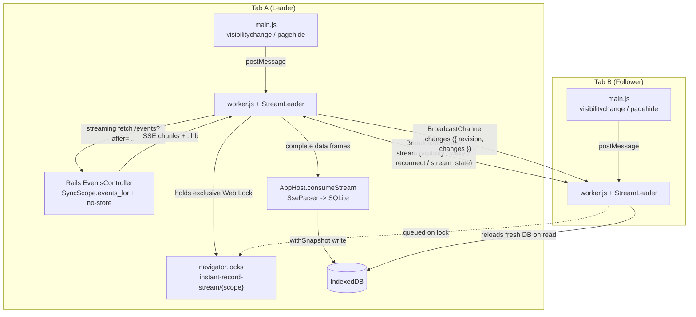
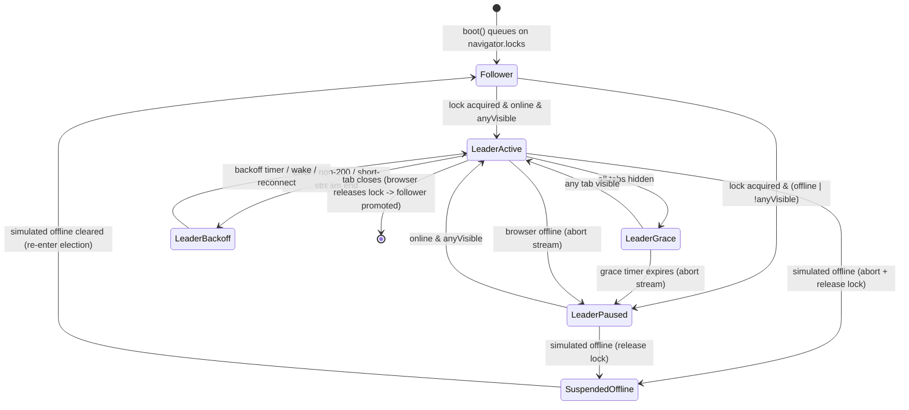

# Leader-Elected Visibility-Aware SSE Sync Stream - Plan

## Goal Capsule

- **Objective:** Eliminate per-tab 1-second sync polling so multi-tab browsers hold at most one live inbound change stream per user scope, stay quiet when backgrounded or offline, and deliver remote updates to all open tabs without interrupting local responsiveness or leaking private user events.
- **Means:** Elect one leader worker per `(origin, scope)` via `navigator.locks` to hold a streaming SSE fetch feeding `host.consumeStream` and broadcast applied updates over `BroadcastChannel` (KTD1, KTD2, KTD3).
- **Authority:** Product Contract governs user-observable sync, visibility, offline, and security behavior; Planning Contract governs lock, channel, framing, and reconnect mechanics; `AGENTS.md` governs branch-merge-push delivery with no pull requests.
- **Execution profile:** Single branch (`feat/leader-adaptive-sse-stream`) merged `--no-ff` into `main` per `AGENTS.md` after passing gem, JS, demo, and browser verification.
- **Stop conditions:** Stop and report if tests fail without a clean fix, if a parallel thread moves `main` with an unresolvable conflict, or if push to `main` is refused.

---

## Product Contract

### Summary

Replace the per-tab 1000ms `/events?window=0` polling interval in the compiled browser worker with a single `navigator.locks`-elected leader per `(origin, scope)` holding a streaming SSE connection to `/events`. The leader applies incoming SSE frames incrementally through `host.consumeStream`, persists updated snapshots to IndexedDB, and broadcasts change notices to follower tabs over `BroadcastChannel`. When all tabs in the scope are hidden or the browser is offline, the leader pauses cleanly and resumes immediately on return; when the leader tab closes, a follower assumes leadership automatically.

### Problem Frame

`compiled/web/src/worker.js` runs `setInterval(pollChanges, 1000)` independently in every open tab, sending `/events?after=<cursor>&window=0` every second regardless of tab count or visibility. With N tabs open, the client sends N HTTP requests per second even when idle or backgrounded, defeating the server's Rack streaming SSE endpoint (`InstantRecord::EventsController`) and Falcon fiber architecture. The gem already provides incremental SSE parsing via `InstantRecord::Client.consume_stream` (`Transport::SseParser`), and the worker already coordinates background history fills with `navigator.locks` and cross-tab updates with `BroadcastChannel`.

### Requirements

**Leader election and streaming delivery**

- R1. At most one worker per `(origin, scope)` holds an active inbound `/events` stream at a time, elected via `navigator.locks` (with single-tab fallback when `navigator.locks` is absent).
- R2. The leader opens a streaming SSE fetch to `/events?after=<cursor>` (with optional `&identity=<key>` and `&scope=<syncScope>`, without `window=0`), reads chunks incrementally without blocking local worker requests, and feeds complete SSE event frames into `host.consumeStream`.
- R3. Applied updates persisted by the leader are broadcast over `BroadcastChannel` to follower tabs with the change list when available, so follower tabs refresh without polling the server themselves.
- R4. Closing or terminating the leader tab triggers automatic failover to a waiting follower, which reloads the persisted snapshot/cursor from IndexedDB and resumes streaming without losing events.

**Visibility, offline, and reconnect behavior**

- R5. Page visibility (`visibilitychange` and initial `document.visibilityState`) is tracked across tabs in the scope; when all tabs are backgrounded past a short grace window, the leader aborts the active stream and pauses inbound network traffic until any tab becomes visible again.
- R6. When the browser is offline (`navigator.onLine === false`) or the inspector's simulated offline mode is enabled, the leader aborts the stream and stays paused without retry loops, resuming immediately upon returning online.
- R7. A tab entering simulated offline releases leadership so any online peer tab in the same scope continues receiving live updates.
- R8. Transient stream failures back off exponentially with jitter and reset backoff upon healthy delivery, online recovery, or visibility restoration; endpoints that close immediately (such as `Email::SyncController#events` or `sse_window_seconds = 0`) wait a bounded short-stream delay rather than busy-looping.
- R9. Identity or session changes (`serverRequest` POSTs such as `/auth/session`, or `event: reset` / bootstrap transitions) cause the leader to reconnect immediately so per-user `SyncScope` updates take effect without waiting for the current SSE window to expire.

**Privacy, caching, and inspector visibility**

- R10. Private per-user events from `SyncScope.events_for` remain uncached (`Cache-Control: no-store` on `/events`, no public CDN caching) and stream leadership is never shared across distinct `syncScope` or mailbox scopes.
- R11. The demo sync inspector reflects live stream connection state (`streamOpen`) and reports offline/error/delivery stream entries cleanly without 1-second offline log spam.

### Acceptance Examples

- AE1. **Covers R1, R2, R3.** Given two visible tabs sharing `(origin, scope)`, when both boot and a remote change arrives on `/events`, then only one `/events` streaming request is open (without `window=0`), the leader applies the frame via `consumeStream`, persists the snapshot, and the follower receives the update via `BroadcastChannel`.
- AE2. **Covers R4.** Given a leader tab and a follower tab in the same scope, when the leader tab closes (releasing its Web Lock), then the follower acquires the lock, reads the current cursor from IndexedDB, and opens the replacement SSE stream.
- AE3. **Covers R5.** Given two tabs in the same scope, when tab A becomes hidden while tab B stays visible, the stream stays open; when tab B also becomes hidden past the grace period, the stream aborts and no `/events` requests fire until either tab becomes visible again, which triggers immediate reconnection.
- AE4. **Covers R6, R7.** Given a leader tab that toggles simulated offline while a second online tab exists in the same scope, then the offline tab logs a single offline stream status and yields leadership so the online tab takes over; when the sole tab toggles offline and back online, it pauses offline and catches up immediately upon re-enabling online.
- AE5. **Covers R8.** Given an `/events` endpoint returning 200 OK with immediate close (empty body, 5ms duration), then the leader waits the short-stream delay instead of tight-looping; given repeated 500 or network errors, retry delays grow exponentially up to the cap.
- AE6. **Covers R9, R10.** Given an authenticated user switching sessions via `/auth/session` while a 25-second SSE stream is open, then the leader aborts and reconnects promptly with the new session cookie, applies `event: reset`, and bootstraps the new user's visible rows; `/events` continues returning `Cache-Control: no-store`.

### Scope Boundaries

- **In scope:** Compiled browser worker/page stream coordination (`compiled/web/src/`), pure-JS SSE frame buffering and leader state machine with Node unit tests, real-browser multi-tab Playwright verification (`test/browser/stream_leader.mjs`), and server header/per-user SSE stream regression verification (`test/event_stream_test.rb`).
- **Deferred to Follow-Up Work:**
  - *Demo layout label and non-logging `instant_record.stream_state` listener (`demo/app/views/layouts/application.html.erb`, `demo/app/javascript/controllers/inspector_controller.js`):* Left untouched to keep `demo/` unmodified where Postgres.app's interactive macOS permission dialog blocks headless `demo/bin/rails test`; `inspector_controller.js` already consumes `streamOpen` via `instant_record.debug` and `instant_record.debug_backlog`, and `worker.js` already emits `instant_record.stream_state`.
- **Considered and not built:**
  - *Adding a `wasm_reset_stream` C/Wasm export:* Not needed because buffering complete `\n\n`-delimited SSE frames in JS before calling `host.consumeStream` guarantees Ruby's `SseParser` never retains partial frames across reconnects and avoids touching the C/WASI ABI. Revisit only if a streaming caller ever feeds raw unframed byte chunks directly to Wasm.
  - *Converting `Email::SyncController#events` into a tailing Rack stream:* Out of scope for this change; adaptive short-stream pacing handles immediate-close endpoints safely while preserving existing demo mail controller behavior.
  - *Public CDN caching or shared fan-out proxy for `/events`:* Explicitly forbidden by R10 because `SyncScope.events_for` produces per-user filtered streams.

---

## Planning Contract

### Key Technical Decisions

- KTD1. **Exclusive Web Lock per `(mailboxScope, syncScope)` for leader election.** Each worker queues on `navigator.locks.request("instant-record-stream/" + scopeKey, { mode: "exclusive" }, callback)` where `scopeKey` combines `mailboxScope || "default"` and `syncScope || "anon"` (Web Locks are already origin-scoped). The browser releases the lock immediately on tab close or worker crash, guaranteeing fast failover without leader-heartbeat leases. Including `syncScope` prevents sharing leadership if two tabs fall back to distinct in-memory tokens when `localStorage` is disabled.
- KTD2. **Separate coordination `BroadcastChannel` plus structured change payloads.** Keep `instant-record-spinel-changes[/<scope>]` dedicated to snapshot updates carrying `{ revision, changes }` (maintaining compatibility with existing numeric messages) so follower tabs receive targeted `changes` lists for in-place UI refreshes. Add a separate `instant-record-spinel-stream[/<scope>]` channel for `hello`, `visibility`, `bye`, `discover`, `ping`, `wake`, `reconnect`, and `stream_state` coordination messages so control chatter never triggers spurious `records_changed` refreshes.
- KTD3. **Pure-JS SSE frame buffering in `compiled/web/src/stream-leader.js`.** Extract the entire election, visibility tracker, SSE frame splitter, and streaming reconnect loop into a dependency-injected ES module (`compiled/web/src/stream-leader.js`), mirroring `changes.js` and `history-fill.js`. The JS framer normalizes `\r\n` to `\n` across chunk boundaries (retaining a trailing `\r` until the next chunk arrives), splits on `\n\n`, discards heartbeat/comment-only blocks (`: hb\n\n`) without waking Wasm or IndexedDB, and feeds only complete event frames to `host.consumeStream`. This makes every state transition deterministically unit-testable under `node --test` and keeps Wasm ABI unchanged.
- KTD4. **Multi-tab visibility tracking with grace period, `document.open()` listener survival, and stale-peer liveness check.** `main.js` passes initial `document.visibilityState !== "hidden"` in `boot` and registers `visibilitychange` and `pagehide` listeners through a helper called after `document.open()/write()/close()` during boot and re-called after every `document.open()` in `submitLocalForm`, immediately re-syncing current visibility state. `worker.js` buffers `pageVisible` and `pageTornDown` at module scope so messages arriving during async `boot()` are never lost. The leader tracks `selfVisible` and a `peers` map populated via `hello`, `visibility`, `bye`, and `discover` (broadcast when assuming leadership). Transitioning from any-visible to all-hidden starts a short grace timer (5s default) before aborting the stream; any tab turning visible cancels the timer and reconnects immediately. When the leader itself is hidden and relies on a peer marked visible whose `seenAt` is older than a TTL, the leader sends `ping` and prunes unresponsive peers so a crashed visible tab cannot pin the stream open indefinitely.
- KTD5. **Adaptive reconnect pacing and session-change reconnect.** Long-lived 200 OK streams (open >= 2s) reconnect after brief jitter (50–150ms) with backoff reset. Immediate-close 200 OK streams (< 2s, e.g., `Email::SyncController#events` or `window=0`) wait a short-stream interval (1000ms when idle, 100ms when events were applied) so they never tight-loop. Non-200 or network errors use exponential backoff (1s base, 30s cap, jittered). An idle watchdog (60s, reset on every received chunk or heartbeat) aborts silently stalled sockets. Any `serverRequest` POST (such as `/auth/session` or `/auth/session/sign_out`) or completed bootstrap broadcasts `reconnect` so the leader reopens immediately with fresh session cookies or cursor; `drain()` also calls `wake()` when `pending` reaches 0.
- KTD6. **Serialize streamed frame application with `drain()` and `withSnapshot`, and update inspector stream state without log spam.** `getStreamParams()` always runs inside `withSnapshot("readonly", ...)` so a newly promoted leader reloads any newer IndexedDB snapshot and reads the true `cursor`, `identity`, `bootstrapped`, and `pending` (only calling `kickSync(0)` when `!draining && !kickTimer` so drain backoff is never clobbered). When data frames arrive while `draining` is in flight, await `draining.catch(() => {})` before entering `withSnapshot("readwrite", ...)`. On `event: reset` (`!consumed.bootstrapped`), persist the reset, clear `currentCursor`/`currentIdentity`, abort the stale stream, and trigger `kickSync(0)` to bootstrap immediately. Dynamic `streamOpen` changes post a non-logging `instant_record.stream_state` message handled by `demo/app/javascript/controllers/inspector_controller.js`, while `instant_record.debug` stream log entries emit only on applied deliveries, errors, and simulated-offline transitions.

### High-Level Technical Design

### Assumptions

- `Email::SyncController#events` remains a one-shot SSE response; adaptive short-stream pacing in `StreamLeader` keeps shared-inbox tabs working under one leader without changing that controller.
- `InstantRecord::EventsController` already sets `Cache-Control: no-store` and applies `SyncScope.events_for`; no server wire-protocol changes are needed, only regression tests verifying the headers and per-user stream isolation.
- Updating the inspector SVG label in `demo/app/views/layouts/application.html.erb` changes `demo/`, so `cd demo && bin/rails test` must be run per `AGENTS.md`.

### Risks & Dependencies

- **Auth session switch latency (`compiled/test/auth.mjs`):** A long-lived SSE stream holds the session identity read when the request opened. Mitigated by KTD5: `serverRequest` POST triggers an immediate `reconnect` signal across tabs.
- **Simulated offline inspector expectations (`compiled/test/sync-inspector.mjs`):** The test checks for a bad stream log row for `/instant_record/events` when offline is checked and an ok stream row when unchecked. Mitigated by emitting one `status: "offline"` stream report when entering simulated offline and a `status: 200` stream report when the stream connects/delivers after unchecking offline.
- **Playwright / compiled build toolchain availability:** Running compiled E2E scripts requires `compiled/web/dist` and toolchain; if the Spinel/Roundhouse toolchain is not installed in this worktree, verify via Vite bundle build (`npx vite build` or Node ESM tests) plus Playwright browser tests against a real local SSE test server exercising real Chromium `navigator.locks`, `BroadcastChannel`, `visibilitychange`, and streaming `fetch`!

### Sources & Research

- `compiled/web/src/worker.js` — current `pollChanges` loop (lines 11, 206–246, 506, 519), `withSnapshot` + `changes` BroadcastChannel (lines 99–136, 426–427), `runFill` Web Locks pattern (lines 316–327), `serverRequest` (lines 554–570), `instant_record.simulate` (lines 536–547).
- `compiled/web/src/main.js` — worker lifecycle, `boot` call, `syncScope()`, `recordsChanged()`.
- `compiled/web/src/app-host.js` — `consumeStream(chunk)` and `syncState()` contracts.
- `lib/instant_record/client.rb` — `consume_stream` (lines 239–246), `apply_events` (lines 270–299), `Transport::SseParser`.
- `app/controllers/instant_record/events_controller.rb` — `EVENT_STREAM_HEADERS` (`cache-control: no-store`), `EventStream`, `window_seconds`, `SyncScope.stale?` reset frame.
- `demo/app/javascript/controllers/inspector_controller.js` — existing `streamOpen` tracking and `data-connected` wire styling (`demo/app/assets/stylesheets/base.css:538`).
- `compiled/test/sync-inspector.mjs`, `compiled/test/auth.mjs`, `compiled/test/overlapping-writes.mjs`, `compiled/test/shared-inbox.mjs` — existing E2E contracts.

---

## Implementation Units

### U1. Stream leader, SSE frame buffer, and visibility coordinator module

- **Goal:** Implement the standalone, dependency-injected `StreamLeader` and SSE frame buffer module covering leader election, incremental streaming, multi-tab visibility pause/resume, offline/simulated-offline handling, adaptive reconnect/backoff, and graceful failover.
- **Requirements:** R1, R2, R4, R5, R6, R7, R8, R9, R10; KTD1, KTD2, KTD3, KTD4, KTD5.
- **Dependencies:** None.
- **Files:**
  - Create `compiled/web/src/stream-leader.js`
  - Create `compiled/web/src/stream-leader.test.js`
- **Approach:**
  1. Implement `SseFrameBuffer` to normalize `\r\n` to `\n` across chunk boundaries (holding a trailing `\r` across chunks), split complete `\n\n`-terminated frames, discard blank and comment-only frames (`: hb\n\n`), and expose `reset()` for new connections.
  2. Implement `streamScopeKey(mailboxScope, syncScope)`, `eventsUrl(endpoint, { cursor, identity, scope })` (always appending `after`, optional `identity`, and optional `scope`, never `window=0`), and `createStreamLeader(options)` with injectable `locks`, `createChannel`, `fetch`, timers, `now`, `isOnline`, `isOfflineSimulated`, `getLatencyMs`, `getStreamParams`, `applyFrames`, `onReport`, and `onStreamStateChange`.
  3. Implement Web Lock election (`instant-record-stream/${key}`) with a single-flight election guard, aborting any pending lock acquisition (or releasing on grant) when entering simulated offline so rapid offline/online toggles never queue duplicate lock requests, and single-tab fallback when `locks` is missing.
  4. Implement coordination channel protocol (`hello`, `visibility`, `bye`, `discover`, `ping`, `wake`, `reconnect`, `stream_state`) with hidden grace period and stale-peer liveness pruning.
  5. Implement streaming `fetch` reader loop (`response.body.getReader()` + `TextDecoder({ stream: true })` with `response.text()` fallback), idle watchdog, clean window reconnect jitter, short-stream delay, exponential error backoff with jitter, and immediate `reconnect()` / `wake()` support.
- **Patterns to follow:** `compiled/web/src/history-fill.js`, `compiled/web/src/changes.js`, and their `node:test` suites in `compiled/web/src/*.test.js`.
- **Test scenarios:**
  - `SseFrameBuffer` splits frames split across arbitrary UTF-8/CRLF chunks, preserves multiple events in one chunk, ignores `: hb\n\n` comments, and discards half-received frames on `reset()`.
  - Covers AE1: two `StreamLeader` instances sharing a simulated lock manager and `BroadcastChannel` elect one leader; only the leader invokes `fetch` (without `window=0`) and passes complete data frames to `applyFrames`.
  - Covers AE2: destroying/closing the leader releases its lock and promotes the queued follower, which fetches fresh cursor state via `getStreamParams` and opens the replacement stream.
  - Covers AE3: hiding one of two tabs keeps the stream open; hiding both pauses and aborts after the grace delay with zero further requests; making either tab visible cancels the pause/grace and reconnects immediately; a crashed visible peer is pruned via `ping` TTL when the leader is hidden.
  - Covers AE4: simulated offline aborts the stream, emits one `status: "offline"` report, and releases the lock so an online follower takes over; browser offline pauses without retry spam and resumes immediately on `online`.
  - Covers AE5: immediate-close 200 OK stream waits `shortStreamDelayMs` instead of busy-looping; 500/network errors apply exponential backoff up to cap and reset backoff after a healthy stream or wake signal.
  - Covers AE6: `reconnect()` from either leader or follower aborts the open stream immediately and reopens with updated identity/cursor; `applyFrames` returning `{ reset: true }` breaks out of the current stream and stops consuming stale events.
  - Scope isolation: two leaders with different `syncScope` or `mailboxScope` use distinct lock and channel names and never share stream leadership.
- **Verification:** `node --test compiled/web/src/*.test.js` passes all unit tests. This seam catches all protocol, lock, visibility, framing, and backoff edge cases deterministically; it does not verify real browser `navigator.locks`/`BroadcastChannel` behavior (covered in U4).

### U2. Wire visibility forwarding in `main.js` and replace polling in `worker.js`

- **Goal:** Connect page visibility lifecycle in `main.js` and replace `setInterval(pollChanges, 1000)` in `worker.js` with `StreamLeader`, broadcasting applied SSE changes to follower tabs and reporting live `streamOpen` state to the inspector.
- **Requirements:** R1, R2, R3, R4, R5, R6, R7, R8, R9, R10, R11; KTD1, KTD2, KTD4, KTD5, KTD6.
- **Dependencies:** U1.
- **Files:**
  - Modify `compiled/web/src/main.js`
  - Modify `compiled/web/src/worker.js`
- **Approach:**
  1. In `main.js`, pass `visible: document.visibilityState !== "hidden"` in the `boot` payload and attach `visibilitychange` and `pagehide` listeners via a helper called *after* `document.open()/write()/close()` during boot and re-called after every `document.open()` in `submitLocalForm`, immediately posting the current visibility state.
  2. In `worker.js`, track `pageVisible` and `pageTornDown` at module scope so visibility/pagehide messages arriving during async `boot()` are preserved before `streamLeader` is created. Extend `withSnapshot` so `save(changeList)` posts `{ revision: snapshotRevision, changes: changeList ?? null }` on `changes`, and update `changes.onmessage` to pass `changes` through in `self.postMessage({ type: "records_changed", changes })` while remaining backwards-compatible with plain revision numbers.
  3. Remove `POLL_EVERY_MS`, `pollInFlight`, `pollChanges`, and `setInterval(pollChanges, POLL_EVERY_MS)`.
  4. Instantiate `StreamLeader` inside `boot()` using `streamScopeKey(scope, syncScope)` and `eventsUrl(...)`, wiring `getStreamParams` (always running inside `withSnapshot("readonly", ...)` to read fresh `host.syncState()`, calling `kickSync(0)` only when `!draining && !kickTimer` if not bootstrapped or `pending > 0`), `applyFrames` (awaiting `draining.catch(() => {})`, applying `host.consumeStream(batch)` inside `withSnapshot("readwrite", ...)`, handling `!consumed.bootstrapped` reset, and saving with `consumed.changes`), `onReport`, and `onStreamStateChange` (posting `{ type: "instant_record.stream_state", streamOpen }` and keeping `streamOpen` accurate for `instant_record.debug_backlog`).
  5. Wire `online` / `offline` worker events, `instant_record.simulate` offline transitions, `instant_record.visibility` / `instant_record.pagehide` messages, `drain()` (calling `streamLeader?.reconnect()` on bootstrap completion and `streamLeader?.wake()` when `result.pending === 0`), and `serverRequest` POSTs to call `streamLeader` controls (`setOfflineSimulated`, `setOnline`, `setVisible`, `teardown`, `reconnect`, `wake`).
  6. Keep shell first-load catch-up non-blocking by starting `streamLeader` immediately when `shell` is loaded (and after `first` navigation otherwise).
- **Patterns to follow:** Existing `worker.js` `withSnapshot`, `drain()`, `runFill()`, and `report()` conventions; `main.js` message dispatch pattern.
- **Test scenarios:**
  - Verified by U4 multi-tab browser test and existing JS/Ruby test suites: worker boots without `setInterval` polling, forwards visibility changes, propagates targeted `changes` to followers over `BroadcastChannel`, reports `streamOpen` in backlog and stream debug events, and reconnects on `serverRequest` POST.
- **Verification:** `compiled/web/src/worker.js` has no `setInterval(pollChanges` or `/events?window=0` polling; Vite build or ESM import check succeeds cleanly.

### U3. Add server SSE cache and per-user scope regression tests

- **Goal:** Lock in server-side regression tests proving `/events` sets `Cache-Control: no-store` and enforces per-user `SyncScope.events_for` over streaming polls.
- **Requirements:** R10.
- **Dependencies:** None.
- **Files:**
  - Modify `test/event_stream_test.rb`
- **Approach:**
  1. Add tests in `test/event_stream_test.rb` verifying `EVENT_STREAM_HEADERS` includes `"cache-control" => "no-store"` (no public caching directive) and that `EventStream` streams per-user `SyncScope.events_for` filtering across distinct identities without leaking private rows.
- **Patterns to follow:** Existing tests in `test/event_stream_test.rb` and `test/sync_scope_test.rb`.
- **Test scenarios:**
  - `EVENT_STREAM_HEADERS["cache-control"]` equals `"no-store"` and does not include `public` or `s-maxage`.
  - Two `EventStream` instances opened for different `SyncScope` identities receive only their own permitted changes from `SyncScope.events_for`.
- **Verification:** `bundle exec rake test` passes.

### U4. Multi-tab real-browser verification of leader election, failover, visibility pause, and BroadcastChannel fan-out

- **Goal:** Prove end-to-end in real Chromium (`navigator.locks`, `BroadcastChannel`, real streaming HTTP SSE server, `visibilitychange`) that multiple tabs share one SSE connection, broadcast updates to followers, pause when all tabs are hidden, and fail over immediately when the leader closes.
- **Requirements:** R1, R2, R3, R4, R5, R6, R7, R8, R9, R10; Covers AE1, AE2, AE3, AE4, AE5, AE6.
- **Dependencies:** U1, U2.
- **Files:**
  - Create `test/browser/stream_leader.mjs`
- **Approach:**
  1. Mirror `test/browser/files.mjs` / `compiled/test/shell-worker.mjs` (including the Playwright resolution fallback across `PLAYWRIGHT_NODE_MODULES`, `playwright-core`, `playwright`, and `compiled/bench/env.mjs`): spin up a local Node HTTP server that serves a minimal harness page + worker importing `compiled/web/src/stream-leader.js` and exposes a real chunked `text/event-stream` `/events` endpoint (setting `Cache-Control: no-store`, sending `: hb\n\n` heartbeats, and pushing SSE change frames on demand while recording every open/closed connection).
  2. Launch Chromium via Playwright with two tabs in the same browser context (sharing `navigator.locks` and `BroadcastChannel`):
     - Verify only ONE `/events` stream opens across both tabs (no `window=0`).
     - Push an SSE frame from the server; verify both leader and follower receive the update and `streamOpen` is true.
     - Simulate `visibilitychange` (overriding `document.visibilityState` and dispatching `new Event("visibilitychange")`, since headless Chromium does not hide all tabs via `bringToFront()`): hide tab 1 only -> stream stays open; hide tab 2 as well -> stream aborts after grace period and no reconnects occur while both are hidden; unhide tab 2 -> leader immediately reconnects and catches up a queued event.
     - Close the leader tab -> follower immediately acquires the Web Lock and opens a replacement `/events` stream from the latest cursor, receiving the next pushed event.
     - Trigger simulated offline on leader while a second online tab exists -> offline tab releases lock and second tab takes over seamlessly.
- **Patterns to follow:** `test/browser/files.mjs` and `compiled/test/shell-worker.mjs`.
- **Test scenarios:**
  - Covers AE1: two tabs open -> exactly 1 active `/events` SSE connection without `window=0`, both tabs receive streamed event.
  - Covers AE2: leader tab closes -> follower opens replacement `/events?after=<latest>` stream and receives subsequent events.
  - Covers AE3: hiding one tab keeps stream live; hiding all tabs aborts stream cleanly; revealing any tab resumes immediately.
  - Covers AE4: simulated offline yields leadership to an online peer tab in the same context.
- **Verification:** `node test/browser/stream_leader.mjs` runs against Chromium and passes cleanly with zero page errors.

---

## Verification Contract

| Gate | Command | Applies to |
|---|---|---|
| JS unit tests | `node --test compiled/web/src/*.test.js` | U1, U2 |
| Gem test suite | `bundle exec rake test` | U3, regression |
| Demo test suite | `cd demo && bin/rails test` | U3, regression |
| Real-browser multi-tab SSE test | `node test/browser/stream_leader.mjs` | U1, U2, U4 |
| Compiled web bundle check | `cd compiled/web && npx vite build` (when `node_modules` present) | U1, U2 |

## Definition of Done

- Per-tab `setInterval(pollChanges, 1000)` and `/events?window=0` short-polling are removed from `compiled/web/src/worker.js`.
- Single leader per `(origin, scope)` holds a real streaming SSE connection via `navigator.locks`, feeds complete frames into `host.consumeStream`, and broadcasts applied updates (including `changes`) to followers over `BroadcastChannel`.
- All-tabs-hidden pauses cleanly after grace period; offline/simulated-offline pauses without retry spam and yields leadership on simulated offline; leader tab closure triggers automatic follower failover.
- `InstantRecord::EventsController` preserves `Cache-Control: no-store` and per-user `SyncScope.events_for`, verified by tests.
- All unit, gem, demo, and real-browser tests pass after merging `origin/main` into the branch; no dead code or scratch files remain.
- Branch is merged `--no-ff` into `main`, pushed to `origin/main`, and deleted locally (and on remote if pushed), with no pull request opened, per `AGENTS.md`.
