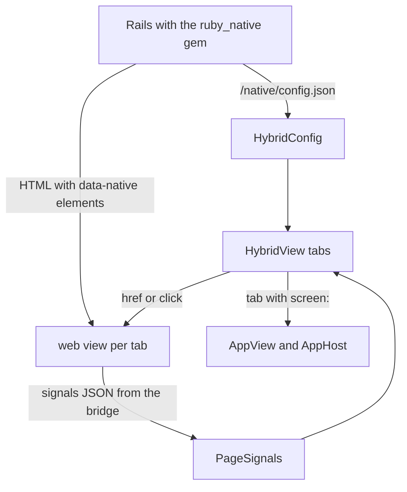

# Hybrid iOS Pages - Plan

## Goal Capsule

- **Objective:** A Rails developer can change an InstantRecord iPhone app's pages, tabs and navigation bar by deploying Rails, without an App Store build.
- **Means:** A web shell in `InstantRecordNative` that reads the Ruby Native gem's public markup and config (KTD1).
- **Authority:** This plan, then `AGENTS.md`. The existing Ruby-screen and typed-SwiftUI modes keep working unchanged.
- **Execution profile:** One change, on branch `feat/ios-hybrid-pages`. `AGENTS.md` forbids pull requests: merge `origin/main`, test, merge with `--no-ff` into `main`, push, delete the branch.
- **Stop conditions:** A test that fails and cannot be fixed, or a refused push.
- **Who finishes:** The executing agent, in a checkout other than the primary one, which is 247 commits behind and holds other work.

---

## Product Contract

### Summary

A third iOS mode joins the two that exist. Rails serves HTML pages. Hidden `data-native-*` elements in them declare tabs, a navigation bar, buttons and menus, and the app draws those natively. The markup, config file and endpoint are the `ruby_native` gem's, so an app written for Ruby Native runs in this shell for the signals it supports. A tab may instead be a Ruby screen, drawn from the phone's own database.

### Problem Frame

A Ruby screen is compiled into the app binary, and so is a SwiftUI view. Outside development mode, changing either means a new App Store build. Pages that Rails renders have no such wait, but the repo has no web view.

### Requirements

**Pages and native elements**

- R1. The app loads the Rails server's pages and draws the tabs `config/ruby_native.yml` lists, as served at `/native/config.json`.
- R2. A page's `native_navbar_tag` is drawn as a native bar: title, buttons, button menus, segments, share, submit button, and selected and destructive states.
- R3. Tapping a native element follows its `href` on the same server or clicks its `click` selector in the page. An `action: :replace` item and a segment replace the history entry when they carry an `href`.
- R4. The tab bar shows on pages that carry `native_tabs_tag` and on a Ruby screen's tab, and needs two tabs or more.
- R5. Badges on a tab, pull to refresh, forms skipped by Back, toasts, haptics, and the page's `native-hidden` and `can-go-back` styles work.
- R6. Native elements follow the page after Turbo or Inertia changes it without a full load.
- R7. A signal outside the supported set changes nothing on screen and breaks nothing.

**Shipping from Rails**

- R8. A deploy that changes the config or a page shows in the app with no new build. The config is read again at launch and when the app returns to the front, and the last good copy is used while offline.

**Both kinds in one app**

- R9. A tab entry with `screen: <name>` is drawn by that Ruby screen when the installed app registered it by name, and by its `path` otherwise. Ruby Native's own apps ignore the key.

**Safety**

- R10. Only the main frame of the app's own server can speak to the native side. Links to other origins open outside the app.

**Making an app**

- R12. `alert`, `confirm`, new-window links, a failed load and a dead page process are handled, so a confirmed delete works and a failure offers Retry.

- R11. `bin/rails generate instant_record:ios Shop --hybrid` writes an app that builds with no compiled library. Adding `--screen` writes one with both.

### Acceptance Examples

- AE1. **Covers R8.** Given a running app, when the server's config gains a tab and the app returns to the front, then the tab shows.
- AE2. **Covers R9.** Given `screen: mailbox` on a tab and a binary that did not register `mailbox`, then the tab loads its `path`.
- AE3. **Covers R10.** Given an iframe or another origin posts a message, then nothing happens.

### Scope Boundaries

- Not built: Advanced Mode (Turbo push stack, modals, `native_presentation_tag`), push, in-app purchase, scanner, OAuth and secure sessions, locale, keyboard, overscroll, review, floating button, anchored menus, Android, and the hosted build and deploy service.
- Not copied: Ruby Native's shell, which is not public.
- Considered and not built: our own copies of the gem's helpers. The gem is MIT and maintained, and two definitions of one helper would collide.
- Considered and not built: more than one `screen` tab. The compiled library opens one database at a time. A second registered one falls back to its `path`.
- Not built: sharing a web sign-in with the Ruby screen's sync. Their requests keep separate cookies, so a mixed app's screen data must be public or carry its own token. The README says so.
- Config keys read: `app.entry_path`, `appearance.tint_color` (string or light and dark), and a tab's `title`, `titles`, `path`, `icon`, `icons.ios`, `key`, `badge`, `eager` and `screen`. Others are ignored, `auto_route` and `search` among them.
- Not claimed: hybrid pages work offline. They are fetched. Compiled browser pages need a service worker, which a web view allows only for app-bound domains.

---

## Planning Contract

### Key Technical Decisions

- KTD1. **Speak the gem's public contract and depend on the gem in the app, not in InstantRecord.** An app adds `gem "ruby_native"`. InstantRecord ships only the shell. `config_as_json` deep-copies the YAML, so `screen:` passes through. Contract source: `ruby_native` 0.21.1, `config/signals.yml` and `lib/ruby_native/helper.rb`.
- KTD2. **Follow Normal Mode: one web view for each tab, with its own history.** It needs no Turbo and no push stack, so Back is the web view's.
- KTD3. **A page script gathers signals into one JSON snapshot, and Swift draws from it.** A `MutationObserver` sends a new snapshot when signals change. Tests run the script in a real web view on the Mac.
- KTD4. **The user agent says `Ruby Native iOS/<version>/<build> iOS/<os>` and `RubyNative/0.21.1 InstantRecord/1`.** `native_app?` matches on that text, so it is a protocol token. The last token lets a server tell the shells apart.
- KTD5. **`XcodeProject` takes `libraries: nil` for an app with no compiled library.** The Inbox's project file must stay byte-identical.
- KTD7. **The script runs in the page's world,** because the gem's back button calls `RubyNative.postMessage` inline. Methods the shell does not support are no-ops (`scan`). Snapshots batch in a microtask and carry `location.href`.
- KTD8. **Replace is `location.replace`, or Turbo's replace visit, called with arguments and never with interpolated text.** Swift validates the URL first.
- KTD9. **Back marks history items, matched to the snapshot's URL.** The edge swipe is off, since it would not skip forms.
- KTD10. **A config replaces the good copy only when it is a 200 with a usable tab,** kept per server.
- KTD6. **Only same-origin, main-frame messages are accepted, checked in Swift.** Page-side checks can be bypassed.

### High-Level Technical Design

### Assumptions

- The user wants compatibility with Ruby Native's contract, not a dependency on its paid service. Theirs to change.
- The Objective's third mode adds to the two existing ones and replaces neither.

### Risks

- The gem's markup can change. A fixture rendered by the real gem pins 0.21.1, and unknown signals are ignored (R7).
- The user agent claims a Ruby Native version. A server that gates a feature on it may expect a signal this shell ignores.

---

## Implementation Units

### U1. Config and signals as data

- **Goal:** Decode the config and a page's signals.
- **Requirements:** R1, R4, R7, R8, R9.
- **Dependencies:** none.
- **Files:** `native/ios/InstantRecordNative/Sources/InstantRecordNative/HybridConfig.swift`, `PageSignals.swift` beside it, and tests `HybridConfigTests.swift`, `PageSignalsTests.swift` under `Tests/InstantRecordNativeTests/`.
- **Approach:** Lenient decoding. A malformed config never replaces the last good copy.
- **Test scenarios:**
  - A full config decodes, with unknown keys ignored.
  - A tab with no `path` is dropped, and the rest remain.
  - An unregistered name, and a second registered one, fall back to the path (AE2).
  - A failed or malformed fetch keeps the cached copy.
- **Verification:** `swift test`.

### U2. The page script

- **Goal:** Gather signals and provide `window.RubyNative`.
- **Requirements:** R2, R3, R5, R6, R7, R10.
- **Dependencies:** U1.
- **Files:** `HybridBridge.swift` in the sources, `HybridBridgeTests.swift` and a gem-rendered fixture `Tests/InstantRecordNativeTests/Fixtures/ruby_native_page.html`.
- **Approach:** KTD3 and KTD6. `postMessage({action: "back"})`, `visit` and `share` as documented.
- **Test scenarios:**
  - The gem-rendered fixture yields the expected bar, menu, segment, badge and form.
  - A DOM change after load sends a new snapshot; removing the bar clears it.
  - A click selector clicks its element, including one hidden by `native-hidden`.
  - Covers AE3. A message from an iframe or another origin is refused.
- **Verification:** `swift test`, in a real web view.

### U3. The shell

- **Goal:** Draw tabs, bar and web views.
- **Requirements:** R1 to R6, R8 to R10.
- **Dependencies:** U1, U2.
- **Files:** `HybridView.swift`, `HybridTab.swift` in the sources, and `HybridTabTests.swift`.
- **Approach:** iOS-only views behind `#if os(iOS)`; navigation decisions as plain functions the Mac can test.
- **Test scenarios:**
  - Same-origin links stay; other origins, `mailto:` and `tel:` go outside; a subframe load is left alone.
  - Back skips a history entry marked as a form.
  - A `javascript:` or other-origin `href` from a page never loads in the web view.
- **Verification:** `swift test`, and an iOS build.

### U4. Generator and project

- **Goal:** `--hybrid` with and without `--screen`.
- **Requirements:** R11.
- **Dependencies:** U3.
- **Files:** `lib/instant_record/native/xcode_project.rb`, `lib/generators/instant_record/ios/ios_generator.rb`, `templates/HybridApp.swift.tt`, `test/native_xcode_project_test.rb`, `demo/test/generators/ios_generator_test.rb`.
- **Approach:** KTD5. Neither flag is an error naming both.
- **Test scenarios:**
  - `--hybrid` writes no bridging header or engine, and a project with no library flags.
  - `--hybrid --screen` writes both and registers the host.
  - Neither flag writes nothing and says which to give.
  - The Inbox project stays byte-identical.
- **Verification:** `bundle exec rake test`, demo tests.

### U5. Docs and proof

- **Goal:** Documentation, and the shell run against the real gem.
- **Requirements:** R1 to R6, R8, R11.
- **Dependencies:** U4.
- **Files:** `native/ios/README.md`, `README.md`, `CHANGELOG.md`.
- **Approach:** A scratch Rails app with the published gem and a generated app, run in the simulator. Nothing scratch is committed.
- **Test expectation:** none beyond the run, since this unit is docs and a manual proof.
- **Verification:** AE1 seen in the simulator, with screenshots.

---

## Verification Contract

- `swift test` in `native/ios/InstantRecordNative`.
- `bundle exec rake test`, and `bin/rails test` in `demo`.
- `xcodebuild` of a generated `--hybrid` app for the iOS simulator, launched against a Rails server with the real gem.

## Definition of Done

- Every requirement has a passing test or an observed simulator result, and anything unobserved is named as such.
- README states the supported and unsupported signals.
- No scratch app, gem copy or abandoned code in the diff.
- Merged to `main` and pushed as `AGENTS.md` says.
